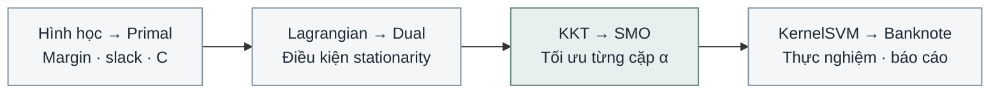
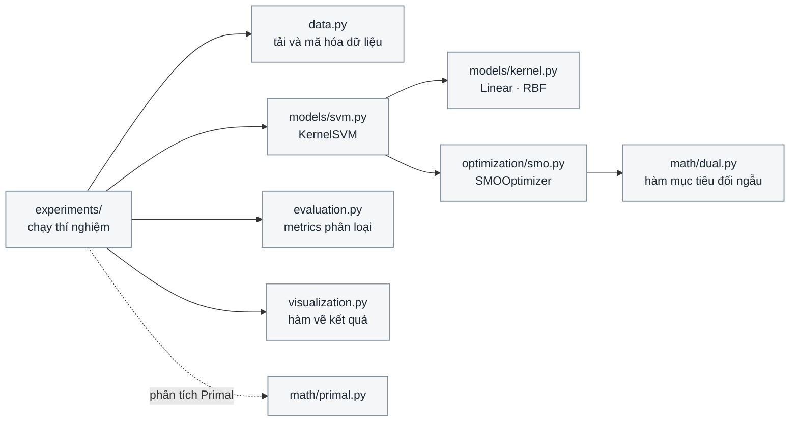

# SVM Optimization Lab — Đồ án môn Tối ưu hóa

> **Mục tiêu:** hiểu SVM như một bài toán tối ưu lồi, tự giải thích được Primal → Lagrangian → Dual → KKT → SMO, sau đó tự cài đặt một SVM nhị phân và đối chiếu với `scikit-learn` trên Banknote Authentication.

Project được thiết kế cho người mới học tối ưu hóa: mỗi chủ đề có tài liệu riêng, ví dụ số nhỏ, module Python tương ứng và bài kiểm tra. Không cần đọc hết code ngay từ đầu.

> **Hiển thị công thức:** các file Markdown dùng inline `$...$` và block `$$...$$`; công thức chính có `\tag{...}` để đánh số. GitHub hỗ trợ trực tiếp bằng MathJax; xem [chỉ mục công thức](docs/11_formula_index.md) để tra số và [GitHub: Writing mathematical expressions](https://docs.github.com/en/get-started/writing-on-github/working-with-advanced-formatting/writing-mathematical-expressions).

## 1. Kết quả học tập kỳ vọng

Sau khi hoàn thành, bạn nên có thể:

1. Giải thích siêu phẳng, margin và support vectors bằng hình học.
2. Viết được bài toán Soft-Margin SVM ở dạng Primal và giải thích từng thành phần.
3. Tự đi từ hàm Lagrange đến bài toán Dual bằng các điều kiện đạo hàm.
4. Nêu và diễn giải bốn nhóm điều kiện KKT.
5. Mô tả vì sao SMO cập nhật hai hệ số Lagrange mỗi lần và viết được các công thức cập nhật.
6. Chạy được SVM tự cài Linear/RBF, so sánh với `sklearn.svm.SVC`.
7. Báo cáo kết quả thực nghiệm mà không rò rỉ dữ liệu test vào quá trình chuẩn hóa.

## 2. Roadmap học và code



| Chặng | Tài liệu | Code nên đọc/chạy | Đầu ra cần đạt |
|---|---|---|---|
| 1. Hình học | `docs/01_svm_geometry.md` | `math/geometry.py` | Hiểu f(x), khoảng cách và margin |
| 2. Primal | `docs/02_primal_soft_margin.md` | `math/primal.py` | Tính hinge loss và objective |
| 3. Dual | `docs/03_lagrange_dual.md` | `math/dual.py` | Tính dual objective, kiểm tra khả thi |
| 4. KKT | `docs/04_kkt.md` | `math/kkt.py` | Diễn giải alpha và support vectors |
| 5. Ví dụ giải tay | `docs/07_hand_example.md` | `python -m experiments.02_hand_example` | Thấy primal = dual = 0.25 |
| 6. SMO | `docs/05_smo_walkthrough.md` | `optimization/smo.py` | Hiểu cập nhật cặp alpha |
| 7. Kernel | `docs/06_kernel.md` | `models/kernel.py` | Linear và RBF kernel |
| 8. Thực nghiệm | `docs/08_experiment_guide.md` | `experiments/` | So sánh và viết nhận xét |
| 9. Hướng dẫn đọc code | `docs/09_code_walkthrough.md` | Tất cả module | Biết mỗi file làm gì và đọc theo thứ tự nào |
| 10. Nguồn hình | `docs/10_image_credits.md` | Hình minh họa | Kiểm tra nguồn và giấy phép hình |
| 11. Chỉ mục công thức | `docs/11_formula_index.md` | Công thức LaTeX | Tra số và dẫn chiếu công thức |

## 3. Sơ đồ kiến trúc code



Nguồn sơ đồ có thể chỉnh sửa: [`docs/diagrams/architecture.mmd`](docs/diagrams/architecture.mmd).

## 4. Cài đặt môi trường

Yêu cầu Python 3.10 trở lên.

### Windows PowerShell

```powershell
cd svm_optimization_project
py -m venv .venv
.venv\Scripts\Activate.ps1
python -m pip install --upgrade pip
pip install -r requirements.txt
pip install -e .
```

### macOS / Linux

```bash
cd svm_optimization_project
python3 -m venv .venv
source .venv/bin/activate
python -m pip install --upgrade pip
pip install -r requirements.txt
pip install -e .
```

Nếu chưa muốn cài package ở chế độ editable, có thể chạy với `PYTHONPATH=src` (Linux/macOS) hoặc thêm `src` vào `PYTHONPATH` trên Windows. Cách dễ nhất là dùng `pip install -e .`.

## 5. Chạy theo thứ tự khuyến nghị

**Bước A — xác nhận công thức toán trước:**

```bash
python -m experiments.02_hand_example
```

Kết quả giải tích kỳ vọng:

- `w = [0.5, 0.5]`, `b = 0`.
- `alpha = [0.25, 0.25, 0, 0]`.
- Primal objective = `0.25`.
- Dual objective = `0.25`.
- Hai mẫu đầu là support vectors.

**Bước B — chạy SVM thư viện làm baseline:**

```bash
python -m experiments.01_baseline_sklearn
```

**Bước C — chạy SMO tự cài:**

```bash
python -m experiments.03_custom_smo
```

**Bước D — khảo sát C và kernel:**

```bash
python -m experiments.04_compare_C_kernel
```

Mặc định bước D dùng `sklearn.svm.SVC` để chạy nhanh. Mở file và đặt `USE_CUSTOM = True` để khảo sát phiên bản SMO tự cài. Bản SMO ở đây hướng tới học thuật và minh họa, không nhắm đến tốc độ của LIBSVM.

**Bước E — chạy tests:**

```bash
pytest -q
```

## 6. Dataset: Banknote Authentication

- Nguồn: [UCI Machine Learning Repository — Banknote Authentication](https://archive.ics.uci.edu/dataset/267/banknote+authentication).
- 1.372 quan sát, 4 đặc trưng liên tục, 2 lớp.
- Đặc trưng: variance, skewness, curtosis, entropy của ảnh tiền giấy sau khi trích xuất đặc trưng bằng Wavelet Transform.
- Dataset không được đóng gói trong ZIP. Chương trình tải dữ liệu qua `ucimlrepo` ở lần chạy đầu và cache tại `data/banknote/banknote_authentication.csv`.

Nhãn gốc được mã hóa tăng dần thành `-1` và `+1` để phù hợp với công thức SVM. Khi đọc kết quả, hãy xem mô tả mapping được in/ghi trong tài liệu; không tự diễn giải `+1` là thật hay giả nếu chưa kiểm tra mapping từ dữ liệu gốc.

## 7. Quy tắc thực nghiệm quan trọng

- Chia train/test có `stratify=y` để giữ tỷ lệ lớp.
- Fit `StandardScaler` chỉ trên tập train, sau đó transform tập test. Không fit scaler trên toàn bộ dữ liệu.
- So sánh trên cùng một cách chia dữ liệu và cùng thước đo.
- Với bài toán nhị phân, ngoài Accuracy cần báo cáo Precision, Recall, F1 và Confusion Matrix.
- Không chọn siêu tham số dựa trên test set. Script quét C/kernel là khảo sát minh họa; trong báo cáo nghiêm túc, chọn tham số bằng cross-validation trên train rồi mới đánh giá test một lần.
- Báo cáo số Support Vectors, số vòng cập nhật và objective của SMO; Accuracy một mình chưa thể hiện chất lượng phần tối ưu.

## 8. Cấu trúc project

```text
svm_optimization_project/
├── README.md
├── requirements.txt
├── pyproject.toml
├── docs/                         # Lý thuyết, ví dụ, hướng dẫn từng bước
│   ├── 00_roadmap.md
│   ├── 01_svm_geometry.md
│   ├── 02_primal_soft_margin.md
│   ├── 03_lagrange_dual.md
│   ├── 04_kkt.md
│   ├── 05_smo_walkthrough.md
│   ├── 06_kernel.md
│   ├── 07_hand_example.md
│   ├── 08_experiment_guide.md
│   └── diagrams/
├── src/svm_optimization/
│   ├── data.py
│   ├── math/                      # geometry, primal, dual, kkt
│   ├── optimization/smo.py        # thuật toán SMO
│   ├── models/                    # kernel và KernelSVM
│   ├── evaluation.py
│   └── visualization.py
├── experiments/                   # Các chương trình chạy theo chặng
├── tests/                         # Unit tests
├── data/banknote/                 # Cache dataset tải về
└── reports/                       # Biểu đồ, bảng kết quả được sinh ra
```

## 9. Giới hạn cần ghi rõ trong báo cáo

1. `SMOOptimizer` là bản cài đặt phục vụ học tập, dùng chiến lược chọn cặp đơn giản; không tối ưu hiệu năng cho dataset rất lớn.
2. Bản SMO bỏ qua cặp có `eta` gần 0 (trường hợp suy biến/điểm trùng). Thư viện chuẩn xử lý nhiều tình huống phức tạp hơn.
3. `KernelSVM` chỉ hỗ trợ phân loại nhị phân với nhãn `-1/+1`, hai kernel Linear và RBF.
4. KKT report hiện được viết cho Linear SVM với vector `w` tường minh. Với RBF, cần diễn giải qua kernel feature space.
5. Dataset được tải từ UCI khi chạy lần đầu; cần kết nối Internet ở bước đó.

## 10. Tài liệu tham khảo nền tảng

- Cortes, C. & Vapnik, V. (1995). *Support-Vector Networks*. Machine Learning, 20, 273–297. DOI: [10.1007/BF00994018](https://doi.org/10.1007/BF00994018).
- Platt, J. (1998). *Sequential Minimal Optimization: A Fast Algorithm for Training Support Vector Machines*. Microsoft Research Technical Report MSR-TR-98-14.
- Chang, C.-C. & Lin, C.-J. (2011). *LIBSVM: A Library for Support Vector Machines*. ACM Transactions on Intelligent Systems and Technology, 2(3).
- [scikit-learn — Support Vector Machines](https://scikit-learn.org/stable/modules/svm.html).
- [UCI — Banknote Authentication](https://archive.ics.uci.edu/dataset/267/banknote+authentication).
