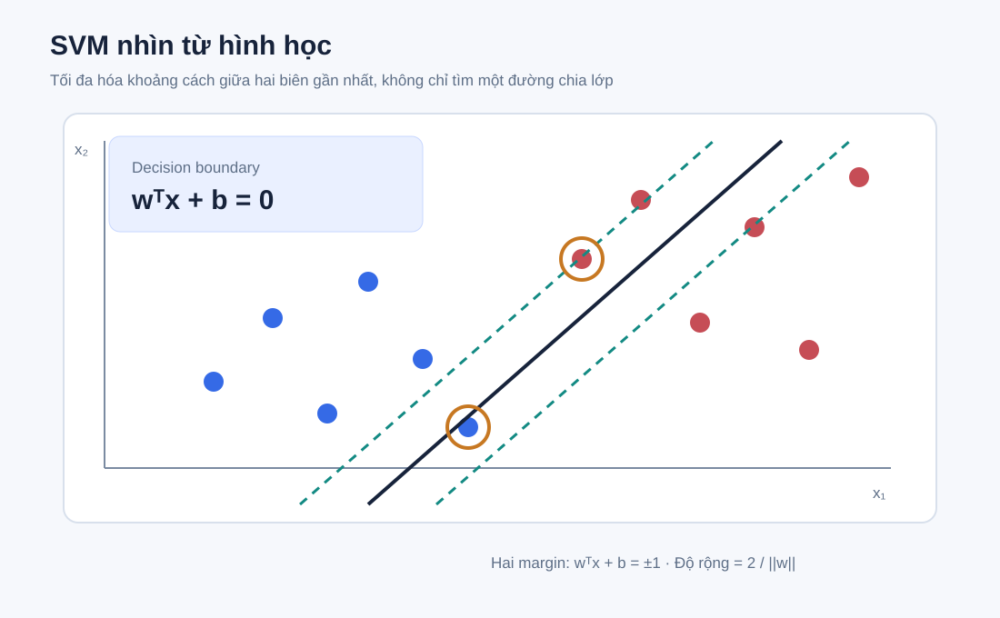
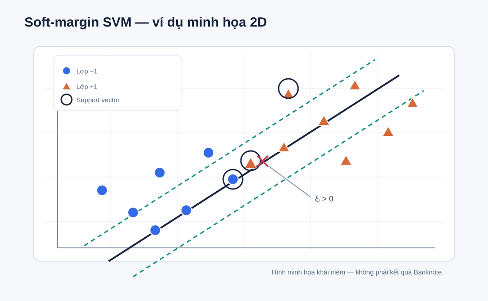
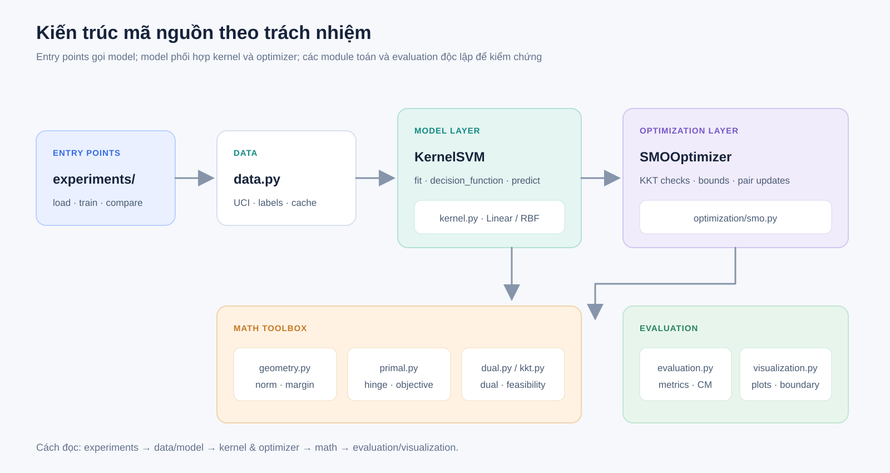
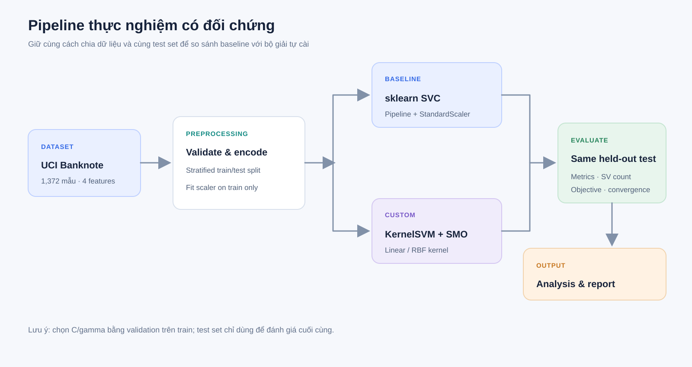
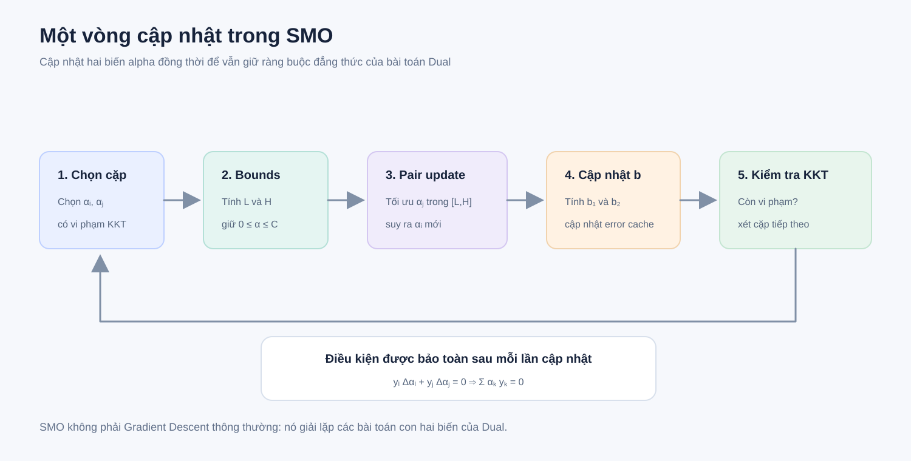

# SVM Optimization Lab

Đồ án môn **Tối ưu hóa**: nghiên cứu SVM nhị phân từ mô hình hình học đến bài toán Primal/Dual, Lagrange, KKT và thuật toán SMO; triển khai một `KernelSVM` học tập và đối chiếu với `scikit-learn` trên Banknote Authentication.

> Project được thiết kế theo hướng học từ từ, dành cho người đã biết concept SVM nhưng chưa vững toán. Đọc tài liệu, làm ví dụ nhỏ, sau đó mới chạy code.

## Sơ đồ tổng thể



## Hình minh họa

| Hình học SVM | Soft margin |
|---|---|
|  |  |

| Kiến trúc module | Pipeline thực nghiệm |
|---|---|
|  |  |



Các hình được tạo riêng cho project và lưu ngay trong `docs/images/`; không hotlink ảnh từ website khác. File Mermaid có thể chỉnh sửa ở `docs/diagrams/`.

## Nội dung học

1. `docs/00_roadmap.md` — roadmap và kiến thức toán 20/80.
2. `docs/01_svm_geometry.md` — hyperplane, khoảng cách và margin.
3. `docs/02_primal_soft_margin.md` — slack, hinge loss và Primal QP.
4. `docs/03_lagrange_dual.md` — Lagrangian, đạo hàm riêng và Dual.
5. `docs/04_kkt.md` — bốn nhóm điều kiện KKT và support vectors.
6. `docs/05_smo_walkthrough.md` — cập nhật hai alpha trong SMO.
7. `docs/06_kernel.md` — Linear và RBF Kernel.
8. `docs/07_hand_example.md` — bài toán 4 điểm giải tay có nghiệm kiểm tra.
9. `docs/08_experiment_guide.md` — Banknote, thực nghiệm và cách viết báo cáo.
10. `docs/09_code_walkthrough.md` — hướng dẫn đọc từng module.

## Cài đặt

Python 3.10+.

```bash
python -m venv .venv
# Windows: .venv\\Scripts\\activate
# macOS/Linux: source .venv/bin/activate
python -m pip install --upgrade pip
pip install -r requirements.txt
pip install -e .
```

## Chạy theo thứ tự khuyến nghị

```bash
# 1. Kiểm chứng công thức với ví dụ giải tay
python -m experiments.02_hand_example

# 2. Baseline SVC của scikit-learn
python -m experiments.01_baseline_sklearn

# 3. SVM tự cài bằng SMO
python -m experiments.03_custom_smo

# 4. Khảo sát C và kernel
python -m experiments.04_compare_C_kernel

# 5. Vẽ boundary trên hai feature để trực quan hóa
python -m experiments.05_visualize_2d

# 6. Unit tests
pytest -q
```

Các script thực nghiệm tự tải dataset trong lần chạy đầu. Cần Internet và package `ucimlrepo`; CSV sau đó được cache tại `data/banknote/`.

## Dataset

**UCI Banknote Authentication** — 1.372 mẫu, 4 đặc trưng số trích xuất từ ảnh tiền giấy qua Wavelet Transform, 2 lớp. [Dataset UCI](https://archive.ics.uci.edu/dataset/267/banknote+authentication).

## Trọng tâm môn Tối ưu hóa

- Soft-margin Primal: tối thiểu hóa regularization + slack penalty dưới các ràng buộc tuyến tính.
- Lagrangian và Dual: suy ra hệ số Lagrange, equality constraint và box constraints.
- KKT: kiểm tra primal/dual feasibility, stationarity và complementary slackness.
- SMO: tối ưu theo từng cặp alpha để giữ equality constraint.
- Kiểm chứng: primal objective, dual objective, feasibility, support vectors, objective history và metrics phân loại.

Công thức trong Markdown dùng `$...$` và `$$...$$` để GitHub render bằng MathJax. Xem thêm [GitHub mathematical expressions](https://docs.github.com/en/get-started/writing-on-github/working-with-advanced-formatting/writing-mathematical-expressions).

## Giới hạn

Đây là implementation SMO hướng học tập, không thay thế LIBSVM về hiệu năng hoặc xử lý các trường hợp suy biến. Chỉ hỗ trợ binary labels `-1/+1`, Linear và RBF. Chọn hyperparameter bằng cross-validation trên train; không chọn theo test set.

## Tài liệu tham khảo nền tảng

- Cortes & Vapnik (1995), *Support-Vector Networks*, DOI: [10.1007/BF00994018](https://doi.org/10.1007/BF00994018).
- Platt (1998), *Sequential Minimal Optimization: A Fast Algorithm for Training Support Vector Machines*, MSR-TR-98-14.
- Chang & Lin (2011), *LIBSVM: A Library for Support Vector Machines*.
