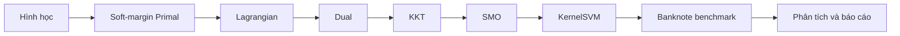

# 00 — Lộ trình học SVM cho người mới học Tối ưu hóa

## Mục tiêu của đồ án

Đây không phải đồ án chỉ dùng SVM để đạt Accuracy cao. Câu hỏi trung tâm của môn **Tối ưu hóa** là: ta tối ưu đại lượng nào, dưới các ràng buộc nào, vì sao có thể chuyển từ Primal sang Dual, và thuật toán tìm nghiệm ra sao?

Bản sơ đồ Mermaid có thể chỉnh sửa tại [`diagrams/overview.mmd`](diagrams/overview.mmd).

Hình pipeline chỉ dùng để hình dung mối liên hệ giữa dữ liệu, tiền xử lý, mô hình và đánh giá; pipeline Banknote cụ thể được mô tả bằng Mermaid ở phần dưới. Nguồn: [Wikimedia Commons](https://commons.wikimedia.org/wiki/File:Machine_Learning_Pipeline_in_Production.png), CC BY-SA 4.0.

## Thứ tự học 20/80

| Chặng | Chủ đề | Câu hỏi phải trả lời |
|---|---|---|
| 1. Mô hình hóa | Hyperplane, margin, Soft Margin, Primal | SVM muốn tìm nghiệm nào? Hàm mục tiêu và ràng buộc là gì? |
| 2. Biến đổi toán | Lagrangian, stationarity, Dual | Vì sao xuất hiện các hệ số Lagrange `alpha`? |
| 3. Giải tối ưu | KKT, Support Vectors, SMO | Điều kiện tối ưu nói gì và SMO cập nhật biến thế nào? |
| 4. Kiểm chứng | KernelSVM, Banknote, metrics | Code có giải đúng bài toán và tổng quát hóa ra sao? |

## Kiến thức toán tối thiểu

| Kiến thức | Ví dụ trong SVM | Mức cần đạt |
|---|---|---|
| Vector | `w`, `x` | Hiểu là danh sách số biểu diễn hướng/đặc trưng |
| Dot product | `w.T @ x` | Tự tính tổng nhân từng cặp phần tử |
| Norm | `||w||` | Tính được độ dài vector |
| Hàm bậc hai | `0.5 * ||w||^2` | Biết đạo hàm của `0.5*w^2` là `w` |
| Đạo hàm riêng | `dL/dw = 0` | Hiểu tìm điểm dừng theo từng biến |
| Bất đẳng thức | `y_i f(x_i) >= 1 - xi_i` | Hiểu ràng buộc cần được thỏa mãn |
| Lagrange | `L = objective - alpha*g` | Hiểu alpha gắn với ràng buộc |
| KKT | `alpha_i * g_i = 0` | Hiểu điều kiện bù và vai trò của alpha |

Bạn chưa cần chứng minh các định lý tối ưu tổng quát. Hãy học từng khái niệm ngay khi nó xuất hiện trong SVM.

## Lịch học gợi ý 7 buổi

| Buổi | Học gì | Việc phải tự làm |
|---|---|---|
| 1 | Hyperplane, margin, support vector | Vẽ hai lớp và giải thích điểm gần biên |
| 2 | Primal, slack, C, hinge loss | Tính loss cho 4 mẫu |
| 3 | Lagrange, đạo hàm riêng | Tự biến đổi ra `w = sum(alpha*y*x)` |
| 4 | Dual, QP, KKT | Giải thích ràng buộc của alpha |
| 5 | SMO | Tự tính một lần cập nhật cặp alpha |
| 6 | Code | Chạy tests và giải thích từng module |
| 7 | Thực nghiệm | Chạy Banknote và viết nhận xét tối ưu hóa |

## Cách học mỗi module

1. Đọc phần **ý tưởng** trước, chưa nhìn code.
2. Viết lại công thức bằng lời của mình.
3. Chạy ví dụ số nhỏ.
4. Mở module Python tương ứng và đối chiếu từng dòng với công thức.
5. Thay một giá trị, dự đoán kết quả trước khi chạy.
6. Trả lời câu hỏi cuối tài liệu rồi mới sang chặng tiếp theo.

## Tiêu chí tự đánh giá

- [ ] Tôi giải thích được vì sao margin là `2 / ||w||`.
- [ ] Tôi giải thích được vì sao tối đa hóa margin thành tối thiểu `0.5 * ||w||^2`.
- [ ] Tôi hiểu vai trò của `C` và `xi`.
- [ ] Tôi tự lấy đạo hàm Lagrangian theo `w`, `b`, `xi`.
- [ ] Tôi giải thích được vì sao `0 <= alpha_i <= C`.
- [ ] Tôi diễn giải được các trường hợp của alpha.
- [ ] Tôi hiểu một vòng SMO cập nhật hai alpha như thế nào.
- [ ] Tôi so sánh được nghiệm SMO và baseline SVC.
