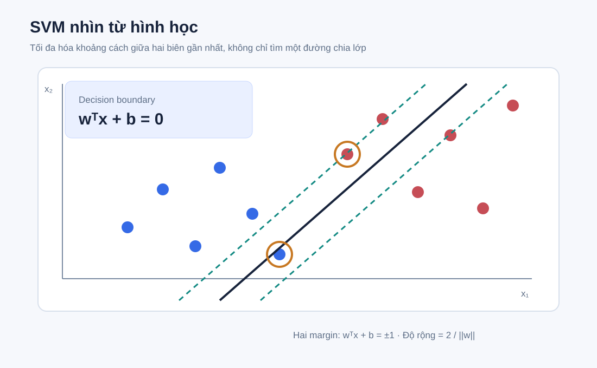

# 01 — Hình học SVM: siêu phẳng và margin

## 1. Bài toán phân loại nhị phân

Ta có dữ liệu huấn luyện `D = {(x_i, y_i)}`. Mỗi `x_i` là vector gồm `d` đặc trưng, còn nhãn `y_i` chỉ nhận `-1` hoặc `+1`.

Ví dụ `x = [variance, skewness, curtosis, entropy]` là một mẫu tiền giấy có bốn đặc trưng. SVM học một quy tắc để dự đoán mẫu thuộc lớp nào.

## 2. Siêu phẳng

Một siêu phẳng được viết:

$$
f(x)=w^T x+b=0.
$$

- `w` là vector pháp tuyến, chỉ hướng vuông góc với siêu phẳng.
- `b` dịch chuyển siêu phẳng.
- `f(x)` là điểm số có dấu; chưa phải xác suất.
- Dự đoán `sign(f(x))`.

Trong 2D, siêu phẳng là đường thẳng. Nếu `w=[2,1]`, `b=-3`, đường phân chia là `2*x1 + x2 - 3 = 0`.

## Hình minh họa: Hyperplane, margin và support vectors



Đây là hình dựng riêng cho project bằng dữ liệu minh họa 2D. Đường liền là decision boundary; hai đường nét đứt là margin; các điểm được khoanh là những điểm nằm gần biên. Đây là minh họa ý tưởng, không phải kết quả huấn luyện Banknote.

## 3. Khoảng cách từ điểm đến siêu phẳng

Với một điểm `x`, khoảng cách hình học là:

$$
d(x,H)=\frac{|w^T x+b|}{\|w\|_2}.
$$

Tại sao phải chia cho `||w||`? Nếu nhân cả `w` và `b` với 10 thì phương trình siêu phẳng không đổi. Chia cho độ dài vector pháp tuyến làm khoảng cách không phụ thuộc cách scale phương trình.

## 4. Chuẩn hóa margin

Ta có thể nhân `w,b` với một hằng số dương mà không làm đổi ranh giới phân lớp. SVM chọn một cách chuẩn hóa thuận tiện sao cho hai biên gần nhất thỏa:

$$
w^T x+b=+1,\qquad w^T x+b=-1.
$$

Khoảng cách giữa hai mặt biên là:

$$
\text{margin}=\frac{2}{\|w\|_2}.
$$

Vì vậy, tối đa hóa margin tương đương tối thiểu hóa `||w||`. Ta dùng bình phương và hệ số 1/2 vì đạo hàm gọn hơn:

$$
\min_{w,b}\frac12\|w\|_2^2.
$$

## 5. Ràng buộc phân loại

Một cách viết gọn cho cả hai lớp:

$$
y_i(w^T x_i+b)\geq 1.
$$

- Nếu `y_i=+1`, yêu cầu `f(x_i)>=1`.
- Nếu `y_i=-1`, yêu cầu `f(x_i)<=-1`.

Như vậy mỗi điểm nằm ở đúng phía và không lọt vào vùng margin.

## 6. Hình dung


Khi vẽ hình 2D, ta thường thấy hai đường margin song song và một đường phân chia ở giữa. Các mẫu nằm sát hai đường margin là support vectors trong trường hợp không suy biến.

## 7. Liên hệ với code

File `src/svm_optimization/math/geometry.py`:

- `decision_score`: tính `w^T x+b`.
- `predict_linear`: lấy dấu để dự đoán `-1/+1`.
- `vector_norm`: tính `||w||`.
- `margin_width`: tính `2/||w||`.
- `point_to_hyperplane_distance`: tính khoảng cách một điểm.

Chạy kiểm tra nhanh:

```python
import numpy as np
from svm_optimization.math.geometry import margin_width, decision_score

w = np.array([0.5, 0.5])
X = np.array([[-1., -1.], [1., 1.]])
print(decision_score(X, w, 0.0))  # [-1., 1.]
print(margin_width(w))            # 2.828427...
```

## 8. Bạn cần tự trả lời

1. Nếu thay `w,b` bằng `10w,10b`, ranh giới có thay đổi không? Margin tính bằng công thức có thay đổi không?
2. Vì sao điểm `f(x)=0` nằm đúng trên hyperplane?
3. Với `w=[3,4]`, margin width bằng bao nhiêu?
