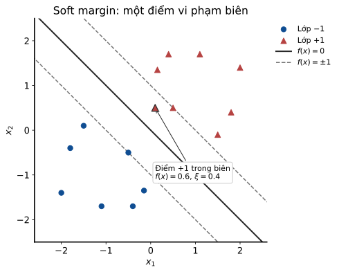
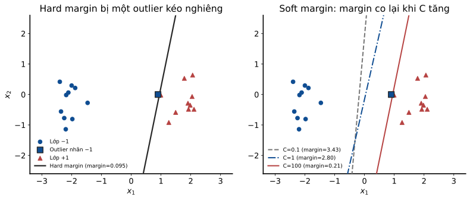
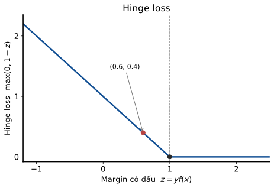

# 02 — Primal Soft-Margin SVM

## 1. Vì sao cần Soft Margin?

Hard-margin đòi mọi mẫu thỏa $y_i f(x_i)\geq1$. Điều đó không phù hợp khi dữ liệu có nhiễu, hai lớp chồng lấn hoặc có outlier.

Soft-margin thêm một biến $\xi_i \geq 0$ cho mỗi mẫu để cho phép vi phạm biên có kiểm soát:

$$
y_i(w^T x_i+b)\geq 1-\xi_i,\qquad \xi_i\geq0\qquad\text{(2.1)}
$$

$\xi_i$ là slack variable. Nó đo mức vi phạm margin theo cách tối ưu.



*Hình 2: Điểm có nhãn +1 vẫn ở đúng phía ranh giới nhưng vi phạm biên: f(x) = 0.6 và slack tối thiểu bằng 0.4. Đây là dữ liệu tổng hợp.*

Soft-margin cũng giải quyết một vấn đề khác của hard-margin: chỉ một outlier nằm lẫn vào phía lớp đối diện cũng có thể làm hard-margin chọn một ranh giới rất lệch, margin gần như bằng 0.



*Hình 3: Dữ liệu tổng hợp hai cụm cách xa nhau, cộng thêm một điểm nhãn −1 nằm sâu trong cụm +1. Bên trái: hard margin (SVC tuyến tính, C rất lớn) buộc phải nghiêng sát outlier để vẫn phân loại đúng, margin chỉ còn 0.095. Bên phải: soft margin với C=0.1/1/100 trên cùng dữ liệu — C càng lớn, mô hình càng chấp nhận ít vi phạm hơn và margin càng co lại (3.43 → 2.80 → 0.21).*

```python
from sklearn.svm import SVC
import numpy as np

X = np.array([[-1., -1.], [1., 1.], [-2., -1.], [2., 1.]])  # 4 điểm của ví dụ giải tay
y = np.array([-1, 1, -1, 1])
for C in [0.1, 1, 10]:
    clf = SVC(kernel='linear', C=C).fit(X, y)
    margin = 2 / np.linalg.norm(clf.coef_)
    print(f'C={C}: margin={margin:.4f}, n_sv={len(clf.support_)}')
# C=0.1: margin=4.3853, n_sv=4
# C=1: margin=2.8284, n_sv=2
# C=10: margin=2.8284, n_sv=2
```

## 2. Hàm mục tiêu

$$
\boxed{\min_{w,b,\xi}\quad \frac12\|w\|^2+C\sum_{i=1}^{n}\xi_i}\qquad\text{(2.2)}
$$

với hai nhóm ràng buộc ở trên.

- $\frac{1}{2}\|w\|^2$: thúc đẩy margin lớn.
- `sum(xi)`: phạt vi phạm.
- $C > 0$: điều chỉnh mức đánh đổi.

### Hiểu C bằng trực giác

- $C$ lớn: phạt vi phạm mạnh; mô hình cố gắng phân loại đúng/đặt điểm ra ngoài margin hơn, nhưng có thể nhạy với nhiễu.
- $C$ nhỏ: chấp nhận vi phạm nhiều hơn để ưu tiên margin rộng và regularization mạnh hơn.

Không có giá trị C luôn tốt nhất; phải chọn bằng validation/cross-validation.

## 3. Hinge loss là slack tối ưu

Nếu cố định $w,b$, slack nhỏ nhất thỏa ràng buộc là:

$$
\xi_i=\max(0,1-y_i f(x_i))\qquad\text{(2.3)}
$$

Biểu thức này gọi là hinge loss. Vì vậy có thể viết mục tiêu tương đương:

$$
\frac12\|w\|^2+C\sum_i\max(0,1-y_i f(x_i))\qquad\text{(2.4)}
$$

Hinge loss không phải cách duy nhất để phạt margin có dấu $z=y f(x)$ nhỏ. Logistic loss (đã co giãn để bằng 1 tại $z=0$, giống hinge) cũng giảm dần theo $z$, nhưng mượt và không bao giờ chạm hẳn 0.


*Hình 4: Hinge loss (xanh) là một đường gấp khúc, bằng 0 khi $z\geq1$. Logistic loss đã co giãn (đỏ, nét đứt) luôn dương, giảm chậm dần khi $z$ tăng chứ không "cắt" phẳng tại 1 như hinge.*

```python
import numpy as np

def hinge(z):
    return np.maximum(0, 1 - z)

def logistic_scaled(z):  # co giãn để bằng 1 tại z=0 như hinge
    return np.log1p(np.exp(-z)) / np.log(2)

for z in [-2, -1, 0, 1, 2]:
    print(f'{z:2d} {hinge(z):.1f} {logistic_scaled(z):.4f}')
# -2 3.0 3.0685
# -1 2.0 1.8946
#  0 1.0 1.0000
#  1 0.0 0.4519
#  2 0.0 0.1831
```



*Hình 5: Khi margin có dấu đạt 1 trở lên, hinge loss bằng 0.*

### Ba trường hợp của $\xi_i$

Vị trí của một điểm so với margin quyết định $\xi_i$ rơi vào đúng một trong ba trường hợp sau:

| Điều kiện trên $y_i f(x_i)$ | $\xi_i$ | Ý nghĩa |
|---|---|---|
| $y_i f(x_i)\geq 1$ | $\xi_i=0$ | nằm ngoài hoặc đúng trên margin |
| $0\leq y_i f(x_i)<1$ | $0<\xi_i\leq1$ | nằm trong margin, vẫn đúng phía |
| $y_i f(x_i)<0$ | $\xi_i>1$ | phân loại sai |

Chiếu lại Hình 5: điểm có $y=+1$, $f(x)=0.6$ cho $y f(x)=0.6$, rơi vào hàng giữa nên $\xi=1-0.6=0.4$, đúng giá trị đã nêu ở Hình 5.

*Ý tưởng minh họa tham khảo từ Phạm Đình Khanh, Machine Learning Algorithms to Practice, ch. 7 SVM: [phamdinhkhanh.github.io/deepai-book/ch_ml/SVM.html](https://phamdinhkhanh.github.io/deepai-book/ch_ml/SVM.html).*

## 4. Ví dụ số

Giả sử nhãn $y=+1$ và điểm số $f(x)=0.6$:

$$
\xi=\max(0,1-1\times0.6)=0.4.
$$

Nếu $y=-1$ và $f(x)=-1.4$:

$$
\xi=\max(0,1-(-1)(-1.4))=0.
$$

Mẫu thứ hai được phân loại đúng và nằm ngoài margin, nên không bị hinge loss.

Nếu $y=+1$ nhưng $f(x)=-0.2$, thì `xi=1.2`: mẫu bị phân loại sai và chịu mức phạt lớn hơn.

## 5. Vì sao đây là bài toán tối ưu lồi?

- `0.5||w||²` là hàm lồi theo $w$.
- `C sum xi` là hàm tuyến tính.
- Các ràng buộc $y_i(w^T x_i+b)\geq1-\xi_i$ và $\xi_i \geq 0$ là tuyến tính.

Do đó đây là một bài toán tối ưu lồi có ràng buộc tuyến tính (dạng quadratic programming). Tính lồi là điểm rất quan trọng: nghiệm tối ưu cục bộ cũng là nghiệm tối ưu toàn cục.

## 6. Liên hệ với code

File `src/svm_optimization/math/primal.py`:

- `hinge_losses(y, scores)`: tính loss từng mẫu.
- `soft_margin_objective(w,y,scores,C)`: tính hàm mục tiêu.
- `primal_constraints(...)`: kiểm tra độ vi phạm ràng buộc.

Ví dụ:

```python
import numpy as np
from svm_optimization.math.primal import hinge_losses

y = np.array([1, -1, 1])
scores = np.array([0.6, -1.4, -0.2])
print(hinge_losses(y, scores))  # [0.4, 0.0, 1.2]
```

## 7. Bạn cần tự trả lời

1. $\xi_i=0$ có nghĩa là gì?
2. Vì sao tăng C không đơn giản luôn làm mô hình tốt hơn?
3. Hinge loss khác Accuracy như thế nào?
4. Thành phần nào trong objective thúc đẩy margin lớn, thành phần nào phạt lỗi?
