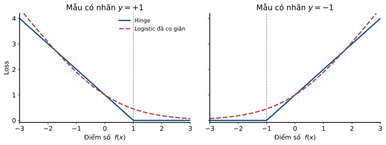
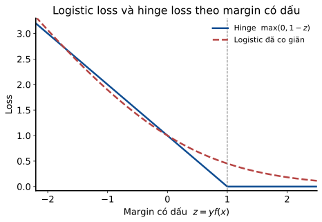
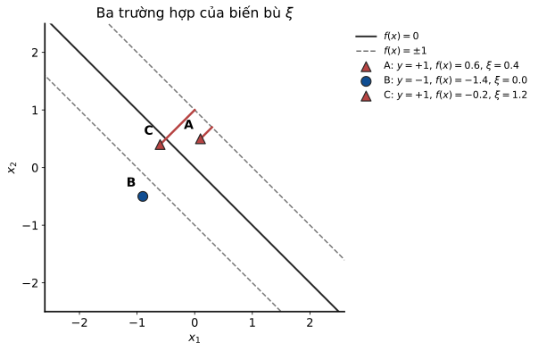

# 02 — Primal Soft-Margin SVM

## 1. Vì sao cần Soft Margin?

Hard-margin đòi mọi mẫu thỏa $y_i f(x_i)\geq1$. Điều đó không phù hợp khi dữ liệu có nhiễu, hai lớp chồng lấn hoặc có outlier.

Soft-margin thêm một biến $\xi_i \geq 0$ cho mỗi mẫu để cho phép vi phạm biên có kiểm soát:

$$
y_i(w^T x_i+b)\geq 1-\xi_i,\qquad \xi_i\geq0\qquad\text{(2.1)}
$$

$\xi_i$ là slack variable. Nó đo mức vi phạm margin theo cách tối ưu.


*Hình 1: Điểm nhãn +1 vi phạm biên với f(x) = 0.6, slack bằng 0.4.*

Điểm trong Hình 1 vẫn ở đúng phía ranh giới nhưng lọt vào vùng margin, nên cần một slack dương để ràng buộc (2.1) được thỏa.

Soft-margin cũng giải quyết một vấn đề khác của hard-margin: chỉ một outlier nằm lẫn vào phía lớp đối diện cũng có thể làm hard-margin chọn một ranh giới rất lệch, margin gần như bằng 0 [[5]](10_image_credits.md#ref-5).

Hình 2 dùng hai cụm tổng hợp cách xa nhau, cộng thêm một điểm nhãn −1 nằm sâu trong cụm +1. Hard margin (SVC tuyến tính, C rất lớn) phải nghiêng sát outlier để vẫn phân loại đúng mọi điểm, nên margin chỉ còn 0.095. Soft margin cho phép outlier vi phạm; C càng lớn thì mô hình càng ít chấp nhận vi phạm và margin càng co lại: 3.43 với C=0.1, 2.80 với C=1, 0.21 với C=100.


*Hình 2: Hard margin bị một outlier kéo nghiêng (trái); soft margin với ba giá trị C (phải).*

```python
from sklearn.svm import SVC
import numpy as np

X = np.array([[-1., -1.], [1., 1.], [-2., -1.], [2., 1.]])
y = np.array([-1, 1, -1, 1])
for C in [0.1, 1, 10]:
    clf = SVC(kernel='linear', C=C).fit(X, y)
    margin = 2 / np.linalg.norm(clf.coef_)
    print(f'C={C}: margin={margin:.4f}, n_sv={len(clf.support_)}')
# C=0.1: margin=4.3853, n_sv=4
# C=1: margin=2.8284, n_sv=2
# C=10: margin=2.8284, n_sv=2
```

## 2. Hàm mục tiêu

$$
\boxed{\min_{w,b,\xi}\quad \frac12\|w\|^2+C\sum_{i=1}^{n}\xi_i}\qquad\text{(2.2)}
$$

với hai nhóm ràng buộc ở trên.

- $\frac{1}{2}\|w\|^2$: thúc đẩy margin lớn.
- `sum(xi)`: phạt vi phạm.
- $C > 0$: điều chỉnh mức đánh đổi.

### Hiểu C bằng trực giác

- $C$ lớn: phạt vi phạm mạnh; mô hình cố gắng phân loại đúng/đặt điểm ra ngoài margin hơn, nhưng có thể nhạy với nhiễu.
- $C$ nhỏ: chấp nhận vi phạm nhiều hơn để ưu tiên margin rộng và regularization mạnh hơn.

Khi $C$ đủ lớn, phần phạt $C\sum_i\xi_i$ lấn át $\frac12\|w\|^2$; với dữ liệu tách được, nghiệm tối ưu có mọi $\xi_i=0$ và soft margin trùng với hard margin [[5]](10_image_credits.md#ref-5).

Không có giá trị C luôn tốt nhất; phải chọn bằng validation/cross-validation.

## 3. Hinge loss là slack tối ưu

Nếu cố định $w,b$, slack nhỏ nhất thỏa ràng buộc là:

$$
\xi_i=\max(0,1-y_i f(x_i))\qquad\text{(2.3)}
$$

Biểu thức này gọi là hinge loss. Vì vậy có thể viết mục tiêu tương đương:

$$
\frac12\|w\|^2+C\sum_i\max(0,1-y_i f(x_i))\qquad\text{(2.4)}
$$

### Từ logistic loss đến hinge loss

Muốn thấy vì sao SVM dùng hinge loss, hãy so sánh nó với logistic loss của hồi quy logistic, xét riêng từng lớp theo điểm số $f(x)$ [[5]](10_image_credits.md#ref-5). Với mẫu $y=+1$, logistic loss $\log(1+e^{-f(x)})$ (chia cho $\log2$ để bằng 1 tại $f(x)=0$) giảm dần khi $f(x)$ tăng nhưng không bao giờ bằng 0. Với mẫu $y=-1$, đồ thị lật ngược lại. Hinge loss giữ phần dốc đó nhưng cắt phẳng về 0 ngay khi mẫu vượt qua biên của lớp mình: $f(x)\geq1$ với $y=+1$ và $f(x)\leq-1$ với $y=-1$.



*Hình 3: Loss của từng lớp theo điểm số f(x); nét đứt là biên của lớp đó.*

Hệ quả: một mẫu đã nằm ở đúng phía và ngoài biên thì không còn đóng góp gì vào hinge loss. Dời mẫu đó đi xa hơn nữa cũng không làm đổi nghiệm. Chỉ những mẫu "khó", nằm gần ranh giới hoặc vi phạm biên, mới quyết định ranh giới; đó chính là các support vector. Với logistic loss thì khác: mọi mẫu, kể cả mẫu rất dễ, đều kéo ranh giới một chút.

Hai đồ thị trong Hình 3 là ảnh gương của nhau. Thay $f(x)$ bằng margin có dấu $z=y f(x)$ thì hai lớp gộp thành một đường duy nhất: hinge $\max(0,1-z)$ và logistic $\log(1+e^{-z})/\log2$. Hinge là đường gấp khúc, bằng 0 khi $z\geq1$; logistic luôn dương và chỉ giảm chậm dần.



*Hình 4: Logistic loss và hinge loss theo margin có dấu z = y f(x).*

```python
import numpy as np

def hinge(z):
    return np.maximum(0, 1 - z)

def logistic_scaled(z):  # co giãn để bằng 1 tại z=0 như hinge
    return np.log1p(np.exp(-z)) / np.log(2)

for z in [-2, -1, 0, 1, 2]:
    print(f'{z:2d} {hinge(z):.1f} {logistic_scaled(z):.4f}')
# -2 3.0 3.0685
# -1 2.0 1.8946
#  0 1.0 1.0000
#  1 0.0 0.4519
#  2 0.0 0.1831
```


*Hình 5: Hinge loss bằng 0 khi margin có dấu đạt 1 trở lên.*

### Góc nhìn điều chuẩn: $\lambda=1/C$

Chia (2.4) cho $C$ không làm đổi nghiệm, và đặt $\lambda=1/C$ được dạng "loss + điều chuẩn" quen thuộc [[5]](10_image_credits.md#ref-5):

$$
\sum_{i=1}^{n}\max(0,1-y_i f(x_i))+\frac{\lambda}{2}\|w\|^2,\qquad\lambda=\frac1C.
$$

So với hồi quy logistic có điều chuẩn L2, SVM chỉ thay logistic loss bằng hinge loss. Tăng $\lambda$, tức giảm $C$, làm $w$ nhỏ lại, margin rộng ra và ranh giới bớt bám theo từng điểm, nên giảm $C$ là cách đầu tiên nên thử khi mô hình quá khớp.

### Ba trường hợp của $\xi_i$

Vị trí của một điểm so với margin quyết định $\xi_i$ rơi vào đúng một trong ba trường hợp sau [[5]](10_image_credits.md#ref-5):

| Điều kiện trên $y_i f(x_i)$ | $\xi_i$ | Ý nghĩa |
|---|---|---|
| $y_i f(x_i)\geq 1$ | $\xi_i=0$ | nằm ngoài hoặc đúng trên margin |
| $0\leq y_i f(x_i)<1$ | $0<\xi_i\leq1$ | nằm trong margin, vẫn đúng phía |
| $y_i f(x_i)<0$ | $\xi_i>1$ | phân loại sai |

Hình 6 đặt ba ví dụ số của mục 4 lên cùng ranh giới $f(x)=x_1+x_2$. Đoạn màu đỏ nối mỗi điểm vi phạm với biên của lớp nó. Độ dài đoạn này bằng $\xi_i/\|w\|$, nên $\xi_i$ chính là khoảng cách từ điểm tới biên, đo theo đơn vị $1/\|w\|$. Điểm A nằm trong margin nhưng vẫn đúng phía nên $\xi=0.4<1$. Điểm C vượt qua cả ranh giới nên $\xi=1.2>1$. Điểm B ở ngoài biên của lớp mình nên $\xi=0$ và không có đoạn nối.



*Hình 6: Ba trường hợp của $\xi$: trong margin (A), ngoài biên (B), phân loại sai (C).*

## 4. Ví dụ số

Giả sử nhãn $y=+1$ và điểm số $f(x)=0.6$:

$$
\xi=\max(0,1-1\times0.6)=0.4.
$$

Nếu $y=-1$ và $f(x)=-1.4$:

$$
\xi=\max(0,1-(-1)(-1.4))=0.
$$

Mẫu thứ hai được phân loại đúng và nằm ngoài margin, nên không bị hinge loss.

Nếu $y=+1$ nhưng $f(x)=-0.2$, thì `xi=1.2`: mẫu bị phân loại sai và chịu mức phạt lớn hơn.

## 5. Vì sao đây là bài toán tối ưu lồi?

- `0.5||w||²` là hàm lồi theo $w$.
- `C sum xi` là hàm tuyến tính.
- Các ràng buộc $y_i(w^T x_i+b)\geq1-\xi_i$ và $\xi_i \geq 0$ là tuyến tính.

Do đó đây là một bài toán tối ưu lồi có ràng buộc tuyến tính (dạng quadratic programming). Tính lồi là điểm rất quan trọng: nghiệm tối ưu cục bộ cũng là nghiệm tối ưu toàn cục.

## 6. Liên hệ với code

File `src/svm_optimization/math/primal.py`:

- `hinge_losses(y, scores)`: tính loss từng mẫu.
- `soft_margin_objective(w,y,scores,C)`: tính hàm mục tiêu.
- `primal_constraints(...)`: kiểm tra độ vi phạm ràng buộc.

Ví dụ:

```python
import numpy as np
from svm_optimization.math.primal import hinge_losses

y = np.array([1, -1, 1])
scores = np.array([0.6, -1.4, -0.2])
print(hinge_losses(y, scores))  # [0.4, 0.0, 1.2]
```

## 7. Bạn cần tự trả lời

1. $\xi_i=0$ có nghĩa là gì?
2. Vì sao tăng C không đơn giản luôn làm mô hình tốt hơn?
3. Hinge loss khác Accuracy như thế nào?
4. Thành phần nào trong objective thúc đẩy margin lớn, thành phần nào phạt lỗi?
