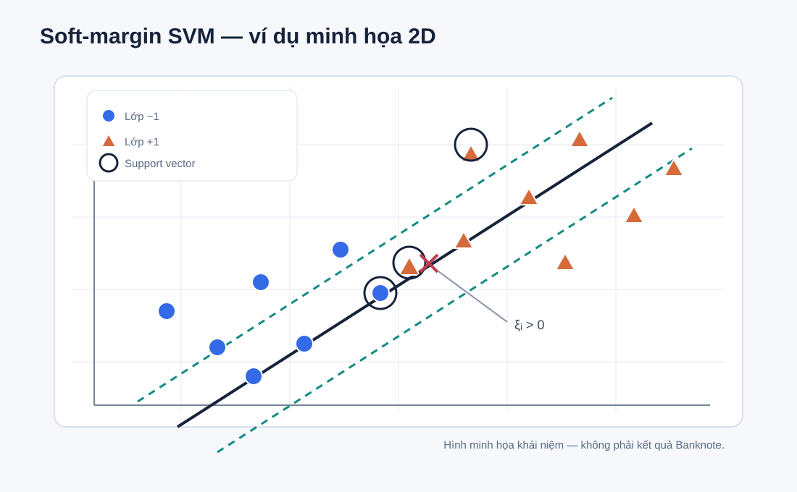

# 02 — Primal Soft-Margin SVM

## 1. Vì sao cần Soft Margin?

Hard-margin đòi mọi mẫu thỏa `y_i f(x_i)>=1`. Điều đó không phù hợp khi dữ liệu có nhiễu, hai lớp chồng lấn hoặc có outlier.

Soft-margin thêm một biến `xi_i >= 0` cho mỗi mẫu để cho phép vi phạm biên có kiểm soát:

$$
y_i(w^T x_i+b)\geq 1-\xi_i,\qquad \xi_i\geq0.
$$

`xi_i` là slack variable. Nó đo mức vi phạm margin theo cách tối ưu.

## Hình minh họa: Soft Margin và slack



Đây là hình minh họa do project tự tạo bằng dữ liệu tổng hợp 2D, **không phải kết quả trên Banknote**. Vòng tròn rỗng thể hiện support vectors; dấu nhân thể hiện mẫu có vi phạm margin. Một số mẫu có thể vẫn được phân loại đúng nhưng nằm bên trong margin.

## 2. Hàm mục tiêu

$$
\boxed{\min_{w,b,\xi}\quad \frac12\|w\|^2+C\sum_{i=1}^{n}\xi_i}
$$

với hai nhóm ràng buộc ở trên.

- `0.5 * ||w||^2`: thúc đẩy margin lớn.
- `sum(xi)`: phạt vi phạm.
- `C > 0`: điều chỉnh mức đánh đổi.

### Hiểu C bằng trực giác

- `C` lớn: phạt vi phạm mạnh; mô hình cố gắng phân loại đúng/đặt điểm ra ngoài margin hơn, nhưng có thể nhạy với nhiễu.
- `C` nhỏ: chấp nhận vi phạm nhiều hơn để ưu tiên margin rộng và regularization mạnh hơn.

Không có giá trị C luôn tốt nhất; phải chọn bằng validation/cross-validation.

## 3. Hinge loss là slack tối ưu

Nếu cố định `w,b`, slack nhỏ nhất thỏa ràng buộc là:

$$
\xi_i=\max(0,1-y_i f(x_i)).
$$

Biểu thức này gọi là hinge loss. Vì vậy có thể viết mục tiêu tương đương:

$$
\frac12\|w\|^2+C\sum_i\max(0,1-y_i f(x_i)).
$$

## 4. Ví dụ số

Giả sử nhãn `y=+1` và điểm số `f(x)=0.6`:

$$
\xi=\max(0,1-1\times0.6)=0.4.
$$

Nếu `y=-1` và `f(x)=-1.4`:

$$
\xi=\max(0,1-(-1)(-1.4))=0.
$$

Mẫu thứ hai được phân loại đúng và nằm ngoài margin, nên không bị hinge loss.

Nếu `y=+1` nhưng `f(x)=-0.2`, thì `xi=1.2`: mẫu bị phân loại sai và chịu mức phạt lớn hơn.

## 5. Vì sao đây là bài toán tối ưu lồi?

- `0.5||w||²` là hàm lồi theo `w`.
- `C sum xi` là hàm tuyến tính.
- Các ràng buộc `y_i(w^T x_i+b) >= 1-xi_i` và `xi_i>=0` là tuyến tính.

Do đó đây là một bài toán tối ưu lồi có ràng buộc tuyến tính (dạng quadratic programming). Tính lồi là điểm rất quan trọng: nghiệm tối ưu cục bộ cũng là nghiệm tối ưu toàn cục.

## 6. Liên hệ với code

File `src/svm_optimization/math/primal.py`:

- `hinge_losses(y, scores)`: tính loss từng mẫu.
- `soft_margin_objective(w,y,scores,C)`: tính hàm mục tiêu.
- `primal_constraints(...)`: kiểm tra độ vi phạm ràng buộc.

Ví dụ:

```python
import numpy as np
from svm_optimization.math.primal import hinge_losses

y = np.array([1, -1, 1])
scores = np.array([0.6, -1.4, -0.2])
print(hinge_losses(y, scores))  # [0.4, 0.0, 1.2]
```

## 7. Bạn cần tự trả lời

1. `xi_i=0` có nghĩa là gì?
2. Vì sao tăng C không đơn giản luôn làm mô hình tốt hơn?
3. Hinge loss khác Accuracy như thế nào?
4. Thành phần nào trong objective thúc đẩy margin lớn, thành phần nào phạt lỗi?
