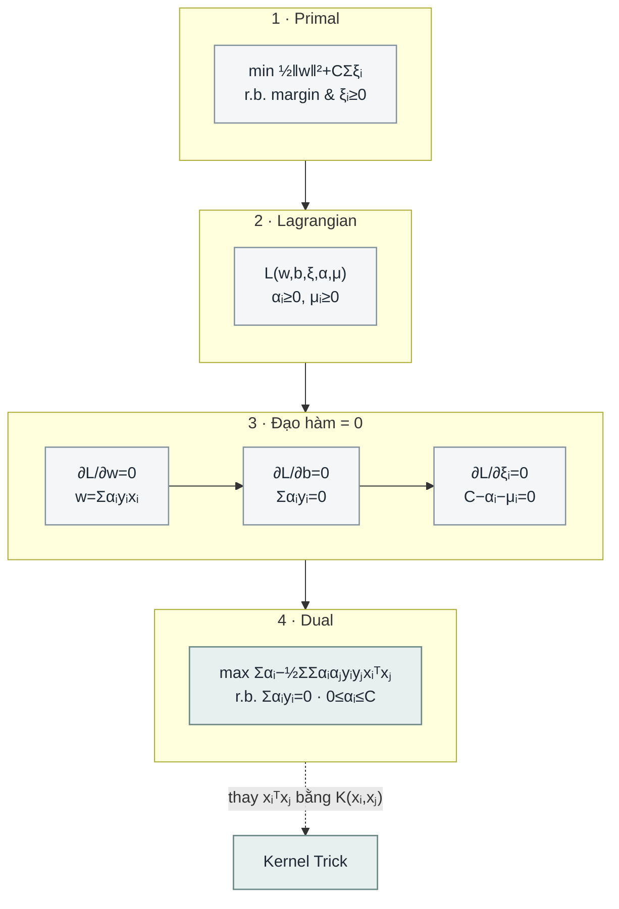

# 03 — Lagrangian và bài toán đối ngẫu (Dual)

Đây là phần toán trọng tâm của đồ án. Hãy hiểu ý nghĩa trước, sau đó tự viết lại từng phép đạo hàm.

## 0. Khởi động: một bài QP tí hon với một nhân tử

Trước khi vào Lagrangian của SVM, hãy giải một bài toán quy hoạch bậc hai (QP) rất nhỏ: hai biến, một ràng buộc tuyến tính, để thấy nhân tử Lagrange hoạt động ra sao trong trường hợp đơn giản nhất.

Xét bài toán

$$
\min_{x,y}\ x^2+2y^2\quad\text{sao cho}\quad x+y=3.
$$

Gắn ràng buộc vào hàm mục tiêu bằng một nhân tử $\lambda$:

$$
L(x,y,\lambda)=x^2+2y^2-\lambda(x+y-3).
$$

Cho đạo hàm riêng bằng 0:

$$
\frac{\partial L}{\partial x}=2x-\lambda=0,\qquad\frac{\partial L}{\partial y}=4y-\lambda=0
$$

nên $x=\lambda/2$ và $y=\lambda/4$. Thay vào ràng buộc $x+y=3$: $\lambda/2+\lambda/4=3$, suy ra $\lambda=4$, do đó $x=2$, $y=1$ và giá trị nhỏ nhất của mục tiêu là $2^2+2\times1^2=6$.

Chạy lại bằng `scipy.optimize.minimize` với ràng buộc đẳng thức `x+y=3` cho cùng kết quả $x=2,\ y=1$, mục tiêu $\approx6$, khớp với lời giải tay. Cơ chế vừa dùng — đưa ràng buộc vào hàm mục tiêu qua một nhân tử rồi cho đạo hàm bằng 0 — chính là cách phần dưới sẽ lặp lại với SVM, chỉ khác là có nhiều biến hơn và các ràng buộc là bất đẳng thức nên nhân tử ($\alpha_i,\mu_i$) phải không âm [[5]](10_image_credits.md#ref-5).

### Lagrangian tổng quát và đối ngẫu

Tổng quát, xét bài toán cực tiểu $f(x)$ với ràng buộc đẳng thức $h_i(x)=0$ và bất đẳng thức $g_j(x)\leq0$. Hàm Lagrange gắn mỗi ràng buộc với một nhân tử:

$$
L(x,\lambda,\nu)=f(x)+\sum_i\lambda_i h_i(x)+\sum_j\nu_j g_j(x).
$$

Khi $\nu_j\geq0$, tại mọi điểm khả thi phần cộng thêm không dương nên $L\leq f$. Do đó $q(\lambda,\nu)=\min_x L(x,\lambda,\nu)$ luôn là cận dưới của giá trị tối ưu gốc [[5]](10_image_credits.md#ref-5). Bài toán đối ngẫu tìm cận dưới tốt nhất: cực đại $q$ với $\nu\geq0$. Hàm $q$ luôn lõm, kể cả khi $f$ không lồi, vì nó là cực tiểu của một họ hàm tuyến tính theo $(\lambda,\nu)$. Khi hai giá trị tối ưu bằng nhau ta có đối ngẫu mạnh (strong duality).

SVM thuộc lớp quy hoạch bậc hai: cực tiểu $\frac12x^TAx+c^Tx+r$ với $Hx=d$, $Gx\leq e$. Hessian của mục tiêu là $A$; nếu $A$ nửa xác định dương thì mục tiêu lồi. Nếu thêm vào đó có một điểm thỏa mọi đẳng thức và thỏa chặt mọi bất đẳng thức (điều kiện Slater) thì đối ngẫu mạnh xảy ra và KKT vừa cần vừa đủ. Với soft margin, $A$ là ma trận đơn vị trên phần $w$ và bằng 0 trên $b,\xi$; chọn các $\xi_i$ đủ lớn là thỏa chặt mọi ràng buộc, nên Slater luôn đúng.

### Gom bình phương: một bài QP giải tay

Một bài QP nhỏ đôi khi giải được chỉ bằng cách gom bình phương [[5]](10_image_credits.md#ref-5). Xét

$$
\min_{x,y}\ 2x^2+2xy+y^2+2x+2y+1\quad\text{sao cho}\quad x+y\geq2,\ x\geq1.
$$

Mục tiêu viết lại được thành $(x+y+1)^2+x^2$. Trên miền ràng buộc có $x+y+1\geq3$ và $x\geq1$, nên giá trị không nhỏ hơn $3^2+1^2=10$, đạt tại $x=y=1$; `scipy.optimize.minimize` cho cùng nghiệm. Ma trận $A$ có hai hàng $(4,2)$ và $(2,2)$, hai trị riêng dương nên mục tiêu lồi; điểm $(2,2)$ thỏa chặt cả hai ràng buộc nên Slater đúng. Mẹo này hiếm khi dùng được; với bài toán lớn như SVM phải dựa vào KKT.

### KKT của QP chỉ có đẳng thức là một hệ tuyến tính

Khi chỉ có ràng buộc đẳng thức, đạo hàm của $L$ theo $x$ bằng 0 cho $Ax+H^T\lambda=-c$, còn ràng buộc cho $Hx=d$. Ghép lại:

$$
\begin{bmatrix}A&H^T\\H&0\end{bmatrix}\begin{bmatrix}x\\\lambda\end{bmatrix}=\begin{bmatrix}-c\\d\end{bmatrix}.
$$

Bài QP ở đầu mục có $A=\mathrm{diag}(2,4)$, $c=0$, $H=[1,1]$, $d=3$. Giải hệ ba phương trình được lại $x=2$, $y=1$; nhân tử ra $-4$ thay vì $4$ chỉ vì ở đây ràng buộc được cộng vào $L$ thay vì trừ đi.

```python
import numpy as np

K = np.array([[2., 0., 1.], [0., 4., 1.], [1., 1., 0.]])
print(np.linalg.solve(K, [0., 0., 3.]))  # [ 2.  1. -4.]
```

## 1. Nhắc lại Primal

$$
\begin{aligned}
\min_{w,b,\xi}\quad &\frac12\|w\|^2+C\sum_i\xi_i\\
\text{s.t.}\quad &1-y_i(w^Tx_i+b)-\xi_i\leq0,\\
&-\xi_i\leq0.
\end{aligned}\qquad\text{(3.1)}
$$

Ta đưa mỗi ràng buộc bất đẳng thức vào Lagrangian bằng một biến nhân tử không âm:

- $\alpha_i \geq 0$ cho ràng buộc margin.
- $\mu_i \geq 0$ cho ràng buộc $\xi_i \geq 0$.

## 2. Lagrangian

$$
\begin{aligned}
L(w,b,\xi,\alpha,\mu)
=&\frac12\|w\|^2+C\sum_i\xi_i\\
&-\sum_i\alpha_i[y_i(w^Tx_i+b)-1+\xi_i]\\
&-\sum_i\mu_i\xi_i.
\end{aligned}\qquad\text{(3.2)}
$$

Bạn có thể đọc từng dòng:

- Dòng đầu là objective gốc.
- Dòng hai gắn điều kiện phân loại vào Lagrangian.
- Dòng ba gắn điều kiện slack không âm.

## 3. Lấy đạo hàm riêng và cho bằng 0

### Theo w

$$
\frac{\partial L}{\partial w}=w-\sum_i\alpha_i y_i x_i=0
$$

Suy ra:

$$
\boxed{w=\sum_i\alpha_i y_i x_i}\qquad\text{(3.3)}
$$

Ý nghĩa: vector pháp tuyến tối ưu là tổ hợp có trọng số của các mẫu dữ liệu. Mẫu có alpha bằng 0 không đóng góp vào w.

### Theo b

$$
\frac{\partial L}{\partial b}=-\sum_i\alpha_i y_i=0
$$

Suy ra:

$$
\boxed{\sum_i\alpha_i y_i=0}\qquad\text{(3.4)}
$$

Đây là ràng buộc đẳng thức của bài toán Dual.

### Theo $\xi_i$

$$
\frac{\partial L}{\partial\xi_i}=C-\alpha_i-\mu_i=0
$$

Vì $\mu_i \geq 0$ và $\alpha_i \geq 0$:

$$
\mu_i=C-\alpha_i\quad\Longrightarrow\quad 0\leq\alpha_i\leq C\qquad\text{(3.5)}
$$

Đây là nguồn gốc của cận trên C trong bài toán đối ngẫu, không phải một điều kiện được đặt tùy ý.

## 4. Thay trở lại Lagrangian

Thay (3.3)–(3.5) vào (3.2), từng nhóm số hạng triệt tiêu như sau:

- Các số hạng chứa $\xi_i$ gom lại thành $\sum_i(C-\alpha_i-\mu_i)\xi_i=0$.
- Số hạng chứa $b$ là $-b\sum_i\alpha_i y_i=0$.
- $-\sum_i\alpha_i y_i w^Tx_i=-w^Tw=-\|w\|^2$, cộng với $\frac12\|w\|^2$ còn $-\frac12\|w\|^2$.

Viết $\|w\|^2=\sum_i\sum_j\alpha_i\alpha_jy_iy_jx_i^Tx_j$ theo (3.3) và loại $w,b,\xi,\mu$, ta nhận được:

$$
\boxed{
\begin{aligned}
\max_{\alpha}\quad &\sum_i\alpha_i-\frac12\sum_i\sum_j\alpha_i\alpha_jy_iy_j(x_i^Tx_j)\\
\text{s.t.}\quad &\sum_i\alpha_i y_i=0,\\
&0\leq\alpha_i\leq C.
\end{aligned}}\qquad\text{(3.6)}
$$

Đây là bài toán đối ngẫu bậc hai. Ta tối đa hóa một hàm lõm theo alpha (tương đương tối thiểu hóa hàm lồi sau khi đổi dấu), với các ràng buộc tuyến tính.

Sơ đồ sau tóm tắt toàn bộ quá trình suy diễn ở trên (Primal → Lagrangian → đạo hàm → Dual); đọc từ trên xuống để nối lại các bước (3.1)–(3.6); nhánh chấm cuối cùng là bước thay tích vô hướng bằng kernel, trình bày ở doc 06.



Nguồn: [`diagrams/lagrange_dual.mmd`](diagrams/lagrange_dual.mmd).

## 5. Primal và Dual khác nhau thế nào?

| Primal | Dual |
|---|---|
| Biến chính $w,b,\xi$ | Biến chính $\alpha$ |
| Tối thiểu hóa | Tối đa hóa |
| Ràng buộc trên margin và slack | Tổng alpha*y bằng 0; alpha nằm trong [0,C] |
| Dễ diễn giải hình học | Là nền tảng cho Support Vectors và Kernel Trick |

Theo điều kiện Slater của bài toán lồi này, strong duality được đảm bảo trong điều kiện chuẩn của Soft-Margin SVM: nghiệm tối ưu Primal và Dual có cùng giá trị mục tiêu. Điều này cho phép dùng khoảng cách primal-dual để kiểm tra nghiệm số.

## 6. Ví dụ kiểm tra ràng buộc Dual

Với `y=[-1,+1,-1,+1]` và `alpha=[0.25,0.25,0,0]`:

$$
\sum_i\alpha_i y_i=0.25(-1)+0.25(+1)=0.
$$

Nếu `C=1`, từng alpha nằm trong `[0,1]`, nên nghiệm thỏa ràng buộc Dual.

## 7. Liên hệ với code

File `src/svm_optimization/math/dual.py`:

- `dual_objective(alpha,y,K)`: tính hàm mục tiêu Dual.
- `dual_gradient(...)`: tính gradient theo alpha.
- `check_dual_feasibility(...)`: kiểm tra cận alpha và ràng buộc equality.

`K` là Gram matrix, với $K_{ij}=x_i^T x_j$ ở Linear Kernel. Khi dùng kernel, phép tích vô hướng được thay bằng $K(x_i,x_j)$.

## 8. Bạn cần tự trả lời

1. $\alpha_i$ xuất hiện từ ràng buộc nào?
2. Vì sao $\alpha_i \leq C$?
3. Ràng buộc $\sum_i\alpha_i y_i=0$ xuất hiện từ đạo hàm theo biến nào?
4. Vì sao Dual thuận tiện để đưa Kernel vào?
