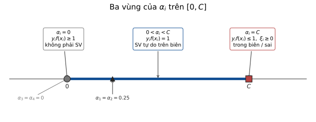

# 04 — Điều kiện KKT và Support Vectors

KKT là bộ điều kiện liên hệ nghiệm tối ưu với ràng buộc. Với bài toán lồi và điều kiện chính quy phù hợp, KKT là điều kiện cần và đủ để một nghiệm khả thi là nghiệm tối ưu.

## 1. Bốn nhóm điều kiện

### A. Primal feasibility — nghiệm Primal khả thi

$$
y_i(w^Tx_i+b)\geq1-\xi_i,\qquad \xi_i\geq0\qquad\text{(4.1)}
$$

Nói dễ hiểu: mô hình không được vi phạm các ràng buộc gốc.

### B. Dual feasibility — nghiệm Dual khả thi

$$
\alpha_i\geq0,\qquad \mu_i\geq0.
$$

Đây đúng là điều kiện để hàm Lagrange là cận dưới của bài toán gốc (doc 03, mục 0). Vì $\mu_i=C-\alpha_i$, tương đương:

$$
0\leq\alpha_i\leq C.
$$

### C. Stationarity — đạo hàm Lagrangian bằng 0

$$
w=\sum_i\alpha_i y_i x_i,\qquad \sum_i\alpha_i y_i=0,
$$

$$
C-\alpha_i-\mu_i=0.
$$

### D. Complementary slackness — điều kiện bù

$$
\alpha_i[y_i(w^Tx_i+b)-1+\xi_i]=0\qquad\text{(4.2)}
$$

$$
\mu_i\xi_i=0\qquad\text{(4.3)}
$$

Một tích bằng 0 nghĩa là ít nhất một trong hai thừa số phải bằng 0. Đây là chìa khóa để hiểu Support Vectors.

Kết hợp (4.2), (4.3) với $\mu_i=C-\alpha_i$ được ba trường hợp [[5]](10_image_credits.md#ref-5):

- $\alpha_i=0$: $\mu_i=C>0$ nên $\xi_i=0$, và $y_if(x_i)\geq1$. Điểm nằm ngoài hoặc trên margin.
- $0<\alpha_i<C$: $\mu_i>0$ nên $\xi_i=0$; $\alpha_i>0$ nên ngoặc vuông trong (4.2) bằng 0, tức $y_if(x_i)=1$. Điểm nằm đúng trên margin.
- $\alpha_i=C$: $\mu_i=0$ nên $\xi_i$ được phép dương. Điểm nằm trên margin, trong margin hoặc bị phân loại sai.

## 2. Alpha nói gì về một điểm?

| Alpha | Suy luận từ KKT | Diễn giải thường gặp |
|---|---|---|
| $\alpha=0$ | Ràng buộc margin không cần nhân tử dương | Điểm thường nằm ngoài margin, không đóng góp vào w |
| $0<\alpha<C$ | $\xi=0$ và margin constraint active | Điểm nằm đúng trên margin; là support vector |
| $\alpha=C$ | $\mu=0$; slack có thể dương hoặc bằng 0 | Điểm nằm trên biên hoặc vi phạm margin; cũng là support vector |

Hình dưới vẽ trục $\alpha_i$ từ 0 đến $C$ theo đúng ba hàng của bảng trên: điểm tại 0, đoạn mở giữa 0 và $C$, điểm tại $C$. Các mốc $\alpha_1=\alpha_2=0.25$ và $\alpha_3=\alpha_4=0$ lấy từ ví dụ giải tay bốn điểm.



*Hình 4.1: Ba vùng của $\alpha_i$ trên $[0,C]$ theo điều kiện KKT.*

**Cẩn thận:** ở trường hợp suy biến, có thể có điểm nằm trên biên nhưng alpha bằng 0. Bảng trên là cách diễn giải điển hình, không nên biến thành khẳng định tuyệt đối cho mọi bộ dữ liệu.

## 3. Tại sao chỉ support vectors quan trọng?

Từ stationarity:

$$
w=\sum_i\alpha_i y_i x_i.
$$

Nếu $\alpha_i=0$, mẫu đó không đóng góp vào vector w. Vì vậy ranh giới cuối cùng được xác định trực tiếp bởi các điểm có alpha khác 0 — Support Vectors.

Với kernel:

$$
f(x)=\sum_i\alpha_i y_i K(x_i,x)+b.
$$

Công thức dự đoán cũng chỉ cần các mẫu support vector.

### Tìm b

Lấy một điểm $x_i$ nằm đúng trên margin ($0<\alpha_i<C$). Từ $y_i(w^Tx_i+b)=1$ và $y_i^2=1$ suy ra $b=y_i-w^Tx_i$. Để giảm sai số số học, lấy trung bình trên tập $M$ các điểm như vậy:

$$
b=\frac{1}{|M|}\sum_{i\in M}(y_i-w^Tx_i).
$$

## 4. Ví dụ giải tay

Trong `experiments/02_hand_example.py`, nghiệm có:

- $\alpha_1=0.25$, $\alpha_2=0.25$.
- $\alpha_3=\alpha_4=0$.
- $\xi_i=0$ cho cả bốn điểm.

Hai điểm đầu nằm đúng trên margin và có alpha nằm giữa 0 và C. Hai điểm còn lại nằm ngoài margin và có alpha bằng 0.

Từ đó $w=0.25(1,1)+0.25(1,1)=(0.5,0.5)$ và $b=1-w^T(1,1)=0$. Giá trị đối ngẫu bằng $0.5-0.25=0.25$, đúng bằng giá trị gốc $\frac12\|w\|^2=0.25$: đối ngẫu mạnh. Đoạn code sau lấy alpha từ scikit-learn rồi dựng lại $w$, $b$ theo các công thức trên.

```python
import numpy as np
from sklearn.svm import SVC

X = np.array([[-1., -1.], [1., 1.], [-2., -1.], [2., 1.]])
y = np.array([-1, 1, -1, 1])
clf = SVC(kernel='linear', C=10).fit(X, y)
alpha_y = clf.dual_coef_[0]  # alpha_i * y_i của các vector hỗ trợ
sv = clf.support_vectors_
w = alpha_y @ sv
b = np.mean(y[clf.support_] - sv @ w)
print(clf.support_, np.abs(alpha_y))  # [0 1] [0.25 0.25]
print(w, b)                           # [0.5 0.5] 0.0
```

## 5. Liên hệ với code

File `src/svm_optimization/math/kkt.py`:

- `kkt_report(...)`: tính residual của các điều kiện primal, dual, stationarity và complementary slackness cho Linear SVM.
- `alpha_roles(...)`: phân nhóm alpha gần 0, nằm trong khoảng, gần C.

Một residual gần 0 cho thấy điều kiện tương ứng được thỏa gần đúng theo sai số số học. Đừng mong mọi residual đúng bằng 0 khi dùng thuật toán số.

## 6. Bạn cần tự trả lời

1. Vì sao $0<\alpha<C$ kéo theo $\xi=0$?
2. Một điểm có $\alpha=C$ có nhất thiết bị phân loại sai không?
3. Tại sao alpha khác 0 thường xác định support vector?
4. Complementary slackness có nghĩa là “cả hai thừa số cùng bằng 0” hay “ít nhất một bằng 0”?
