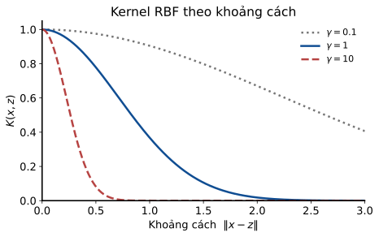

# 06 — Kernel Trick: Linear và RBF

## 1. Vấn đề dữ liệu phi tuyến

Linear SVM tìm một ranh giới tuyến tính trong không gian đặc trưng hiện tại. Có những dữ liệu không thể chia tốt bằng một đường thẳng, ví dụ XOR.

Kernel Trick thay tích vô hướng $x_i^T x_j$ trong Dual bằng một hàm kernel:

$$
K(x_i,x_j)=\phi(x_i)^T\phi(x_j)\qquad\text{(6.1)}
$$

Ta không cần tính tường minh vector $\phi(x)$ có thể nằm trong không gian rất nhiều chiều; chỉ cần tính kernel giữa hai điểm.

Hình 4 cho hai mô hình SVC học cùng dữ liệu XOR tổng hợp: Linear SVM chỉ đoán đúng khoảng một nửa, còn RBF tách được cả bốn cụm. Đây là ví dụ trực quan trên tập huấn luyện, không phải benchmark Banknote.


*Hình 4: Linear SVM và RBF SVM trên dữ liệu XOR tổng hợp.*

## 2. Linear Kernel

$$
K(x,z)=x^Tz\qquad\text{(6.2)}
$$

Đây chính là tích vô hướng thông thường. Dùng khi ranh giới tuyến tính là giả định hợp lý hoặc cần baseline dễ diễn giải.

### Kernel đa thức bậc 2 chính là một $\phi$ tường minh

Công thức (6.1) nói $K(x,z)=\phi(x)^T\phi(z)$ cho một $\phi$ nào đó, nhưng không bắt phải biết $\phi$ là gì. Với $x=(x_1,x_2)\in\mathbb{R}^2$, kernel đa thức bậc 2 $K(x,z)=(x^Tz)^2$ là một trường hợp hiếm có thể viết $\phi$ ra tường minh:

$$
\phi(x)=(x_1^2,\ \sqrt2\,x_1x_2,\ x_2^2).
$$

Khai triển $(x^Tz)^2=(x_1z_1+x_2z_2)^2=x_1^2z_1^2+2x_1x_2z_1z_2+x_2^2z_2^2$, đúng bằng $\phi(x)^T\phi(z)$.

Thử với số cụ thể $x=(1,2)$, $z=(3,4)$: $x^Tz=1\times3+2\times4=11$ nên $K(x,z)=11^2=121$. Mặt khác $\phi(x)=(1,\ 2\sqrt2,\ 4)$ và $\phi(z)=(9,\ 12\sqrt2,\ 16)$, tích vô hướng $\phi(x)^T\phi(z)=1\times9+2\sqrt2\times12\sqrt2+4\times16=9+48+64=121$, khớp với $K(x,z)$ tính trực tiếp. Đây chính là lý do kernel trick hữu ích: ta chỉ cần tính $(x^Tz)^2$, không cần dựng $\phi(x)$ ba chiều. [[5]](10_image_credits.md#ref-5)

Với bậc cao hơn, dựng $\phi(x)$ tường minh rồi dùng Linear SVM trên đó vẫn cho cùng ý tưởng như `SVC(kernel='poly')`, nhưng tốn kém hơn vì số chiều của $\phi(x)$ tăng rất nhanh theo bậc và số đặc trưng gốc:

```python
from sklearn.datasets import make_moons
from sklearn.pipeline import make_pipeline
from sklearn.preprocessing import PolynomialFeatures, StandardScaler
from sklearn.svm import LinearSVC, SVC

X, y = make_moons(n_samples=200, noise=0.15, random_state=1)
poly_pipe = make_pipeline(StandardScaler(),
                          PolynomialFeatures(degree=3),
                          LinearSVC(C=1, max_iter=20000))
svc_poly = make_pipeline(StandardScaler(),
                         SVC(kernel='poly', degree=3, C=1))
poly_pipe.fit(X, y)
svc_poly.fit(X, y)
print('PolynomialFeatures + LinearSVC:',
      round(poly_pipe.score(X, y), 4))
print('SVC(kernel=poly):', round(svc_poly.score(X, y), 4))
# PolynomialFeatures + LinearSVC: 0.99
# SVC(kernel=poly): 0.875
```

Hai cách cho độ chính xác khác nhau vì chúng không dùng cùng một không gian đặc trưng: `PolynomialFeatures(degree=3)` giữ mọi đơn thức bậc 0 đến 3, còn `SVC(kernel='poly')` mặc định `coef0=0` nên kernel $(\gamma x^Tz)^3$ chỉ ứng với các đơn thức bậc đúng 3. Ngoài ra `LinearSVC` mặc định dùng squared hinge loss thay cho hinge loss.

## 3. RBF / Gaussian Kernel

RBF có thể hiểu như một phép đo "giống nhau" giữa $x$ và một điểm mốc (landmark) $l$: nếu $x$ rất gần $l$, giá trị kernel gần $1$; nếu $x$ ở xa $l$, giá trị gần $0$. Ánh xạ một điểm sang các giá trị giống-nhau với vài landmark như vậy có thể biến dữ liệu kiểu XOR — vốn không tách được bằng một đường thẳng trong không gian gốc — thành dữ liệu tách được tuyến tính trong không gian mới.

Ví dụ số trên bốn đỉnh XOR $(0,0),(1,1)$ thuộc lớp $-1$ và $(0,1),(1,0)$ thuộc lớp $+1$: chọn hai landmark $l_1=(0,0)$, $l_2=(1,1)$ và $\gamma=1$. Với $f_1=K(x,l_1)$, $f_2=K(x,l_2)$:

| $x$ | lớp | $f_1$ | $f_2$ | $f_1+f_2$ |
|---|---|---:|---:|---:|
| $(0,0)$ | $-1$ | $1$ | $0.135$ | $1.135$ |
| $(1,1)$ | $-1$ | $0.135$ | $1$ | $1.135$ |
| $(0,1)$ | $+1$ | $0.368$ | $0.368$ | $0.736$ |
| $(1,0)$ | $+1$ | $0.368$ | $0.368$ | $0.736$ |

Hai điểm lớp $-1$ có $f_1+f_2\approx1.135$, hai điểm lớp $+1$ có $f_1+f_2\approx0.736$: một ngưỡng đơn giản như $f_1+f_2=0.9$ đã tách được hai lớp, dù trong không gian $(x_1,x_2)$ gốc XOR không tách được bằng đường thẳng nào. [[5]](10_image_credits.md#ref-5)

Một ví dụ 1D làm rõ hơn vai trò của landmark: bảy điểm nằm xen kẽ trên một trục nên không một ngưỡng nào trên $x$ tách được hai lớp. Đặt hai landmark $l_1=-1.5$, $l_2=1.5$ với $\gamma=1$. Bên trái Hình 5 vẽ $\phi_1=K(x,l_1)$ và $\phi_2=K(x,l_2)$ theo $x$: các điểm lớp $-1$ (chấm xanh) đều gần một trong hai landmark, còn các điểm lớp $+1$ (tam giác đỏ) nằm xa cả hai. Bên phải là không gian $(\phi_1,\phi_2)$, nơi đường thẳng $\phi_1+\phi_2=0.5$ tách sạch hai lớp.


*Hình 5: Kernel RBF quanh hai landmark (trái) và không gian $(\phi_1,\phi_2)$ (phải).*

$$
K(x,z)=\exp(-\gamma\|x-z\|^2),\qquad \gamma>0\qquad\text{(6.3)}
$$

- Hai điểm gần nhau: kernel gần 1.
- Hai điểm xa nhau: kernel gần 0.
- Gamma lớn: ảnh hưởng của một điểm tập trung trong vùng hẹp; ranh giới linh hoạt hơn và dễ overfit.
- Gamma nhỏ: ảnh hưởng lan rộng; ranh giới mượt hơn.

Hình 6 cho thấy vai trò của $\gamma$ qua hình chuông $\exp(-\gamma d^2)$ theo khoảng cách $d=\|x-z\|$ [[5]](10_image_credits.md#ref-5). Ở cùng khoảng cách $d=1$, kernel bằng $e^{-0.1}\approx0.905$ với $\gamma=0.1$, bằng $e^{-1}\approx0.368$ với $\gamma=1$ và gần như bằng 0 ($e^{-10}\approx0.00005$) với $\gamma=10$. Với $\gamma$ lớn, mỗi support vector chỉ "nhìn thấy" vùng rất sát nó, nên ranh giới bám theo từng điểm huấn luyện.



*Hình 6: Kernel RBF theo khoảng cách với $\gamma=0.1$, $1$, $10$.*

Cũng phải điều chỉnh $C$ cùng gamma bằng validation.

## 4. Hàm quyết định có kernel

Từ $w=\sum_i\alpha_i y_i\phi(x_i)$, suy ra:

$$
f(x)=\sum_i\alpha_i y_i K(x_i,x)+b\qquad\text{(6.4)}
$$

Đây là công thức được dùng trong `KernelSVM.decision_function`.

Vì $\alpha_i=0$ với mọi điểm không phải support vector, tổng trong (6.4) chỉ chạy trên các support vector. Mô hình đã huấn luyện chỉ cần giữ lại các support vector, hệ số $\alpha_i y_i$ của chúng và $b$; các mẫu còn lại có thể bỏ đi mà dự đoán không đổi. Đoạn code sau tự tính (6.4) từ các thành phần mà `SVC` lưu lại (`dual_coef_` chứa sẵn $\alpha_i y_i$) và so với `decision_function`:

```python
import numpy as np
from sklearn.datasets import make_moons
from sklearn.svm import SVC
from svm_optimization.models.kernel import rbf_kernel

X, y = make_moons(n_samples=200, noise=0.25, random_state=0)
clf = SVC(kernel='rbf', gamma=1.0, C=1).fit(X, y)
x_new = np.array([[0.5, 0.25]])
K = rbf_kernel(clf.support_vectors_, x_new, gamma=1.0)
f = clf.dual_coef_ @ K + clf.intercept_
print(len(clf.support_), 'support vector trên', len(X), 'mẫu')
print(f.ravel().round(4), clf.decision_function(x_new).round(4))
# 63 support vector trên 200 mẫu
# [-0.1022] [-0.1022]
```

Chỉ 63 trong 200 mẫu tham gia vào dự đoán, và kết quả tự tính trùng với `decision_function`.

## Ví dụ số: từ kernel đến dự đoán

Lấy hai mẫu một chiều $x_1=-1$, $x_2=1$, nhãn $y_1=-1$, $y_2=1$ và RBF với $\gamma=0.5$. Phần tử hàng $i$, cột $j$ của Gram matrix là $K(x_i,x_j)$:

| $K(x_i,x_j)$ | $x_1=-1$ | $x_2=1$ |
|---|---:|---:|
| $x_1=-1$ | $1$ | $e^{-2}\approx0.1353$ |
| $x_2=1$ | $e^{-2}\approx0.1353$ | $1$ |

Với điểm mới $x=0.5$, ta tính $K(x_1,x)\approx0.3247$ và $K(x_2,x)\approx0.8825$. Trên ví dụ này với $C=1$, mô hình học được $\alpha_1=\alpha_2=1$ và $b\approx0$. Thay vào công thức (6.4):

$$
f(x)\approx (-1)(0.3247)+(1)(0.8825)+0=0.5578.
$$

Score dương nên mô hình dự đoán lớp $+1$. Các số trên dùng mẫu rất nhỏ để học cách tính, không phải kết quả Banknote. Chạy ví dụ để xem cả Gram matrix Linear, từng số hạng và score từ `KernelSVM`:

```bash
uv run python -m experiments.07_kernel_trick
```

## 5. Liên hệ với code

`src/svm_optimization/models/kernel.py`:

- `linear_kernel(X,Y)` trả `X @ Y.T`.
- `rbf_kernel(X,Y,gamma)` tính khoảng cách bình phương giữa từng cặp rồi lấy `exp(-gamma*d²)`.
- `make_kernel` tạo callable theo tên kernel.

`src/svm_optimization/models/svm.py` dùng cùng một interface để huấn luyện và dự đoán. Khác biệt giữa Linear và RBF chủ yếu nằm ở cách tạo Gram matrix.

## 6. Lưu ý thực nghiệm

- Chuẩn hóa dữ liệu trước khi RBF vì khoảng cách Euclid phụ thuộc scale từng feature.
- `gamma='scale'` trong project được tính theo `1 / (n_features * variance(X_train))`.
- Với RBF, không có vector w hữu hạn trong không gian đầu vào gốc để vẽ trực tiếp như Linear.
- Khi vẽ boundary 2D, hãy huấn luyện lại trên đúng hai feature; không lấy model bốn feature rồi đưa hai feature vào plot.

## 7. So sánh bốn kernel bằng cross-validation

Mục 2 và 3 so sánh kernel trên ví dụ nhỏ, dựng sẵn để minh họa. Trên dữ liệu thực, cách công bằng hơn là so sánh accuracy qua nhiều lần cross-validation thay vì nhìn một lần chia train/test.

`SVC` của scikit-learn có sẵn bốn kernel [[5]](10_image_credits.md#ref-5):

| Kernel | Công thức $K(x,z)$ | Tham số |
|---|---|---|
| `linear` | $x^Tz$ | không có |
| `poly` | $(\gamma x^Tz+r)^d$ | `gamma`, `coef0` $=r$, `degree` $=d$ |
| `rbf` | $\exp(-\gamma\|x-z\|^2)$ | `gamma` |
| `sigmoid` | $\tanh(\gamma x^Tz+r)$ | `gamma`, `coef0` $=r$ |

Kernel sigmoid không phải lúc nào cũng thỏa điều kiện Mercer (ma trận Gram có thể không nửa xác định dương), nên trong thực tế ít được dùng hơn ba kernel còn lại.

Hình 7 so sánh bốn kernel trên `make_moons` (200 mẫu, nhiễu 0.25). Mỗi mô hình là `SVC` có chuẩn hóa `StandardScaler`, giữ tham số mặc định ngoài kernel, chạy 50 lần Repeated Stratified 5-fold CV. RBF có accuracy trung bình cao nhất (0.924), sigmoid thấp nhất (0.716).


*Hình 7: Accuracy cross-validation của bốn kernel trên `make_moons`.*

```python
from sklearn.datasets import make_moons
from sklearn.model_selection import (
    RepeatedStratifiedKFold, cross_val_score)
from sklearn.pipeline import make_pipeline
from sklearn.preprocessing import StandardScaler
from sklearn.svm import SVC

X, y = make_moons(n_samples=200, noise=0.25, random_state=0)
cv = RepeatedStratifiedKFold(n_splits=5, n_repeats=10, random_state=0)
for kernel in ['linear', 'poly', 'rbf', 'sigmoid']:
    pipe = make_pipeline(StandardScaler(),
                         SVC(kernel=kernel, gamma='scale'))
    scores = cross_val_score(pipe, X, y, cv=cv)
    print(kernel, round(scores.mean(), 4), round(scores.std(), 4))
# linear  0.833 0.0542
# poly    0.828 0.0486
# rbf     0.924 0.0371
# sigmoid 0.716 0.0655
```

Kết quả này chỉ đúng cho `make_moons` với nhiễu và kích thước đã chọn; trên dữ liệu khác (ví dụ Banknote, gần tuyến tính) kernel linear có thể thắng RBF. Luôn so sánh bằng cross-validation trên chính dữ liệu đang xét, không suy ra từ ví dụ này.

## 8. Bạn cần tự trả lời

1. Kernel thay thế phần nào trong Dual?
2. Vì sao cần scale dữ liệu trước RBF?
3. RBF gamma lớn có thể làm ranh giới phức tạp hơn theo cách nào?
4. Kernel Trick có nghĩa là ta nhất thiết phải tạo vector phi(x) không?
