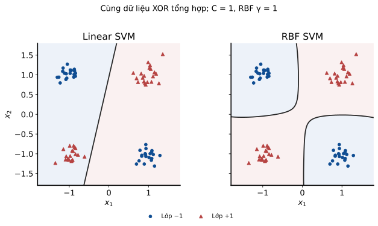

# 06 — Kernel Trick: Linear và RBF

## 1. Vấn đề dữ liệu phi tuyến

Linear SVM tìm một ranh giới tuyến tính trong không gian đặc trưng hiện tại. Có những dữ liệu không thể chia tốt bằng một đường thẳng, ví dụ XOR.

Kernel Trick thay tích vô hướng $x_i^T x_j$ trong Dual bằng một hàm kernel:

$$
K(x_i,x_j)=\phi(x_i)^T\phi(x_j)\qquad\text{(6.1)}
$$

Ta không cần tính tường minh vector $\phi(x)$ có thể nằm trong không gian rất nhiều chiều; chỉ cần tính kernel giữa hai điểm.



*Hình 4: Hai mô hình SVC học cùng dữ liệu XOR tổng hợp. Đây là ví dụ trực quan trên tập huấn luyện, không phải benchmark Banknote.*

## 2. Linear Kernel

$$
K(x,z)=x^Tz\qquad\text{(6.2)}
$$

Đây chính là tích vô hướng thông thường. Dùng khi ranh giới tuyến tính là giả định hợp lý hoặc cần baseline dễ diễn giải.

## 3. RBF / Gaussian Kernel

$$
K(x,z)=\exp(-\gamma\|x-z\|^2),\qquad \gamma>0\qquad\text{(6.3)}
$$

- Hai điểm gần nhau: kernel gần 1.
- Hai điểm xa nhau: kernel gần 0.
- Gamma lớn: ảnh hưởng của một điểm tập trung trong vùng hẹp; ranh giới linh hoạt hơn và dễ overfit.
- Gamma nhỏ: ảnh hưởng lan rộng; ranh giới mượt hơn.

Cũng phải điều chỉnh $C$ cùng gamma bằng validation.

## 4. Hàm quyết định có kernel

Từ $w=\sum_i\alpha_i y_i\phi(x_i)$, suy ra:

$$
f(x)=\sum_i\alpha_i y_i K(x_i,x)+b\qquad\text{(6.4)}
$$

Đây là công thức được dùng trong `KernelSVM.decision_function`.

## Ví dụ số: từ kernel đến dự đoán

Lấy hai mẫu một chiều $x_1=-1$, $x_2=1$, nhãn $y_1=-1$, $y_2=1$ và RBF với $\gamma=0.5$. Phần tử hàng $i$, cột $j$ của Gram matrix là $K(x_i,x_j)$:

| $K(x_i,x_j)$ | $x_1=-1$ | $x_2=1$ |
|---|---:|---:|
| $x_1=-1$ | $1$ | $e^{-2}\approx0.1353$ |
| $x_2=1$ | $e^{-2}\approx0.1353$ | $1$ |

Với điểm mới $x=0.5$, ta tính $K(x_1,x)\approx0.3247$ và $K(x_2,x)\approx0.8825$. Trên ví dụ này với $C=1$, mô hình học được $\alpha_1=\alpha_2=1$ và $b\approx0$. Thay vào công thức (6.4):

$$
f(x)\approx (-1)(0.3247)+(1)(0.8825)+0=0.5578.
$$

Score dương nên mô hình dự đoán lớp $+1$. Các số trên dùng mẫu rất nhỏ để học cách tính, không phải kết quả Banknote. Chạy ví dụ để xem cả Gram matrix Linear, từng số hạng và score từ `KernelSVM`:

```bash
python -m experiments.07_kernel_trick
```

## 5. Liên hệ với code

`src/svm_optimization/models/kernel.py`:

- `linear_kernel(X,Y)` trả `X @ Y.T`.
- `rbf_kernel(X,Y,gamma)` tính khoảng cách bình phương giữa từng cặp rồi lấy `exp(-gamma*d²)`.
- `make_kernel` tạo callable theo tên kernel.

`src/svm_optimization/models/svm.py` dùng cùng một interface để huấn luyện và dự đoán. Khác biệt giữa Linear và RBF chủ yếu nằm ở cách tạo Gram matrix.

## 6. Lưu ý thực nghiệm

- Chuẩn hóa dữ liệu trước khi RBF vì khoảng cách Euclid phụ thuộc scale từng feature.
- `gamma='scale'` trong project được tính theo `1 / (n_features * variance(X_train))`.
- Với RBF, không có vector w hữu hạn trong không gian đầu vào gốc để vẽ trực tiếp như Linear.
- Khi vẽ boundary 2D, hãy huấn luyện lại trên đúng hai feature; không lấy model bốn feature rồi đưa hai feature vào plot.

## 7. Bạn cần tự trả lời

1. Kernel thay thế phần nào trong Dual?
2. Vì sao cần scale dữ liệu trước RBF?
3. RBF gamma lớn có thể làm ranh giới phức tạp hơn theo cách nào?
4. Kernel Trick có nghĩa là ta nhất thiết phải tạo vector phi(x) không?
