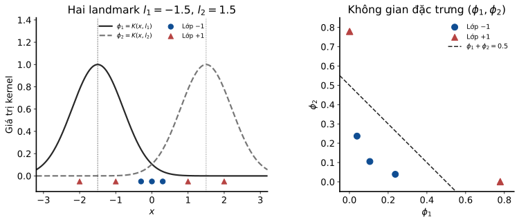
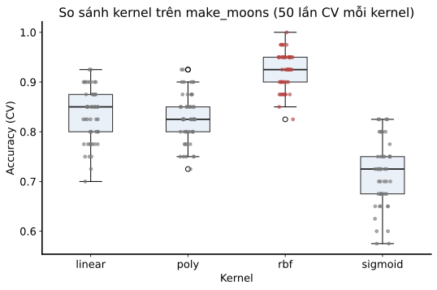

# 06 — Kernel Trick: Linear và RBF

## 1. Vấn đề dữ liệu phi tuyến

Linear SVM tìm một ranh giới tuyến tính trong không gian đặc trưng hiện tại. Có những dữ liệu không thể chia tốt bằng một đường thẳng, ví dụ XOR.

Kernel Trick thay tích vô hướng $x_i^T x_j$ trong Dual bằng một hàm kernel:

$$
K(x_i,x_j)=\phi(x_i)^T\phi(x_j)\qquad\text{(6.1)}
$$

Ta không cần tính tường minh vector $\phi(x)$ có thể nằm trong không gian rất nhiều chiều; chỉ cần tính kernel giữa hai điểm.

Hình 4 cho hai mô hình SVC học cùng dữ liệu XOR tổng hợp: Linear SVM chỉ đoán đúng khoảng một nửa, còn RBF tách được cả bốn cụm. Đây là ví dụ trực quan trên tập huấn luyện, không phải benchmark Banknote.


*Hình 4: Linear SVM và RBF SVM trên dữ liệu XOR tổng hợp.*

### Chi phí khi dựng $\phi$ tường minh

Sau khi ánh xạ, mô hình vẫn tuyến tính, nhưng tuyến tính theo các đặc trưng mới $\phi_1(x), \dots, \phi_D(x)$ [[5]](10_image_credits.md#ref-5):

$$
f(x) = w^T \phi(x) + b = b + \sum_{k=1}^{D} w_k \phi_k(x)
$$

Cái giá nằm ở số chiều $D$. Nếu $\phi(x)$ gồm mọi đơn thức bậc không quá 3 của $n$ đặc trưng gốc thì $D = (n+1)(n+2)(n+3)/6$. Với $n = 4$ như Banknote, $D = 35$ vẫn nhỏ; nhưng với $n = 100$ thì $D = 176851$, và mỗi mẫu phải được biến đổi, lưu trữ và nhân với ngần ấy trọng số. Đoạn code sau đếm $D$ bằng `PolynomialFeatures`.

```python
import numpy as np
from sklearn.preprocessing import PolynomialFeatures

for n in [2, 4, 10, 100]:
    poly = PolynomialFeatures(degree=3).fit(np.zeros((1, n)))
    print(n, 'đặc trưng gốc ->', poly.n_output_features_)
# 2 đặc trưng gốc -> 10
# 4 đặc trưng gốc -> 35
# 10 đặc trưng gốc -> 286
# 100 đặc trưng gốc -> 176851
```

Lưu ý rằng trong bài toán đối ngẫu ở [03](03_lagrange_dual.md), dữ liệu chỉ xuất hiện qua các tích vô hướng $x_i^T x_j$. Sau khi ánh xạ, chúng trở thành $\phi(x_i)^T \phi(x_j)$, nên chỉ cần một cách tính thẳng con số này mà không dựng $\phi$.

### Khi nào một hàm là kernel hợp lệ: điều kiện Mercer

Điều kiện nửa xác định dương xuất hiện một cách tự nhiên. Nếu $K(x, z) = \phi(x)^T \phi(z)$ thì với mọi bộ hệ số $c_1, \dots, c_n$,

$$
\sum_{i=1}^{n} \sum_{j=1}^{n} c_i c_j K(x_i, x_j) = \left\| \sum_{i=1}^{n} c_i \phi(x_i) \right\|^2 \geq 0
$$

tức ma trận Gram với phần tử $K(x_i, x_j)$ luôn nửa xác định dương, mọi giá trị riêng đều không âm [[5]](10_image_credits.md#ref-5). Định lý Mercer khẳng định chiều ngược lại: một hàm đối xứng cho ma trận Gram nửa xác định dương trên mọi tập điểm thì là tích vô hướng trong một không gian đặc trưng nào đó, kể cả khi ta không viết được $\phi$. Khi đó ma trận $y_i y_j K(x_i, x_j)$ trong bài toán đối ngẫu cũng nửa xác định dương, hàm mục tiêu đối ngẫu là hàm lõm, và bài toán vẫn là quy hoạch toàn phương lồi với nghiệm tối ưu toàn cục.

Có thể kiểm tra điều này bằng số. Trên 200 điểm `make_moons`, giá trị riêng nhỏ nhất của ma trận Gram RBF chỉ cỡ $10^{-15}$, tức bằng 0 sai khác làm tròn. Kernel sigmoid với $\gamma = 1$, $r = 1$ cho giá trị riêng nhỏ nhất khoảng $-23$, nên với dữ liệu này nó không phải kernel Mercer và bài toán đối ngẫu không còn lồi.

```python
import numpy as np
from sklearn.datasets import make_moons
from sklearn.metrics.pairwise import rbf_kernel, sigmoid_kernel

X, _ = make_moons(n_samples=200, noise=0.25, random_state=0)
grams = {'rbf': rbf_kernel(X, gamma=1.0),
         'sigmoid': sigmoid_kernel(X, gamma=1.0, coef0=1.0)}
for name, K in grams.items():
    print(name, f'{np.linalg.eigvalsh(K).min():.1e}')
# rbf -2.7e-15
# sigmoid -2.3e+01
```

## 2. Linear Kernel

$$
K(x,z)=x^Tz\qquad\text{(6.2)}
$$

Đây chính là tích vô hướng thông thường. Dùng khi ranh giới tuyến tính là giả định hợp lý hoặc cần baseline dễ diễn giải.

### Kernel đa thức bậc 2 chính là một $\phi$ tường minh

Công thức (6.1) nói $K(x,z)=\phi(x)^T\phi(z)$ cho một $\phi$ nào đó, nhưng không bắt phải biết $\phi$ là gì. Với $x=(x_1,x_2)\in\mathbb{R}^2$, kernel đa thức bậc 2 $K(x,z)=(x^Tz)^2$ là một trường hợp hiếm có thể viết $\phi$ ra tường minh:

$$
\phi(x)=(x_1^2,\ \sqrt2\,x_1x_2,\ x_2^2).
$$

Khai triển $(x^Tz)^2=(x_1z_1+x_2z_2)^2=x_1^2z_1^2+2x_1x_2z_1z_2+x_2^2z_2^2$, đúng bằng $\phi(x)^T\phi(z)$.

Thử với số cụ thể $x=(1,2)$, $z=(3,4)$: $x^Tz=1\times3+2\times4=11$ nên $K(x,z)=11^2=121$. Mặt khác $\phi(x)=(1,\ 2\sqrt2,\ 4)$ và $\phi(z)=(9,\ 12\sqrt2,\ 16)$, tích vô hướng $\phi(x)^T\phi(z)=1\times9+2\sqrt2\times12\sqrt2+4\times16=9+48+64=121$, khớp với $K(x,z)$ tính trực tiếp. Đây chính là lý do kernel trick hữu ích: ta chỉ cần tính $(x^Tz)^2$, không cần dựng $\phi(x)$ ba chiều. [[5]](10_image_credits.md#ref-5)

Với bậc cao hơn, dựng $\phi(x)$ tường minh rồi dùng Linear SVM trên đó vẫn cho cùng ý tưởng như `SVC(kernel='poly')`, nhưng tốn kém hơn vì số chiều của $\phi(x)$ tăng rất nhanh theo bậc và số đặc trưng gốc:

```python
from sklearn.datasets import make_moons
from sklearn.pipeline import make_pipeline
from sklearn.preprocessing import PolynomialFeatures, StandardScaler
from sklearn.svm import LinearSVC, SVC

X, y = make_moons(n_samples=200, noise=0.15, random_state=1)
poly_pipe = make_pipeline(StandardScaler(),
                          PolynomialFeatures(degree=3),
                          LinearSVC(C=1, max_iter=20000))
svc_poly = make_pipeline(StandardScaler(),
                         SVC(kernel='poly', degree=3, C=1))
poly_pipe.fit(X, y)
svc_poly.fit(X, y)
print('PolynomialFeatures + LinearSVC:',
      round(poly_pipe.score(X, y), 4))
print('SVC(kernel=poly):', round(svc_poly.score(X, y), 4))
# PolynomialFeatures + LinearSVC: 0.99
# SVC(kernel=poly): 0.875
```

Hai cách cho độ chính xác khác nhau vì chúng không dùng cùng một không gian đặc trưng: `PolynomialFeatures(degree=3)` giữ mọi đơn thức bậc 0 đến 3, còn `SVC(kernel='poly')` mặc định `coef0=0` nên kernel $(\gamma x^Tz)^3$ chỉ ứng với các đơn thức bậc đúng 3. Ngoài ra `LinearSVC` mặc định dùng squared hinge loss thay cho hinge loss.

## 3. RBF / Gaussian Kernel

RBF có thể hiểu như một phép đo "giống nhau" giữa $x$ và một điểm mốc (landmark) $l$: nếu $x$ rất gần $l$, giá trị kernel gần $1$; nếu $x$ ở xa $l$, giá trị gần $0$. Ánh xạ một điểm sang các giá trị giống-nhau với vài landmark như vậy có thể biến dữ liệu kiểu XOR — vốn không tách được bằng một đường thẳng trong không gian gốc — thành dữ liệu tách được tuyến tính trong không gian mới.

Ví dụ số trên bốn đỉnh XOR $(0,0),(1,1)$ thuộc lớp $-1$ và $(0,1),(1,0)$ thuộc lớp $+1$: chọn hai landmark $l_1=(0,0)$, $l_2=(1,1)$ và $\gamma=1$. Với $f_1=K(x,l_1)$, $f_2=K(x,l_2)$:

| $x$ | lớp | $f_1$ | $f_2$ | $f_1+f_2$ |
|---|---|---:|---:|---:|
| $(0,0)$ | $-1$ | $1$ | $0.135$ | $1.135$ |
| $(1,1)$ | $-1$ | $0.135$ | $1$ | $1.135$ |
| $(0,1)$ | $+1$ | $0.368$ | $0.368$ | $0.736$ |
| $(1,0)$ | $+1$ | $0.368$ | $0.368$ | $0.736$ |

Hai điểm lớp $-1$ có $f_1+f_2\approx1.135$, hai điểm lớp $+1$ có $f_1+f_2\approx0.736$: một ngưỡng đơn giản như $f_1+f_2=0.9$ đã tách được hai lớp, dù trong không gian $(x_1,x_2)$ gốc XOR không tách được bằng đường thẳng nào. [[5]](10_image_credits.md#ref-5)

Một ví dụ 1D làm rõ hơn vai trò của landmark: bảy điểm nằm xen kẽ trên một trục nên không một ngưỡng nào trên $x$ tách được hai lớp. Đặt hai landmark $l_1=-1.5$, $l_2=1.5$ với $\gamma=1$. Bên trái Hình 5 vẽ $\phi_1=K(x,l_1)$ và $\phi_2=K(x,l_2)$ theo $x$: các điểm lớp $-1$ (chấm xanh) đều gần một trong hai landmark, còn các điểm lớp $+1$ (tam giác đỏ) nằm xa cả hai. Bên phải là không gian $(\phi_1,\phi_2)$, nơi đường thẳng $\phi_1+\phi_2=0.5$ tách sạch hai lớp.



*Hình 5: Kernel RBF quanh hai landmark (trái) và không gian $(\phi_1,\phi_2)$ (phải).*

$$
K(x,z)=\exp(-\gamma\|x-z\|^2),\qquad \gamma>0\qquad\text{(6.3)}
$$

- Hai điểm gần nhau: kernel gần 1.
- Hai điểm xa nhau: kernel gần 0.
- Gamma lớn: ảnh hưởng của một điểm tập trung trong vùng hẹp; ranh giới linh hoạt hơn và dễ overfit.
- Gamma nhỏ: ảnh hưởng lan rộng; ranh giới mượt hơn.

Hình 6 cho thấy vai trò của $\gamma$ qua hình chuông $\exp(-\gamma d^2)$ theo khoảng cách $d=\|x-z\|$ [[5]](10_image_credits.md#ref-5). Ở cùng khoảng cách $d=1$, kernel bằng $e^{-0.1}\approx0.905$ với $\gamma=0.1$, bằng $e^{-1}\approx0.368$ với $\gamma=1$ và gần như bằng 0 ($e^{-10}\approx0.00005$) với $\gamma=10$. Với $\gamma$ lớn, mỗi support vector chỉ "nhìn thấy" vùng rất sát nó, nên ranh giới bám theo từng điểm huấn luyện.


*Hình 6: Kernel RBF theo khoảng cách với $\gamma=0.1$, $1$, $10$.*

Vì sao RBF linh hoạt đến vậy? Tách $\|x - z\|^2 = \|x\|^2 + \|z\|^2 - 2x^T z$ rồi khai triển Taylor hàm mũ, ta được

$$
\exp(-\gamma \|x - z\|^2) = e^{-\gamma \|x\|^2} e^{-\gamma \|z\|^2} \sum_{k=0}^{\infty} \frac{(2\gamma)^k}{k!} (x^T z)^k
$$

Mỗi số hạng $(x^T z)^k$ là một kernel đa thức bậc $k$, nên RBF là tổng có trọng số dương của các kernel đa thức ở mọi bậc, nhân thêm hai thừa số chỉ phụ thuộc riêng $x$ và riêng $z$ [[5]](10_image_credits.md#ref-5). Ánh xạ $\phi$ tương ứng vì thế có vô hạn chiều: không thể dựng tường minh như `PolynomialFeatures`, nhưng kernel vẫn tính được chỉ bằng một khoảng cách và một hàm mũ.

Cũng phải điều chỉnh $C$ cùng gamma bằng validation.

## 4. Hàm quyết định có kernel

Từ $w=\sum_i\alpha_i y_i\phi(x_i)$, suy ra:

$$
f(x)=\sum_i\alpha_i y_i K(x_i,x)+b\qquad\text{(6.4)}
$$

Đây là công thức được dùng trong `KernelSVM.decision_function`.

Vì $\alpha_i=0$ với mọi điểm không phải support vector, tổng trong (6.4) chỉ chạy trên các support vector. Mô hình đã huấn luyện chỉ cần giữ lại các support vector, hệ số $\alpha_i y_i$ của chúng và $b$; các mẫu còn lại có thể bỏ đi mà dự đoán không đổi. Đoạn code sau tự tính (6.4) từ các thành phần mà `SVC` lưu lại (`dual_coef_` chứa sẵn $\alpha_i y_i$) và so với `decision_function`:

```python
import numpy as np
from sklearn.datasets import make_moons
from sklearn.svm import SVC
from svm_optimization.models.kernel import rbf_kernel

X, y = make_moons(n_samples=200, noise=0.25, random_state=0)
clf = SVC(kernel='rbf', gamma=1.0, C=1).fit(X, y)
x_new = np.array([[0.5, 0.25]])
K = rbf_kernel(clf.support_vectors_, x_new, gamma=1.0)
f = clf.dual_coef_ @ K + clf.intercept_
print(len(clf.support_), 'support vector trên', len(X), 'mẫu')
print(f.ravel().round(4), clf.decision_function(x_new).round(4))
# 63 support vector trên 200 mẫu
# [-0.1022] [-0.1022]
```

Chỉ 63 trong 200 mẫu tham gia vào dự đoán, và kết quả tự tính trùng với `decision_function`.

## Ví dụ số: từ kernel đến dự đoán

Lấy hai mẫu một chiều $x_1=-1$, $x_2=1$, nhãn $y_1=-1$, $y_2=1$ và RBF với $\gamma=0.5$. Phần tử hàng $i$, cột $j$ của Gram matrix là $K(x_i,x_j)$:

| $K(x_i,x_j)$ | $x_1=-1$ | $x_2=1$ |
|---|---:|---:|
| $x_1=-1$ | $1$ | $e^{-2}\approx0.1353$ |
| $x_2=1$ | $e^{-2}\approx0.1353$ | $1$ |

Với điểm mới $x=0.5$, ta tính $K(x_1,x)\approx0.3247$ và $K(x_2,x)\approx0.8825$. Trên ví dụ này với $C=1$, mô hình học được $\alpha_1=\alpha_2=1$ và $b\approx0$. Thay vào công thức (6.4):

$$
f(x)\approx (-1)(0.3247)+(1)(0.8825)+0=0.5578.
$$

Score dương nên mô hình dự đoán lớp $+1$. Các số trên dùng mẫu rất nhỏ để học cách tính, không phải kết quả Banknote. Chạy ví dụ để xem cả Gram matrix Linear, từng số hạng và score từ `KernelSVM`:

```bash
uv run python -m experiments.07_kernel_trick
```

## 5. Liên hệ với code

`src/svm_optimization/models/kernel.py`:

- `linear_kernel(X,Y)` trả `X @ Y.T`.
- `rbf_kernel(X,Y,gamma)` tính khoảng cách bình phương giữa từng cặp rồi lấy `exp(-gamma*d²)`.
- `make_kernel` tạo callable theo tên kernel.

`src/svm_optimization/models/svm.py` dùng cùng một interface để huấn luyện và dự đoán. Khác biệt giữa Linear và RBF chủ yếu nằm ở cách tạo Gram matrix.

## 6. Lưu ý thực nghiệm

- Chuẩn hóa dữ liệu trước khi RBF vì khoảng cách Euclid phụ thuộc scale từng feature.
- `gamma='scale'` trong project được tính theo `1 / (n_features * variance(X_train))`.
- Với RBF, không có vector w hữu hạn trong không gian đầu vào gốc để vẽ trực tiếp như Linear.
- Khi vẽ boundary 2D, hãy huấn luyện lại trên đúng hai feature; không lấy model bốn feature rồi đưa hai feature vào plot.

## 7. So sánh bốn kernel bằng cross-validation

Mục 2 và 3 so sánh kernel trên ví dụ nhỏ, dựng sẵn để minh họa. Trên dữ liệu thực, cách công bằng hơn là so sánh accuracy qua nhiều lần cross-validation thay vì nhìn một lần chia train/test.

`SVC` của scikit-learn có sẵn bốn kernel [[5]](10_image_credits.md#ref-5):

| Kernel | Công thức $K(x,z)$ | Tham số |
|---|---|---|
| `linear` | $x^Tz$ | không có |
| `poly` | $(\gamma x^Tz+r)^d$ | `gamma`, `coef0` $=r$, `degree` $=d$ |
| `rbf` | $\exp(-\gamma\|x-z\|^2)$ | `gamma` |
| `sigmoid` | $\tanh(\gamma x^Tz+r)$ | `gamma`, `coef0` $=r$ |

Kernel sigmoid không phải lúc nào cũng thỏa điều kiện Mercer (ma trận Gram có thể không nửa xác định dương), nên trong thực tế ít được dùng hơn ba kernel còn lại.

Hình 7 so sánh bốn kernel trên `make_moons` (200 mẫu, nhiễu 0.25). Mỗi mô hình là `SVC` có chuẩn hóa `StandardScaler`, giữ tham số mặc định ngoài kernel, chạy 50 lần Repeated Stratified 5-fold CV. RBF có accuracy trung bình cao nhất (0.924), sigmoid thấp nhất (0.716).



*Hình 7: Accuracy cross-validation của bốn kernel trên `make_moons`.*

```python
from sklearn.datasets import make_moons
from sklearn.model_selection import (
    RepeatedStratifiedKFold, cross_val_score)
from sklearn.pipeline import make_pipeline
from sklearn.preprocessing import StandardScaler
from sklearn.svm import SVC

X, y = make_moons(n_samples=200, noise=0.25, random_state=0)
cv = RepeatedStratifiedKFold(n_splits=5, n_repeats=10, random_state=0)
for kernel in ['linear', 'poly', 'rbf', 'sigmoid']:
    pipe = make_pipeline(StandardScaler(),
                         SVC(kernel=kernel, gamma='scale'))
    scores = cross_val_score(pipe, X, y, cv=cv)
    print(kernel, round(scores.mean(), 4), round(scores.std(), 4))
# linear  0.833 0.0542
# poly    0.828 0.0486
# rbf     0.924 0.0371
# sigmoid 0.716 0.0655
```

Kết quả này chỉ đúng cho `make_moons` với nhiễu và kích thước đã chọn; trên dữ liệu khác (ví dụ Banknote, gần tuyến tính) kernel linear có thể thắng RBF. Luôn so sánh bằng cross-validation trên chính dữ liệu đang xét, không suy ra từ ví dụ này.

## 8. LinearSVC, siêu tham số, xác suất và class_weight

Về thực hành, scikit-learn có hai lớp cho SVM phân loại [[5]](10_image_credits.md#ref-5). `SVC` dựa trên thư viện LIBSVM, giải bài toán đối ngẫu bằng một biến thể của SMO và nhận mọi kernel; thời gian huấn luyện tăng ít nhất theo bình phương số mẫu, nên phù hợp với dữ liệu vừa và nhỏ, cỡ vài chục nghìn mẫu trở xuống. `LinearSVC` dựa trên LIBLINEAR, chỉ học ranh giới tuyến tính nhưng không cần ma trận kernel, chi phí xấp xỉ tuyến tính theo số mẫu, nên là lựa chọn mặc định khi dữ liệu lớn hoặc rất nhiều chiều như văn bản. Hai lớp không cho cùng nghiệm ngay cả khi so với `SVC(kernel='linear')`: `LinearSVC` mặc định dùng bình phương hinge loss (`loss='squared_hinge'`), phạt cả hệ số tự do $b$, và cho chọn chuẩn phạt $\ell_1$ hoặc $\ell_2$ qua tham số `penalty`.

Mỗi kernel có bộ siêu tham số riêng cần chọn bằng cross-validation: kernel tuyến tính chỉ có $C$; RBF có $C$ và $\gamma$; đa thức có $C$, $\gamma$, $r$ và bậc $d$; sigmoid có $C$, $\gamma$ và $r$. Vì mọi kernel đều dựa trên tích vô hướng hoặc khoảng cách, nên đặt `StandardScaler` cùng `SVC` trong một `Pipeline`: các đặc trưng có thang đo tương đương, và trong mỗi fold scaler chỉ học trên phần train.

`SVC` mặc định chỉ trả nhãn và giá trị $f(x)$, không trả xác suất. Khi đặt `probability=True`, mô hình học thêm một hàm sigmoid trên $f(x)$ (Platt scaling):

$$
P(y = 1 \mid x) = \frac{1}{1 + \exp(A f(x) + B)}
$$

trong đó $A$, $B$ được ước lượng bằng cross-validation nội bộ. Việc này làm huấn luyện chậm đi nhiều lần, và lớp có xác suất lớn nhất đôi khi khác với kết quả của `predict`.

Khi một lớp hiếm hơn hẳn, tổng phạt $C \sum_i \xi_i$ bị lớp đông chi phối: mô hình có thể gần như bỏ qua lớp hiếm mà accuracy vẫn cao. Tham số `class_weight` gán cho mỗi lớp $k$ một trọng số $c_k$ và thay hằng số $C$ bằng $C c_{y_i}$ cho từng mẫu:

$$
\min_{w, b, \xi} \frac{1}{2}\|w\|^2 + C \sum_{i=1}^{n} c_{y_i} \xi_i
$$

Trong bài toán đối ngẫu, chặn trên của $\alpha_i$ cũng đổi từ $C$ thành $C c_{y_i}$. Lựa chọn `class_weight='balanced'` đặt $c_k = n / (K n_k)$, với $n_k$ là số mẫu của lớp $k$ và $K$ là số lớp; trên dữ liệu có khoảng 10% mẫu lớp 1, lớp này nhận trọng số gần 5 còn lớp 0 khoảng 0.56 [[5]](10_image_credits.md#ref-5). Trong đoạn code sau, recall của lớp hiếm tăng từ $0.387$ lên $0.839$, đổi lại recall của lớp đông giảm từ $0.996$ xuống $0.848$. Vì vậy nên chọn trọng số theo chi phí thực tế của từng loại lỗi chứ không chỉ theo accuracy.

```python
from sklearn.datasets import make_classification
from sklearn.metrics import recall_score
from sklearn.model_selection import train_test_split
from sklearn.pipeline import make_pipeline
from sklearn.preprocessing import StandardScaler
from sklearn.svm import SVC

X, y = make_classification(n_samples=1000, n_features=4,
                           n_informative=2, n_redundant=0,
                           weights=[0.9], class_sep=0.5,
                           random_state=0)
X_tr, X_te, y_tr, y_te = train_test_split(
    X, y, test_size=0.3, random_state=0, stratify=y)
for cw in [None, 'balanced']:
    pipe = make_pipeline(StandardScaler(),
                         SVC(kernel='linear', class_weight=cw))
    pred = pipe.fit(X_tr, y_tr).predict(X_te)
    r1 = recall_score(y_te, pred)
    r0 = recall_score(y_te, pred, pos_label=0)
    print(cw, 'recall lớp 1:', round(r1, 3),
          'recall lớp 0:', round(r0, 3))
# None recall lớp 1: 0.387 recall lớp 0: 0.996
# balanced recall lớp 1: 0.839 recall lớp 0: 0.848
```

## 9. Nhiều lớp: SVC luôn huấn luyện một-chống-một

Trong scikit-learn, `SVC` luôn huấn luyện theo chiến lược một-chống-một: với $K$ lớp nó học $K(K-1)/2$ bộ phân loại nhị phân rồi dự đoán bằng bỏ phiếu. Tham số `decision_function_shape` không đổi cách huấn luyện mà chỉ đổi dạng đầu ra của `decision_function`: `'ovo'` trả một cột cho mỗi cặp lớp, còn `'ovr'` (mặc định) gộp kết quả thành một cột cho mỗi lớp. Muốn thực sự huấn luyện một-chống-tất-cả thì dùng `LinearSVC`, vốn mặc định là OvR, hoặc bọc mô hình trong `OneVsRestClassifier`. Với 4 lớp, đoạn code sau cho 6 cột ở dạng `'ovo'` và 4 cột ở dạng `'ovr'`.

```python
from sklearn.datasets import make_blobs
from sklearn.svm import SVC

X, y = make_blobs(n_samples=200, centers=4, random_state=0)
for shape in ['ovo', 'ovr']:
    clf = SVC(decision_function_shape=shape).fit(X, y)
    print(shape, clf.decision_function(X[:1]).shape)
# ovo (1, 6)
# ovr (1, 4)
```

## 10. Bạn cần tự trả lời

1. Kernel thay thế phần nào trong Dual?
2. Vì sao cần scale dữ liệu trước RBF?
3. RBF gamma lớn có thể làm ranh giới phức tạp hơn theo cách nào?
4. Kernel Trick có nghĩa là ta nhất thiết phải tạo vector phi(x) không?
