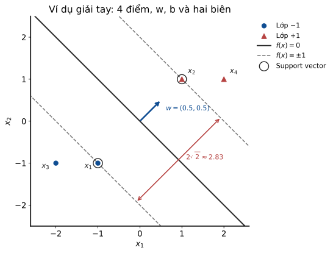

# 07 — Ví dụ giải tay có thể kiểm tra bằng máy

Ví dụ này được chọn để nghiệm tối ưu có dạng đơn giản, giúp kiểm tra cả Primal, Dual, KKT và SMO.

## 1. Dataset nhỏ

| $i$ | $x_i$ | $y_i$ |
|---|---|---:|
|---|---|---:|
| 1 | (-1, -1) | -1 |
| 2 | (1, 1) | +1 |
| 3 | (-2, -1) | -1 |
| 4 | (2, 1) | +1 |

Chọn `C=1`. Ta sẽ thấy hai điểm đầu là support vectors, hai điểm sau nằm ngoài margin.

## 2. Tìm w,b bằng hình học

Ranh giới đối xứng qua gốc nên chọn `b=0`. Hai điểm gần nhất phải chạm margin:

- Với `x_1=(-1,-1), y_1=-1`: `w_1+w_2 >= 1`.
- Với `x_2=(1,1), y_2=+1`: `w_1+w_2 >= 1`.

Bài toán rút gọn:

$$
\min_{w_1,w_2}\frac12(w_1^2+w_2^2)
\quad\text{s.t.}\quad w_1+w_2\geq1.
$$

Tại nghiệm tối ưu, ràng buộc active: `w1+w2=1`. Do đối xứng và tổng bình phương nhỏ nhất khi hai số bằng nhau:

$$
w_1=w_2=0.5,\qquad w=(0.5,0.5),\quad b=0.
$$

Có thể chứng minh bằng Lagrange: `L=0.5(w1²+w2²)+lambda(1-w1-w2)`. Đạo hàm cho `w1=lambda`, `w2=lambda`; kết hợp `w1+w2=1` được `lambda=0.5` và `w1=w2=0.5`.

## 3. Tính điểm và margin

$$
f(x)=0.5x_1+0.5x_2.
$$

| $i$ | $f(x_i)$ | $y_i f(x_i)$ | $\xi_i=\max(0,1-y_i f(x_i))$ |
|---|---:|---:|---:|
| 1 | -1.0 | 1.0 | 0 |
| 2 | 1.0 | 1.0 | 0 |
| 3 | -1.5 | 1.5 | 0 |
| 4 | 1.5 | 1.5 | 0 |

`||w||²=0.5`, do đó:

$$
P=\frac12\|w\|^2+C\sum_i\xi_i=0.25.
$$

Margin width:

$$
\frac{2}{\sqrt{0.5}}=2\sqrt2\approx2.8284.
$$

Hình dưới vẽ bốn điểm, ranh giới $f(x)=0$, hai biên $f(x)=\pm1$, hai support vector $x_1,x_2$ được khoanh tròn, vector $w$ và đúng độ rộng biên vừa tính ở trên.



*Hình 7.1: Ranh giới $f(x)=0$ (đường liền) và hai biên $f(x)=\pm1$ (nét đứt); $x_1,x_2$ khoanh tròn là support vector, mũi tên xanh là $w=(0.5,0.5)$, mũi tên đỏ có độ dài đúng bằng $2\sqrt2\approx2.8284$.*

## 4. Tìm alpha và kiểm tra Dual

Chỉ hai điểm đầu active nên đặt $\alpha_3=\alpha_4=0$. Ràng buộc equality:

$$
-\alpha_1+\alpha_2=0\Rightarrow\alpha_1=\alpha_2.
$$

Từ $w=\sum_i\alpha_i y_i x_i$:

$$
\begin{aligned}
w&=\alpha_1(-1)(-1,-1)+\alpha_2(+1)(1,1)\\
&=(\alpha_1+\alpha_2,\alpha_1+\alpha_2).
\end{aligned}
$$

Vì `w=(0.5,0.5)`, ta được $\alpha_1=\alpha_2=0.25$.

Alpha cuối cùng:

$$
\alpha=(0.25,0.25,0,0).
$$

Tính Dual objective:

$$
D=\sum_i\alpha_i-\frac12\|w\|^2=0.5-0.25=0.25.
$$

Vậy `P=D=0.25`, duality gap bằng 0 trong nghiệm giải tích này.

## 5. Kiểm tra KKT

- Primal feasibility: tất cả margin >= 1, slack = 0.
- Dual feasibility: alpha nằm trong [0,1] và $\sum_i\alpha_i y_i=0$.
- Stationarity: $w=\sum_i\alpha_i y_i x_i$; tổng alpha*y bằng 0.
- Complementarity: hai alpha dương tương ứng hai điểm có margin đúng 1; hai điểm margin 1.5 có alpha bằng 0. Tất cả $\xi=0$ nên `mu*xi=0`.

## 6. Chạy code đối chiếu

```bash
uv run python -m experiments.02_hand_example
```

File sẽ in nghiệm giải tích và nghiệm do SMO tự tìm. Sai khác rất nhỏ là bình thường do tolerance và sai số số học.

## 7. Câu hỏi để tự kiểm tra

1. Tại sao alpha của hai điểm ngoài margin bằng 0?
2. Nếu đổi C thành 0.1, nghiệm còn giống hệt không? Hãy thử chạy code.
3. Vì sao primal objective và dual objective có cùng giá trị ở nghiệm tối ưu?
