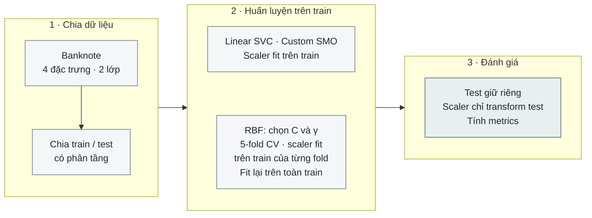

# 08 — Thực nghiệm Banknote Authentication và cách viết báo cáo

## 1. Dataset

Nguồn: [UCI Banknote Authentication](https://archive.ics.uci.edu/dataset/267/banknote+authentication).

Dữ liệu có 1.372 mẫu, bốn đặc trưng số và hai lớp. Các đặc trưng là thống kê được tính từ ảnh tiền giấy sau bước Wavelet Transform: variance, skewness, curtosis, entropy.

Project dùng `ucimlrepo` để tải lần đầu, sau đó cache CSV trong `data/banknote/`.

## 2. Pipeline chuẩn

Nguồn: [`diagrams/experiment_pipeline.mmd`](diagrams/experiment_pipeline.mmd).

## 3. Các script

| Script | Vai trò | Lệnh |
|---|---|---|
| `01_baseline_sklearn.py` | Baseline đáng tin cậy bằng SVC | `python -m experiments.01_baseline_sklearn` |
| `02_hand_example.py` | Đối chiếu giải tay và SMO | `python -m experiments.02_hand_example` |
| `03_custom_smo.py` | Tự cài SMO trên Banknote | `python -m experiments.03_custom_smo` |
| `04_compare_C_kernel.py` | Khảo sát Linear/RBF và C | `python -m experiments.04_compare_C_kernel` |
| `05_visualize_2d.py` | Vẽ boundary 2D trên hai feature đầu | `python -m experiments.05_visualize_2d` |
| `07_kernel_trick.py` | Ví dụ số về Gram matrix và score dự đoán | `python -m experiments.07_kernel_trick` |

## 4. Metrics cần trình bày

- **Accuracy:** tỷ lệ dự đoán đúng tổng thể.
- **Precision (+1):** trong các mẫu dự đoán +1, có bao nhiêu mẫu thật sự +1.
- **Recall (+1):** trong các mẫu thật sự +1, mô hình tìm được bao nhiêu.
- **F1 (+1):** trung bình điều hòa Precision và Recall.
- **Confusion Matrix:** xem loại nhầm lẫn nào xảy ra.

Trong code, lớp `+1` được dùng làm positive class để tính Precision/Recall/F1. Dataset được map nhãn tăng dần `[-1,+1]` từ nhãn gốc; cần ghi rõ trong báo cáo.

## 5. Thí nghiệm tối thiểu nên làm

### Thí nghiệm A — baseline Linear

- `StandardScaler + SVC(kernel='linear', C=1)`.
- Ghi Accuracy, Precision, Recall, F1, số support vectors.

### Thí nghiệm B — custom Linear SMO

- Cùng split, cùng scaler, cùng C.
- Ghi metrics, số support vectors, số pair updates, số vòng lặp, dual objective.
- So sánh custom với SVC. Không kỳ vọng code tự cài phải khớp tuyệt đối vì tiêu chí dừng và thuật toán working-set khác nhau.

### Thí nghiệm C — ảnh hưởng của C

Thử `C = 0.1, 1, 10`. Quan sát:

- Objective/regularization trade-off.
- Số support vectors.
- Precision/Recall/F1.
- Mức nhạy với các mẫu vi phạm margin.

### Thí nghiệm D — trực quan hóa ranh giới 2D

Chạy `python -m experiments.05_visualize_2d`. Script chỉ dùng hai feature đầu để tạo hình minh họa boundary, margin và support vectors. Đây không phải kết quả chính của mô hình bốn feature; hãy nêu rõ sự khác biệt trong báo cáo.

### Thí nghiệm E — Linear so với RBF

Giữ split cố định, chuẩn hóa dữ liệu, thử kernel Linear và RBF. Với RBF, gamma là siêu tham số; không chỉ thay kernel mà bỏ qua gamma.

## 6. Nguyên tắc đánh giá công bằng

- Dùng cùng random seed và train/test split để so sánh.
- Scaler chỉ fit trên train.
- Nếu cần chọn C/gamma, dùng cross-validation trên train. Không chọn siêu tham số dựa trên kết quả test.
- Sau khi chốt cấu hình, đánh giá test một lần.
- Nếu có thời gian, báo cáo mean ± standard deviation của cross-validation.

Script `04_compare_C_kernel.py` hiện là script khảo sát nhạy cảm đơn giản trên cùng test set. Không dùng bảng này để tuyên bố cấu hình tốt nhất tổng quát; báo cáo chính thức nên bổ sung GridSearchCV hoặc cross-validation.

## 7. Phần tối ưu hóa cần được báo cáo

Đây là môn Tối ưu hóa, do đó nên có các kết quả sau ngoài metrics phân loại:

1. Primal objective trên ví dụ giải tay.
2. Dual objective và kiểm tra ràng buộc $\sum_i\alpha_i y_i=0$, $0\le\alpha\le C$.
3. Duality gap trên ví dụ nhỏ.
4. Số support vectors.
5. Diễn biến dual objective qua các pass của SMO.
6. Số cập nhật alpha và tiêu chí dừng.
7. Phân tích vai trò C và kernel.

## 8. Đề cương báo cáo gợi ý

1. **Giới thiệu:** động cơ, mục tiêu, phạm vi nhị phân.
2. **Cơ sở toán:** hyperplane, margin, primal soft-margin, Lagrangian, dual, KKT.
3. **Thuật toán:** SMO, kernel, phân tích độ phức tạp ở mức tổng quan.
4. **Thiết kế thực nghiệm:** Banknote, tiền xử lý, split, metrics, cấu hình.
5. **Kết quả:** bảng SVC/custom, ảnh boundary (ví dụ 2D), confusion matrix, objective history.
6. **Thảo luận:** ảnh hưởng C/kernel, khác biệt giữa hai triển khai, giới hạn.
7. **Kết luận:** trả lời mục tiêu tối ưu hóa và hướng mở rộng.

## 9. Tránh các lỗi phổ biến

- Chỉ trình bày Accuracy mà không có mô hình toán.
- Gọi tất cả điểm gần đường phân chia là support vector mà không xem alpha/KKT.
- Nhầm $C$ với gamma.
- Tính scaler trên toàn dataset trước khi chia train/test.
- Gọi SMO là Gradient Descent thông thường.
- Khẳng định mọi điểm $\alpha=C$ đều bị phân loại sai.
- Dùng test set để chọn siêu tham số rồi vẫn xem đó là đánh giá khách quan.
