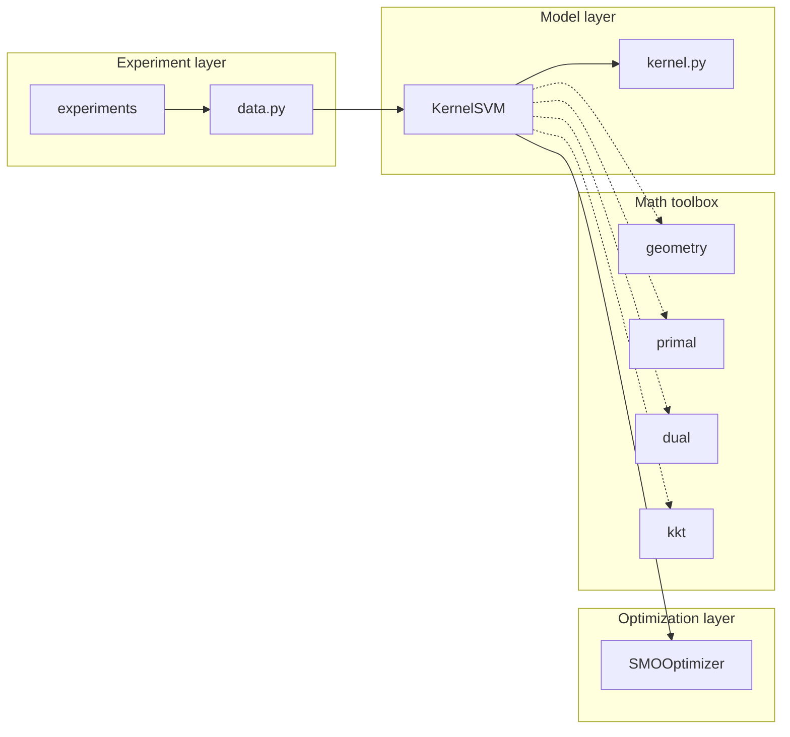
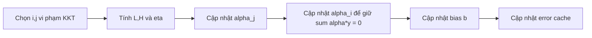

# 09 — Hướng dẫn đọc code theo từng module

Tài liệu này là bản đồ từ lý thuyết sang từng file Python. Đừng đọc project từ trên xuống dưới; hãy đọc theo luồng dữ liệu và toán học.

## 1. Sơ đồ luồng gọi hàm

## 2. Nhóm toán học: `src/svm_optimization/math/`

### `geometry.py`

**Nhiệm vụ:** công thức hình học độc lập với thuật toán huấn luyện.

- `decision_score(X,w,b)`: nhân ma trận `X @ w` rồi cộng bias.
- `predict_linear`: lấy dấu score.
- `vector_norm`: gọi chuẩn Euclid.
- `margin_width`: tính `2 / ||w||`.
- `point_to_hyperplane_distance`: tính khoảng cách có dấu tuyệt đối.

Đây là module nên đọc đầu tiên vì không có vòng lặp tối ưu phức tạp.

### `primal.py`

**Nhiệm vụ:** tính hàm mục tiêu và kiểm tra ràng buộc Primal.

- `hinge_losses`: mỗi phần tử là `max(0, 1-y_i*score_i)`.
- `soft_margin_objective`: cộng regularization và tổng hinge loss.
- `primal_constraints`: đo mức vi phạm margin/slack.

Thử thay score trong ví dụ `docs/02_primal_soft_margin.md` và quan sát loss tăng giảm.

### `dual.py`

**Nhiệm vụ:** làm việc trực tiếp với alpha.

- `dual_objective`: tính `sum(alpha) - 0.5 * (alpha*y)^T K (alpha*y)`.
- `dual_gradient`: gradient của Dual objective.
- `check_dual_feasibility`: kiểm tra cận alpha và equality constraint.

Hãy phân biệt `K` là ma trận kernel giữa mọi cặp mẫu, không phải ma trận nhãn.

### `kkt.py`

**Nhiệm vụ:** kiểm tra residual KKT và phân loại alpha.

- `kkt_report`: với Linear SVM, tính các residual từ `X,y,w,b,xi,alpha,C`.
- `alpha_roles`: phân nhóm alpha gần 0, ở giữa, gần C.

`residual` là độ lệch khỏi điều kiện; càng gần 0 càng tốt. Không phải mọi giá trị alpha đều phải đúng chính xác 0, C hoặc một số cố định do sai số tính toán.

## 3. Nhóm kernel và model: `src/svm_optimization/models/`

### `kernel.py`

**Nhiệm vụ:** trả về Gram matrix.

- Linear: `X @ Y.T`.
- RBF: khoảng cách bình phương từng cặp, rồi `exp(-gamma*distance²)`.

### `svm.py`

**Nhiệm vụ:** API mô hình mà người dùng gọi.

Luồng `fit(X,y)`:

1. Kiểm tra shape, NaN và nhãn `-1/+1`.
2. Tính gamma nếu dùng RBF.
3. Tạo Gram matrix train-train.
4. Gọi `SMOOptimizer.fit(K,y)`.
5. Lưu alpha, support vectors và bias.
6. Với Linear Kernel, tính `w = sum(alpha_i*y_i*x_i)`.

Luồng `decision_function(X)`:

1. Tính kernel giữa dữ liệu mới và dữ liệu train.
2. Nhân kernel với `alpha*y`.
3. Cộng bias.

Luồng `predict(X)` chỉ lấy dấu của decision score.

## 4. Nhóm tối ưu: `src/svm_optimization/optimization/smo.py`

Đây là module quan trọng và khó nhất. Nên đọc bằng cách đối chiếu từng khối với `docs/05_smo_walkthrough.md`.

| Khối code | Câu hỏi cần trả lời |
|---|---|
| Khởi tạo alpha/b/errors | Vì sao ban đầu error bằng `-y`? |
| `violates_kkt` | Điều kiện nào khiến mẫu cần update? |
| Tính L/H | Cận nào giữ alpha nằm trong [0,C]? |
| `eta` và `aj_new` | Đây là tối ưu một chiều theo alpha_j như thế nào? |
| `ai_new` | Làm sao giữ `sum(alpha*y)=0`? |
| `b1`, `b2` | Vì sao hai điểm cập nhật có thể đưa ra hai bias? |
| `errors += ...` | Vì sao có thể cập nhật cache thay vì tính lại mọi score? |
| Điều kiện dừng | Thuật toán dừng do không còn update hay do đạt max_iter? |

## 5. Dataset: `data.py`

`load_banknote()` tải UCI qua `ucimlrepo`, kiểm tra missing values, chuyển target thành -1/+1 và cache thành CSV.

Không dùng thông tin từ test set để chuẩn hóa. Việc chia dữ liệu và chuẩn hóa thuộc experiment script, không nhét vào hàm tải dữ liệu để có thể kiểm soát split rõ ràng.

## 6. Evaluation và Visualization

### `evaluation.py`

`evaluate_binary` trả dictionary gồm Accuracy, Precision, Recall, F1, confusion matrix và classification report. Positive class được đặt là +1.

### `visualization.py`

- `plot_2d_boundary`: chỉ dùng khi model đã train bằng đúng hai feature.
- `plot_confusion_matrix`: trực quan hóa nhầm lẫn.
- `plot_objective_history`: xem dual objective sau từng pass.

Không dùng plot 2D như bằng chứng thay thế kết quả trên đủ bốn feature. Đây chỉ là biểu diễn trực quan.

## 7. Đọc experiment theo mục tiêu

- `01_baseline_sklearn.py`: cách dùng chuẩn `Pipeline(StandardScaler(), SVC(...))`.
- `02_hand_example.py`: ví dụ nhỏ để kiểm tra công thức và SMO.
- `03_custom_smo.py`: luồng dữ liệu thực tế đi qua model tự cài.
- `04_compare_C_kernel.py`: khảo sát nhạy cảm theo C/kernel.
- `05_visualize_2d.py`: mô hình riêng trên hai feature đầu để vẽ ranh giới trực quan.

## 8. Thứ tự đọc code được khuyên dùng

## 9. Bài tập code nhỏ

1. Sửa `C=1` thành `C=0.1` trong ví dụ 4 điểm. Alpha thay đổi thế nào?
2. Thêm một điểm gần biên vào ví dụ nhỏ và xem support vectors thay đổi.
3. Thử Linear và RBF trên XOR trong `tests/test_smo.py`.
4. Thêm một dòng print `np.dot(alpha, y)` sau fit để kiểm tra equality constraint.
5. Thêm test để xác nhận tất cả alpha nằm trong `[0,C]`.
