# Nội dung bổ sung của báo cáo Word

Mỗi mục `## Trước: <tiêu đề>` (hoặc `## Sau: <tiêu đề>`) được `scripts/generate_docx.py` chèn ngay trước (hoặc ngay sau) tiêu đề đó của bản nền, theo đúng thứ tự trong file. Hỗ trợ: đoạn văn (với `$toán$`, `` `code` ``, `**đậm**`), công thức khối `$$…$$`, hình `{width=4.6}` (đường dẫn tương đối với file này, chú thích lấy từ docs hoặc `figure_captions.md`), bảng Markdown có dòng `*Bảng: chú thích*` ngay phía trên, và khối code.

## Trước: Kết luận chương 1

Lộ trình của project đi từ hình học SVM, bài toán primal và dual đến điều kiện KKT, thuật toán SMO và đánh giá trên Banknote Authentication.

{width=6.1}

## Trước: Vai trò của các Vector hỗ trợ (Support Vectors)

Một ví dụ một chiều cho thấy vì sao ranh giới có lề lớn nhất cũng là ranh giới "công bằng" nhất [5]. Giả sử điểm gần nhất của lớp $-1$ nằm tại $x = -1$ và điểm gần nhất của lớp $+1$ nằm tại $x = 3$. Đặt ranh giới tại vị trí $t$ thì khoảng an toàn còn lại của lớp $-1$ là $t + 1$, của lớp $+1$ là $3 - t$.

*Bảng: Khoảng an toàn của hai lớp theo vị trí ranh giới trong ví dụ một chiều.*
| $t$ | an toàn lớp $-1$ | an toàn lớp $+1$ | an toàn nhỏ nhất |
|---|---:|---:|---:|
| $-0.5$ | $0.5$ | $3.5$ | $0.5$ |
| $1$ | $2$ | $2$ | $2$ |
| $2$ | $3$ | $1$ | $1$ |

Khoảng an toàn nhỏ nhất đạt giá trị lớn nhất tại $t = 1$, đúng trung điểm của hai điểm gần nhất. Dịch ranh giới về phía lớp nào thì lớp đó mất bớt khoảng an toàn, nên ranh giới cách đều vừa không thiên vị lớp nào vừa cho lề lớn nhất.

Trong không gian hai chiều, ngoài vị trí còn phải chọn hướng của ranh giới. Bên trái hình sau giữ nguyên hướng pháp tuyến và trượt ranh giới qua ba vị trí A, B, C: khoảng an toàn nhỏ nhất lớn nhất tại B, đường cách đều hai điểm gần nhất của hai lớp. Bên phải đổi sang một hướng pháp tuyến khác; hướng này vẫn phân loại đúng nhưng lề chỉ còn $1.92$, nhỏ hơn lề $2.83$ của đường B.

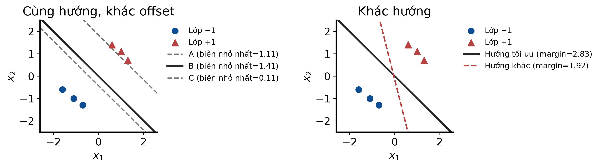{width=6.2}

## Trước: Máy vector hỗ trợ lề cứng (Hard Margin SVM)

Hình sau là một ví dụ hai chiều tổng hợp: các điểm khoanh tròn nằm đúng trên hai biên và là các điểm hỗ trợ.

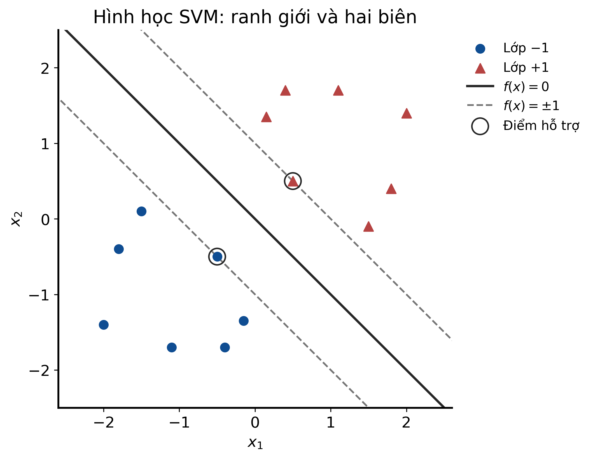{width=5.2}

Các đại lượng hình học trên được cài đặt trong module `geometry.py` của project. Đoạn code sau tính điểm quyết định của hai điểm nằm trên hai biên và độ rộng lề $2/\|w\|$ với $w = [0.5, 0.5]^T$, $b = 0$:

```python
import numpy as np
from svm_optimization.math.geometry import margin_width, decision_score

w = np.array([0.5, 0.5])
X = np.array([[-1., -1.], [1., 1.]])
print(decision_score(X, w, 0.0))  # [-1., 1.]
print(margin_width(w))            # 2.828427...
```

## Trước: Máy vector hỗ trợ lề mềm (Soft Margin SVM)

Bài toán lề cứng ở trên có thể suy ra trực tiếp từ yêu cầu lề lớn nhất qua ba bước [5]. Từ đây, các phần bổ sung dùng quy ước hàm quyết định $f(x) = w^T x + b$ như trong code; quy ước này tương đương $w^T x - b$ của bản nền khi đổi dấu bias.

Bước thứ nhất là đo khoảng cách. Trong mặt phẳng, khoảng cách từ điểm $(x_1, x_2)$ tới đường thẳng $w_1 x_1 + w_2 x_2 + b = 0$ bằng $|w_1 x_1 + w_2 x_2 + b|$ chia cho $\sqrt{w_1^2 + w_2^2}$. Mẫu số chính là $\|w\|$, nên công thức giữ nguyên dạng trong không gian $d$ chiều:

$$d(x_i, H) = \frac{|w^T x_i + b|}{\|w\|}$$

Khi siêu phẳng phân loại đúng mẫu $x_i$, dấu của $w^T x_i + b$ trùng với nhãn: dương nếu $y_i = +1$, âm nếu $y_i = -1$. Trong cả hai trường hợp, tích $y_i(w^T x_i + b)$ không âm và bằng đúng giá trị tuyệt đối, nên có thể bỏ dấu trị tuyệt đối:

$$d(x_i, H) = \frac{y_i(w^T x_i + b)}{\|w\|}$$

Bước thứ hai là phát biểu mục tiêu. Lề của một siêu phẳng do điểm gần nó nhất quyết định, nên siêu phẳng tốt nhất là siêu phẳng làm khoảng cách nhỏ nhất ấy lớn nhất:

$$\max_{w, b} \min_{i} \frac{y_i(w^T x_i + b)}{\|w\|}$$

Bước thứ ba là khử bậc tự do thừa. Nhân $w$ và $b$ với cùng một số $k > 0$ không làm siêu phẳng dịch đi, nên mọi khoảng cách giữ nguyên. Ta được quyền chọn $k$ sao cho điểm gần nhất có $y_i(w^T x_i + b) = 1$; khi đó mọi điểm khác có tử số ít nhất bằng 1, và bài toán max–min trở thành cực đại $1/\|w\|$ với ràng buộc $y_i(w^T x_i + b) \geq 1$ cho mọi $i$. Cực đại $1/\|w\|$ cũng là cực tiểu $\|w\|$, và để đạo hàm gọn người ta thay bằng $\frac{1}{2}\|w\|^2$, đúng là bài toán lề cứng đã phát biểu. Hàm mục tiêu bậc hai lồi và các ràng buộc tuyến tính nên đây là một bài toán quy hoạch bậc hai lồi.

## Trước: Vai trò của biến bù và tham số điều chuẩn C

Chỉ một điểm ngoại lai nằm lẫn vào phía lớp đối diện cũng có thể buộc lề cứng chọn một ranh giới rất lệch, với lề gần bằng 0 [5]. Hình sau dùng hai cụm tổng hợp cách xa nhau, cộng thêm một điểm nhãn $-1$ nằm sâu trong cụm $+1$. Lề cứng phải nghiêng sát điểm ngoại lai để vẫn phân loại đúng mọi điểm, nên lề chỉ còn $0.095$. Lề mềm cho phép điểm đó vi phạm; $C$ càng lớn thì mô hình càng ít chấp nhận vi phạm và lề càng co lại: $3.43$ với $C = 0.1$, $2.80$ với $C = 1$, $0.21$ với $C = 100$.

{width=6.2}

## Trước: Mối liên hệ với hàm mất mát Bản lề (Hinge Loss)

Ảnh hưởng của $C$ có thể kiểm tra trực tiếp bằng `SVC` của scikit-learn trên bốn điểm $(-1, -1)$, $(-2, -1)$ thuộc lớp $-1$ và $(1, 1)$, $(2, 1)$ thuộc lớp $+1$ (cũng là ví dụ giải tay ở chương 4). Với $C = 1$ và $C = 10$, nghiệm trùng với nghiệm lề cứng có lề $2\sqrt{2} \approx 2.83$ và hai vector hỗ trợ; với $C = 0.1$, phạt vi phạm đủ nhẹ để mô hình nới lề lên $4.39$ và cả bốn điểm đều trở thành vector hỗ trợ. Điều này khớp với lập luận về hàm mục tiêu: khi $C$ đủ lớn, phần phạt $C\sum_i \xi_i$ lấn át phần $\frac{1}{2}\|w\|^2$, nên với dữ liệu tách được, nghiệm tối ưu có mọi $\xi_i = 0$ và lề mềm trùng với lề cứng [5].

```python
from sklearn.svm import SVC
import numpy as np

X = np.array([[-1., -1.], [1., 1.], [-2., -1.], [2., 1.]])
y = np.array([-1, 1, -1, 1])
for C in [0.1, 1, 10]:
    clf = SVC(kernel='linear', C=C).fit(X, y)
    margin = 2 / np.linalg.norm(clf.coef_)
    print(f'C={C}: margin={margin:.4f}, n_sv={len(clf.support_)}')
# C=0.1: margin=4.3853, n_sv=4
# C=1: margin=2.8284, n_sv=2
# C=10: margin=2.8284, n_sv=2
```

## Trước: Phương pháp nhân tử Lagrange và bài toán đối ngẫu

Hình sau minh họa biến bù: điểm nhãn $+1$ vẫn ở đúng phía ranh giới nhưng lọt vào vùng lề, nên cần một biến bù dương để ràng buộc lề mềm được thỏa.

{width=4.6}

Vị trí của một điểm so với lề quyết định biến bù $\xi_i$ rơi vào đúng một trong ba trường hợp sau [5].

*Bảng: Ba trường hợp của biến bù theo margin có dấu.*
| Điều kiện trên $y_i f(x_i)$ | $\xi_i$ | Ý nghĩa |
|---|---|---|
| $y_i f(x_i) \geq 1$ | $\xi_i = 0$ | nằm ngoài hoặc đúng trên lề |
| $0 \leq y_i f(x_i) < 1$ | $0 < \xi_i \leq 1$ | nằm trong lề, vẫn đúng phía |
| $y_i f(x_i) < 0$ | $\xi_i > 1$ | phân loại sai |

Ví dụ, điểm có $y = +1$ và $f(x) = 0.6$ nằm ở hàng giữa nên $\xi = 1 - 0.6 = 0.4$; điểm có $y = -1$ và $f(x) = -1.4$ nằm ngoài lề nên $\xi = 0$; điểm có $y = +1$ nhưng $f(x) = -0.2$ bị phân loại sai nên $\xi = 1.2$. Hình sau đặt ba điểm A, B, C ứng với ba ví dụ này lên cùng ranh giới $f(x) = x_1 + x_2$. Đoạn nối mỗi điểm vi phạm với biên của lớp nó dài đúng $\xi_i/\|w\|$, nên $\xi_i$ chính là khoảng cách từ điểm tới biên, đo theo đơn vị $1/\|w\|$. Điểm B ở ngoài biên của lớp mình nên không có đoạn nối.

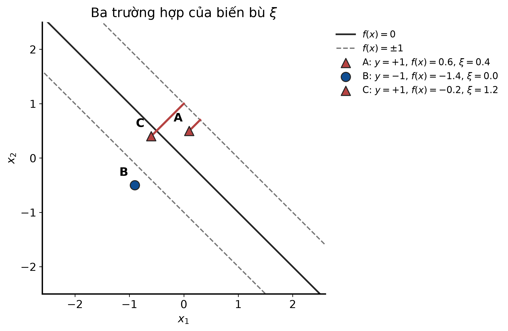{width=5.2}

Hàm `hinge_losses` trong module `primal.py` cho đúng ba giá trị này:

```python
import numpy as np
from svm_optimization.math.primal import hinge_losses

y = np.array([1, -1, 1])
scores = np.array([0.6, -1.4, -0.2])
print(hinge_losses(y, scores))  # [0.4, 0.0, 1.2]
```

Để thấy vì sao SVM dùng hinge loss, có thể so sánh nó với logistic loss của hồi quy logistic, xét riêng từng lớp theo điểm số $f(x)$ [5]. Với mẫu $y = +1$, logistic loss $\log(1 + e^{-f(x)})$, chia cho $\log 2$ để bằng $1$ tại $f(x) = 0$, giảm dần khi $f(x)$ tăng nhưng không bao giờ bằng $0$. Với mẫu $y = -1$, đồ thị lật ngược lại. Hinge loss giữ phần dốc đó nhưng cắt phẳng về $0$ ngay khi mẫu vượt qua biên của lớp mình: $f(x) \geq 1$ với $y = +1$ và $f(x) \leq -1$ với $y = -1$.

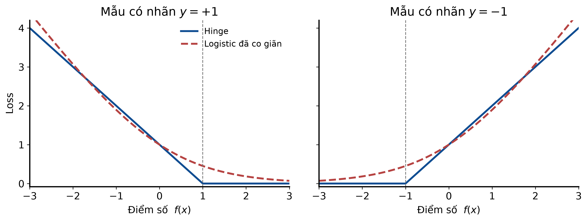{width=6.2}

Hệ quả là một mẫu đã nằm đúng phía và ngoài biên không còn đóng góp gì vào hinge loss; dời mẫu đó đi xa hơn cũng không làm đổi nghiệm. Chỉ những mẫu nằm gần ranh giới hoặc vi phạm biên mới quyết định ranh giới, và đó chính là các vector hỗ trợ. Với logistic loss thì mọi mẫu, kể cả mẫu rất dễ, đều kéo ranh giới một chút.

Hai đồ thị trên là ảnh gương của nhau. Thay $f(x)$ bằng margin có dấu $z = y f(x)$ thì hai lớp gộp thành một đường duy nhất: hinge loss bằng đúng $0$ khi $z \geq 1$, còn logistic loss luôn dương và chỉ giảm chậm dần.

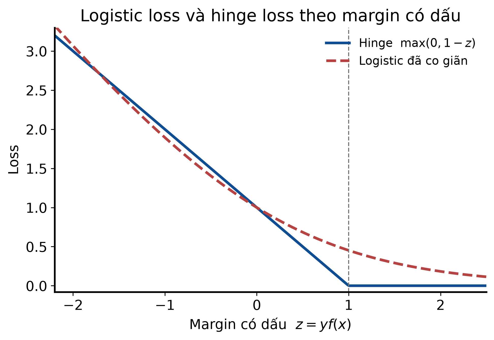{width=4.6}

```python
import numpy as np

def hinge(z):
    return np.maximum(0, 1 - z)

def logistic_scaled(z):  # co giãn để bằng 1 tại z=0 như hinge
    return np.log1p(np.exp(-z)) / np.log(2)

for z in [-2, -1, 0, 1, 2]:
    print(f'{z:2d} {hinge(z):.1f} {logistic_scaled(z):.4f}')
# -2 3.0 3.0685
# -1 2.0 1.8946
#  0 1.0 1.0000
#  1 0.0 0.4519
#  2 0.0 0.1831
```

{width=4.6}

Chia hàm mục tiêu cho $C$ được dạng quen thuộc của học máy có điều chuẩn: tổng hinge loss trên dữ liệu cộng một thành phần phạt độ lớn của $w$ [5]:

$$\sum_{i=1}^{n} \max(0, 1 - y_i f(x_i)) + \frac{\lambda}{2}\|w\|^2, \quad \lambda = \frac{1}{C}$$

So với hồi quy logistic có điều chuẩn L2, SVM chỉ thay logistic loss bằng hinge loss; thành phần điều chuẩn vẫn giữ vai trò kìm độ lớn của $w$. Tăng $\lambda$, tức giảm $C$, làm $w$ nhỏ lại, lề rộng ra và ranh giới bớt bám theo từng điểm, nên giảm $C$ là cách đầu tiên nên thử khi mô hình quá khớp.

## Trước: Ý nghĩa của việc chuyển đổi sang bài toán đối ngẫu

Trước khi áp dụng cho SVM, xét một bài toán quy hoạch bậc hai rất nhỏ để thấy nhân tử Lagrange hoạt động thế nào:

$$\min_{x,y} x^2 + 2y^2 \text{ sao cho } x + y = 3$$

Đưa ràng buộc vào hàm mục tiêu qua một nhân tử $\lambda$:

$$L(x, y, \lambda) = x^2 + 2y^2 - \lambda (x + y - 3)$$

Cho các đạo hàm riêng bằng 0 được $2x - \lambda = 0$ và $4y - \lambda = 0$, tức $x = \lambda/2$ và $y = \lambda/4$. Thay vào ràng buộc được $\lambda = 4$, do đó $x = 2$, $y = 1$ và giá trị nhỏ nhất của mục tiêu bằng $6$. Bài toán SVM lặp lại đúng cơ chế này, chỉ khác là có nhiều biến hơn và các ràng buộc là bất đẳng thức nên các nhân tử $\alpha_i$, $\mu_i$ phải không âm [5].

Tổng quát, xét bài toán cực tiểu $f(x)$ với các ràng buộc đẳng thức $h_i(x) = 0$ và bất đẳng thức $g_j(x) \leq 0$. Hàm Lagrange gắn mỗi ràng buộc với một nhân tử:

$$L(x, \lambda, \nu) = f(x) + \sum_i \lambda_i h_i(x) + \sum_j \nu_j g_j(x)$$

Khi $\nu_j \geq 0$, tại mọi điểm khả thi phần cộng thêm không dương nên $L$ không vượt quá $f$. Vì vậy giá trị nhỏ nhất của $L$ theo $x$, ký hiệu $q(\lambda, \nu)$, luôn là một cận dưới của giá trị tối ưu gốc [5]. Bài toán đối ngẫu tìm cận dưới tốt nhất, tức cực đại $q(\lambda, \nu)$ với $\nu \geq 0$. Hàm $q$ luôn lõm, kể cả khi $f$ không lồi, vì nó là cực tiểu của một họ hàm tuyến tính theo $(\lambda, \nu)$. Khi giá trị tối ưu của hai bài toán bằng nhau, ta nói có đối ngẫu mạnh (strong duality), và giải bài toán nào cũng cho cùng một giá trị.

SVM thuộc lớp quy hoạch bậc hai (QP): cực tiểu $\frac{1}{2}x^T A x + c^T x + r$ với các ràng buộc tuyến tính $Hx = d$ và $Gx \leq e$. Ma trận Hessian của hàm mục tiêu là $A$, nên nếu $A$ nửa xác định dương ($x^T A x \geq 0$ với mọi $x$) thì hàm mục tiêu lồi. Nếu thêm vào đó tồn tại một điểm thỏa mọi đẳng thức và thỏa chặt mọi bất đẳng thức (điều kiện Slater), thì đối ngẫu mạnh xảy ra và các điều kiện KKT vừa cần vừa đủ cho nghiệm tối ưu [5]. Với lề mềm, $A$ là ma trận đơn vị trên phần $w$ và bằng 0 trên $b$, $\xi$ nên nửa xác định dương; chọn các $\xi_i$ đủ lớn là thỏa chặt mọi ràng buộc, nên điều kiện Slater luôn đúng.

Một bài QP nhỏ đôi khi giải được chỉ bằng cách gom bình phương [5]. Xét

$$\min_{x, y} 2x^2 + 2xy + y^2 + 2x + 2y + 1 \text{ sao cho } x + y \geq 2, x \geq 1$$

Hàm mục tiêu viết lại được thành $(x + y + 1)^2 + x^2$. Trên miền ràng buộc có $x + y + 1 \geq 3$ và $x \geq 1$, nên giá trị không nhỏ hơn $3^2 + 1^2 = 10$, đạt tại $x = y = 1$; `scipy.optimize.minimize` cho cùng nghiệm. Ở dạng tổng quát, $A$ có hai hàng $(4, 2)$ và $(2, 2)$ với hai trị riêng dương nên hàm mục tiêu lồi, và điểm $(2, 2)$ thỏa chặt cả hai ràng buộc nên điều kiện Slater đúng. Mẹo gom bình phương hiếm khi áp dụng được; với bài toán lớn như SVM phải dựa vào điều kiện KKT.

Khi chỉ có ràng buộc đẳng thức, điều kiện KKT là một hệ phương trình tuyến tính: đạo hàm của $L$ theo $x$ bằng 0 cho $Ax + H^T \lambda = -c$, còn ràng buộc cho $Hx = d$. Ghép lại thành

$$\begin{bmatrix} A & H^T \\ H & 0 \end{bmatrix} \begin{bmatrix} x \\ \lambda \end{bmatrix} = \begin{bmatrix} -c \\ d \end{bmatrix}$$

Bài QP đầu mục có $A = \mathrm{diag}(2, 4)$, $c = 0$, $H = [1, 1]$ và $d = 3$. Giải hệ ba phương trình này được lại $x = 2$, $y = 1$; nhân tử ra $-4$ thay vì $4$ chỉ vì ở đây ràng buộc được cộng vào $L$ thay vì trừ đi.

```python
import numpy as np

K = np.array([[2., 0., 1.], [0., 4., 1.], [1., 1., 0.]])
print(np.linalg.solve(K, [0., 0., 3.]))  # [ 2.  1. -4.]
```

## Trước: Điều kiện tối ưu KKT (Karush-Kuhn-Tucker) và tính thưa thớt của nghiệm

Áp dụng cho SVM lề mềm: mỗi ràng buộc $y_i(w^T x_i + b) \geq 1 - \xi_i$ được gắn một nhân tử $\alpha_i \geq 0$, mỗi ràng buộc $\xi_i \geq 0$ được gắn một nhân tử $\mu_i \geq 0$. Vì các ràng buộc có dạng "lớn hơn hoặc bằng", chúng được trừ đi trong hàm Lagrange:

$$L(w, b, \xi, \alpha, \mu) = \frac{1}{2}\|w\|^2 + C\sum_i \xi_i - \sum_i \alpha_i [y_i(w^T x_i + b) - 1 + \xi_i] - \sum_i \mu_i \xi_i$$

Cho các đạo hàm riêng của $L$ theo $w$, $b$ và từng $\xi_i$ bằng 0 được ba hệ thức:

$$w = \sum_i \alpha_i y_i x_i, \quad \sum_i \alpha_i y_i = 0, \quad C - \alpha_i - \mu_i = 0$$

Hệ thức đầu cho thấy $w$ là tổ hợp tuyến tính của các điểm dữ liệu, với trọng số $\alpha_i y_i$. Hệ thức cuối kết hợp với $\mu_i \geq 0$ cho $\alpha_i \leq C$, nên $C$ chính là trần của mỗi nhân tử [5].

Thay ba hệ thức này trở lại $L$ để khử các biến gốc. Các số hạng chứa $\xi_i$ gom lại thành $\sum_i (C - \alpha_i - \mu_i)\xi_i = 0$. Số hạng chứa $b$ là $-b\sum_i \alpha_i y_i = 0$. Số hạng $-\sum_i \alpha_i y_i w^T x_i$ bằng $-w^T w = -\|w\|^2$, cộng với $\frac{1}{2}\|w\|^2$ còn lại $-\frac{1}{2}\|w\|^2$. Viết $\|w\|^2$ theo các $\alpha$ được hàm đối ngẫu chỉ còn biến $\alpha$:

$$q(\alpha) = \sum_i \alpha_i - \frac{1}{2}\sum_i \sum_j \alpha_i \alpha_j y_i y_j x_i^T x_j$$

Bài toán đối ngẫu là cực đại $q(\alpha)$ với $\sum_i \alpha_i y_i = 0$ và $0 \leq \alpha_i \leq C$. Biến $\xi$ và $\mu$ đã biến mất, ràng buộc chỉ còn dạng hộp cùng một đẳng thức, và dữ liệu chỉ xuất hiện qua tích vô hướng $x_i^T x_j$. Chính điểm cuối này cho phép thay tích vô hướng bằng hàm hạt nhân ở chương 3.

Hình sau tóm tắt lại chuỗi suy diễn vừa trình bày.

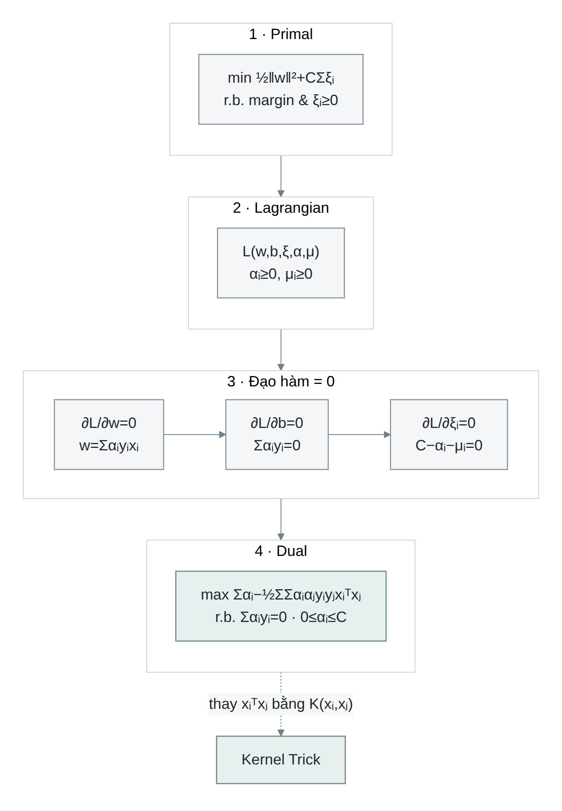{width=4.2}

## Trước: Kết luận chương 2

Nghiệm tối ưu của SVM thỏa bốn nhóm điều kiện KKT [5]. Thứ nhất, khả thi của bài toán gốc: mọi ràng buộc $y_i(w^T x_i + b) \geq 1 - \xi_i$ và $\xi_i \geq 0$ đều đúng. Thứ hai, khả thi của bài toán đối ngẫu: $\alpha_i \geq 0$ và $\mu_i \geq 0$, đúng điều kiện để hàm Lagrange là cận dưới. Thứ ba, điều kiện dừng: các đạo hàm riêng của $L$ bằng 0, chính là ba hệ thức ở trên. Thứ tư, điều kiện bù:

$$\alpha_i [y_i(w^T x_i + b) - 1 + \xi_i] = 0, \quad \mu_i \xi_i = 0$$

Điều kiện bù nói rằng với mỗi ràng buộc, hoặc nhân tử bằng 0, hoặc ràng buộc xảy ra dấu bằng. Kết hợp với $\mu_i = C - \alpha_i$, giá trị của $\alpha_i$ cho biết vị trí của điểm. Nếu $\alpha_i = 0$ thì $\mu_i = C > 0$, kéo theo $\xi_i = 0$ và $y_i f(x_i) \geq 1$: điểm nằm ngoài hoặc trên lề và không đóng góp vào $w$. Nếu $0 < \alpha_i < C$ thì $\mu_i > 0$ nên $\xi_i = 0$, đồng thời ràng buộc thứ nhất xảy ra dấu bằng, tức $y_i f(x_i) = 1$: điểm nằm đúng trên lề. Nếu $\alpha_i = C$ thì $\mu_i = 0$ nên $\xi_i$ được phép dương: điểm nằm trên lề, trong lề hoặc bị phân loại sai. Hai trường hợp sau là các vector hỗ trợ.

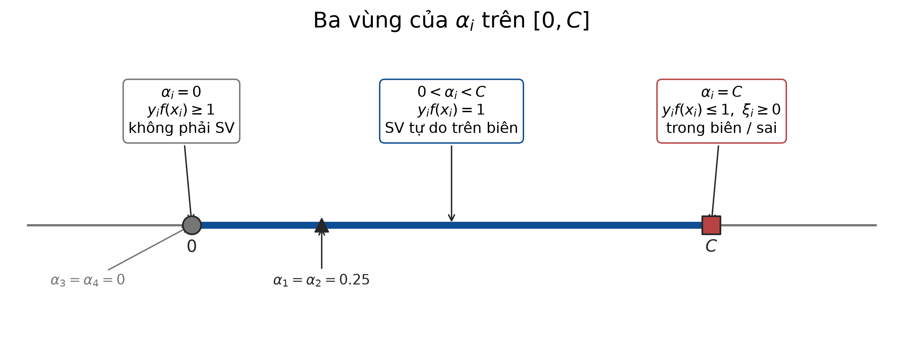{width=5.6}

Khi đã có $\alpha$, vector $w$ tính được từ hệ thức dừng, và chỉ các vector hỗ trợ góp phần vào tổng. Để tìm $b$, lấy một điểm $x_i$ nằm đúng trên lề ($0 < \alpha_i < C$): từ $y_i(w^T x_i + b) = 1$ và $y_i^2 = 1$ suy ra $b = y_i - w^T x_i$. Để giảm sai số số học, người ta lấy trung bình trên tập $M$ các điểm như vậy:

$$b = \frac{1}{|M|}\sum_{i \in M} (y_i - w^T x_i)$$

Dự đoán cho điểm mới $x$ theo dấu của $f(x) = \sum_{i \in S} \alpha_i y_i x_i^T x + b$, trong đó $S$ là tập vector hỗ trợ. Mô hình chỉ cần giữ lại các vector hỗ trợ; đó là tính thưa thớt của nghiệm.

Ví dụ với bốn điểm $(-1, -1)$, $(1, 1)$, $(-2, -1)$, $(2, 1)$ có nhãn $-1, 1, -1, 1$. Giải bài toán đối ngẫu được $\alpha_1 = \alpha_2 = 0.25$ và $\alpha_3 = \alpha_4 = 0$, nên chỉ hai điểm đầu là vector hỗ trợ. Từ đó $w = 0.25(1, 1) + 0.25(1, 1) = (0.5, 0.5)$ và $b = 1 - w^T(1, 1) = 0$. Giá trị đối ngẫu bằng $0.5 - 0.25 = 0.25$, đúng bằng giá trị gốc $\frac{1}{2}\|w\|^2 = 0.25$, minh họa đối ngẫu mạnh. Đoạn code sau lấy $\alpha$ từ scikit-learn rồi dựng lại $w$, $b$ theo đúng các công thức trên.

```python
import numpy as np
from sklearn.svm import SVC

X = np.array([[-1., -1.], [1., 1.], [-2., -1.], [2., 1.]])
y = np.array([-1, 1, -1, 1])
clf = SVC(kernel='linear', C=10).fit(X, y)
alpha_y = clf.dual_coef_[0]  # alpha_i * y_i của các vector hỗ trợ
sv = clf.support_vectors_
w = alpha_y @ sv
b = np.mean(y[clf.support_] - sv @ w)
print(clf.support_, np.abs(alpha_y))  # [0 1] [0.25 0.25]
print(w, b)                           # [0.5 0.5] 0.0
```

## Trước: Thủ thuật hạt nhân (Kernel Trick) và Điều kiện Mercer

Sau khi ánh xạ, mô hình vẫn tuyến tính, nhưng tuyến tính theo các đặc trưng mới $\phi_1(x), \dots, \phi_D(x)$ [5]:

$$f(x) = w^T \phi(x) + b = b + \sum_{k=1}^{D} w_k \phi_k(x)$$

Cái giá nằm ở số chiều $D$. Nếu $\phi(x)$ gồm mọi đơn thức bậc không quá 3 của $n$ đặc trưng gốc thì $D = (n+1)(n+2)(n+3)/6$. Với $n = 4$ như Banknote, $D = 35$ vẫn nhỏ; nhưng với $n = 100$ thì $D = 176851$, và mỗi mẫu phải được biến đổi, lưu trữ và nhân với ngần ấy trọng số. Đoạn code sau đếm $D$ bằng `PolynomialFeatures`.

```python
import numpy as np
from sklearn.preprocessing import PolynomialFeatures

for n in [2, 4, 10, 100]:
    poly = PolynomialFeatures(degree=3).fit(np.zeros((1, n)))
    print(n, 'đặc trưng gốc ->', poly.n_output_features_)
# 2 đặc trưng gốc -> 10
# 4 đặc trưng gốc -> 35
# 10 đặc trưng gốc -> 286
# 100 đặc trưng gốc -> 176851
```

Lưu ý rằng trong bài toán đối ngẫu ở chương 2, dữ liệu chỉ xuất hiện qua các tích vô hướng $x_i^T x_j$. Sau khi ánh xạ, chúng trở thành $\phi(x_i)^T \phi(x_j)$, nên chỉ cần một cách tính thẳng con số này mà không dựng $\phi$.

## Trước: Điều kiện Mercer đảm bảo tính lồi và nghiệm tối ưu toàn cục

Trong project, module `kernel.py` tính ma trận kernel giữa hai tập mẫu; phần tử $K_{ij}$ so sánh mẫu thứ $i$ của tập thứ nhất với mẫu thứ $j$ của tập thứ hai. Kernel tuyến tính trả về tích vô hướng, kernel RBF trả về $\exp(-\gamma \|x_i - z_j\|^2)$:

```python
import numpy as np
from svm_optimization.models.kernel import linear_kernel, rbf_kernel

X = np.array([[0., 0.], [1., 1.]])
Z = np.array([[0., 1.], [1., 0.], [2., 2.]])
K_linear = linear_kernel(X, Z)
K_rbf = rbf_kernel(X, Z, gamma=0.5)
print(K_linear)
# [[0. 0. 0.]
#  [1. 1. 4.]]
print(K_rbf.round(4))
# [[0.6065 0.6065 0.0183]
#  [0.6065 0.6065 0.3679]]
```

Với kernel, hàm quyết định là

$$f(x) = \sum_i \alpha_i y_i K(x_i, x) + b$$

Vì $\alpha_i = 0$ với mọi điểm không phải vector hỗ trợ, tổng này chỉ chạy trên các vector hỗ trợ: mô hình đã huấn luyện chỉ cần giữ các vector hỗ trợ, hệ số $\alpha_i y_i$ của chúng và $b$. Đoạn code sau tự tính hàm quyết định từ các thành phần mà `SVC` lưu lại (`dual_coef_` chứa sẵn $\alpha_i y_i$) rồi so với `decision_function`:

```python
import numpy as np
from sklearn.datasets import make_moons
from sklearn.svm import SVC
from svm_optimization.models.kernel import rbf_kernel

X, y = make_moons(n_samples=200, noise=0.25, random_state=0)
clf = SVC(kernel='rbf', gamma=1.0, C=1).fit(X, y)
x_new = np.array([[0.5, 0.25]])
K = rbf_kernel(clf.support_vectors_, x_new, gamma=1.0)
f = clf.dual_coef_ @ K + clf.intercept_
print(len(clf.support_), 'support vector trên', len(X), 'mẫu')
print(f.ravel().round(4), clf.decision_function(x_new).round(4))
# 63 support vector trên 200 mẫu
# [-0.1022] [-0.1022]
```

Chỉ 63 trong 200 mẫu tham gia vào dự đoán, và kết quả tự tính trùng với `decision_function`.

## Trước: Phân tích các hàm hạt nhân phổ biến

Điều kiện nửa xác định dương xuất hiện một cách tự nhiên. Nếu $K(x, z) = \phi(x)^T \phi(z)$ thì với mọi bộ hệ số $c_1, \dots, c_n$,

$$\sum_{i=1}^{n} \sum_{j=1}^{n} c_i c_j K(x_i, x_j) = \left\| \sum_{i=1}^{n} c_i \phi(x_i) \right\|^2 \geq 0$$

tức ma trận Gram với phần tử $K(x_i, x_j)$ luôn nửa xác định dương, mọi giá trị riêng đều không âm [5]. Định lý Mercer khẳng định chiều ngược lại: một hàm đối xứng cho ma trận Gram nửa xác định dương trên mọi tập điểm thì là tích vô hướng trong một không gian đặc trưng nào đó, kể cả khi ta không viết được $\phi$. Khi đó ma trận $y_i y_j K(x_i, x_j)$ trong bài toán đối ngẫu cũng nửa xác định dương, hàm mục tiêu đối ngẫu là hàm lõm, và bài toán vẫn là quy hoạch toàn phương lồi với nghiệm tối ưu toàn cục.

Có thể kiểm tra điều này bằng số. Trên 200 điểm `make_moons`, giá trị riêng nhỏ nhất của ma trận Gram RBF chỉ cỡ $10^{-15}$, tức bằng 0 sai khác làm tròn. Kernel sigmoid với $\gamma = 1$, $r = 1$ cho giá trị riêng nhỏ nhất khoảng $-23$, nên với dữ liệu này nó không phải kernel Mercer và bài toán đối ngẫu không còn lồi.

```python
import numpy as np
from sklearn.datasets import make_moons
from sklearn.metrics.pairwise import rbf_kernel, sigmoid_kernel

X, _ = make_moons(n_samples=200, noise=0.25, random_state=0)
grams = {'rbf': rbf_kernel(X, gamma=1.0),
         'sigmoid': sigmoid_kernel(X, gamma=1.0, coef0=1.0)}
for name, K in grams.items():
    print(name, f'{np.linalg.eigvalsh(K).min():.1e}')
# rbf -2.7e-15
# sigmoid -2.3e+01
```

## Trước: Hạt nhân hàm cơ sở xuyên tâm (RBF / Gaussian Kernel) và vai trò siêu tham số

Kernel đa thức bậc 2 là trường hợp hiếm có thể viết ánh xạ $\phi$ ra tường minh. Với $x = (x_1, x_2)$, kernel $K(x, z) = (x^T z)^2$ ứng với

$$\phi(x) = (x_1^2, \sqrt{2} x_1 x_2, x_2^2)$$

vì khai triển $(x_1 z_1 + x_2 z_2)^2$ cho đúng $\phi(x)^T \phi(z)$. Thử với $x = (1, 2)$ và $z = (3, 4)$: tính trực tiếp $x^T z = 11$ nên $K(x, z) = 121$; qua ánh xạ, $\phi(x) = (1, 2\sqrt{2}, 4)$, $\phi(z) = (9, 12\sqrt{2}, 16)$ và $\phi(x)^T \phi(z) = 9 + 48 + 64 = 121$. Kernel cho cùng kết quả mà không cần dựng $\phi(x)$ ba chiều [5].

Với bậc cao hơn, có thể dựng $\phi(x)$ tường minh bằng `PolynomialFeatures` rồi huấn luyện `LinearSVC`, nhưng số chiều của $\phi(x)$ tăng rất nhanh theo bậc và số đặc trưng gốc. Hai cách trong đoạn code sau cho độ chính xác khác nhau vì không dùng cùng một không gian đặc trưng: `PolynomialFeatures(degree=3)` giữ mọi đơn thức bậc 0 đến 3, còn `SVC(kernel='poly')` mặc định `coef0=0` nên chỉ ứng với các đơn thức bậc đúng 3; ngoài ra `LinearSVC` mặc định dùng bình phương hinge loss.

```python
from sklearn.datasets import make_moons
from sklearn.pipeline import make_pipeline
from sklearn.preprocessing import PolynomialFeatures, StandardScaler
from sklearn.svm import LinearSVC, SVC

X, y = make_moons(n_samples=200, noise=0.15, random_state=1)
poly_pipe = make_pipeline(StandardScaler(),
                          PolynomialFeatures(degree=3),
                          LinearSVC(C=1, max_iter=20000))
svc_poly = make_pipeline(StandardScaler(),
                         SVC(kernel='poly', degree=3, C=1))
poly_pipe.fit(X, y)
svc_poly.fit(X, y)
print('PolynomialFeatures + LinearSVC:',
      round(poly_pipe.score(X, y), 4))
print('SVC(kernel=poly):', round(svc_poly.score(X, y), 4))
# PolynomialFeatures + LinearSVC: 0.99
# SVC(kernel=poly): 0.875
```

## Trước: Bảng so sánh đặc điểm và tiêu chí lựa chọn hàm hạt nhân

Có thể hiểu RBF như độ giống nhau giữa $x$ và một điểm mốc $l$: giá trị gần $1$ khi $x$ ở sát $l$ và gần $0$ khi $x$ ở xa. Trên bốn đỉnh XOR, $(0, 0)$ và $(1, 1)$ thuộc lớp $-1$, $(0, 1)$ và $(1, 0)$ thuộc lớp $+1$. Chọn hai điểm mốc $l_1 = (0, 0)$, $l_2 = (1, 1)$, $\gamma = 1$ và đặt $f_1 = K(x, l_1)$, $f_2 = K(x, l_2)$.

*Bảng: Đặc trưng RBF theo hai điểm mốc trên bốn đỉnh XOR.*
| $x$ | lớp | $f_1$ | $f_2$ | $f_1 + f_2$ |
|---|---|---:|---:|---:|
| $(0, 0)$ | $-1$ | $1$ | $0.135$ | $1.135$ |
| $(1, 1)$ | $-1$ | $0.135$ | $1$ | $1.135$ |
| $(0, 1)$ | $+1$ | $0.368$ | $0.368$ | $0.736$ |
| $(1, 0)$ | $+1$ | $0.368$ | $0.368$ | $0.736$ |

Lớp $-1$ có $f_1 + f_2 \approx 1.135$, lớp $+1$ có $f_1 + f_2 \approx 0.736$, nên ngưỡng $f_1 + f_2 = 0.9$ đã tách được hai lớp, dù trong không gian gốc không đường thẳng nào tách được XOR [5].

Ví dụ một chiều sau cho thấy rõ hơn vai trò của điểm mốc. Bảy điểm nằm xen kẽ trên một trục nên không ngưỡng nào trên $x$ tách được hai lớp. Đặt hai điểm mốc $l_1 = -1.5$, $l_2 = 1.5$ với $\gamma = 1$: các điểm lớp $-1$ đều gần một điểm mốc, các điểm lớp $+1$ xa cả hai, nên trong không gian $(\phi_1, \phi_2)$ một đường thẳng đã tách sạch hai lớp.

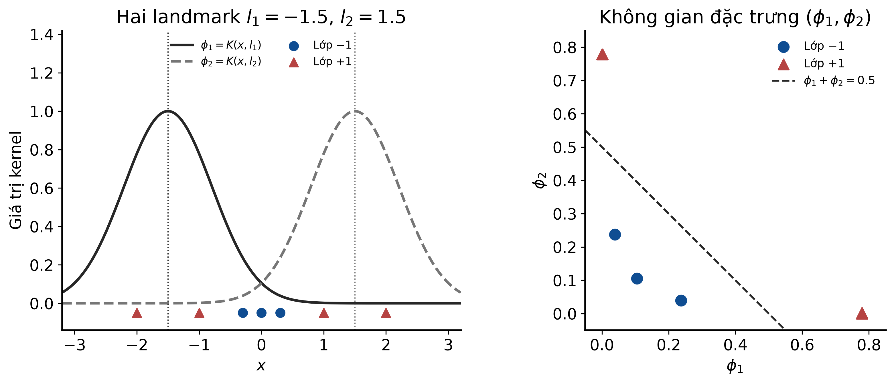{width=6.2}

Vai trò của $\gamma$ thấy rõ qua hình chuông $\exp(-\gamma d^2)$ theo khoảng cách $d = \|x - z\|$ [5]. Ở cùng khoảng cách $d = 1$, kernel bằng $e^{-0.1} \approx 0.905$ với $\gamma = 0.1$, bằng $e^{-1} \approx 0.368$ với $\gamma = 1$ và gần như bằng $0$ với $\gamma = 10$. Với $\gamma$ lớn, mỗi vector hỗ trợ chỉ ảnh hưởng tới vùng rất sát nó, nên ranh giới bám theo từng điểm huấn luyện.

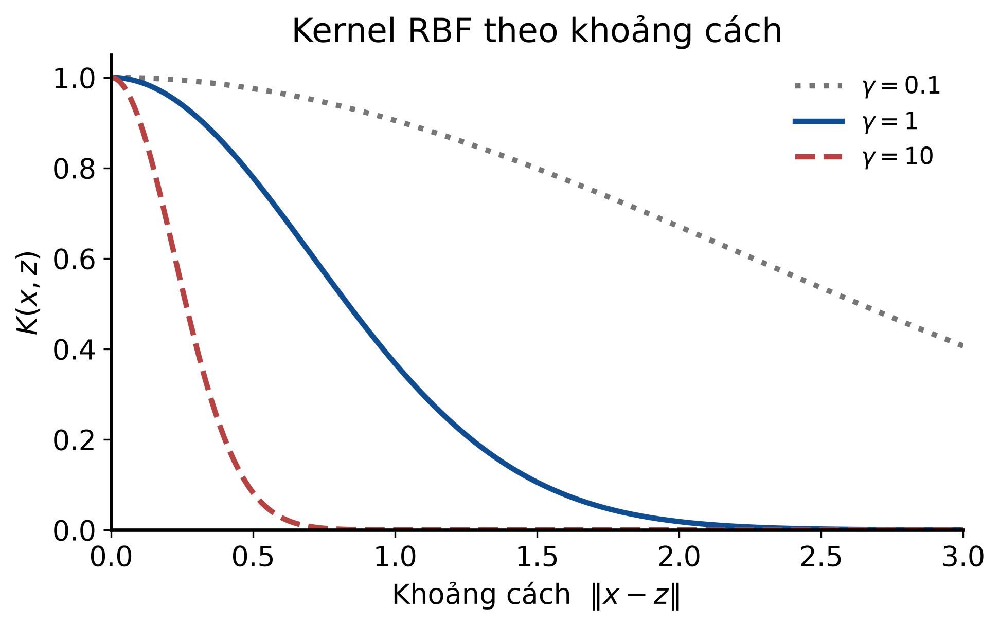{width=4.6}

Vì sao RBF linh hoạt đến vậy? Tách $\|x - z\|^2 = \|x\|^2 + \|z\|^2 - 2x^T z$ rồi khai triển Taylor hàm mũ, ta được

$$\exp(-\gamma \|x - z\|^2) = e^{-\gamma \|x\|^2} e^{-\gamma \|z\|^2} \sum_{k=0}^{\infty} \frac{(2\gamma)^k}{k!} (x^T z)^k$$

Mỗi số hạng $(x^T z)^k$ là một kernel đa thức bậc $k$, nên RBF là tổng có trọng số dương của các kernel đa thức ở mọi bậc, nhân thêm hai thừa số chỉ phụ thuộc riêng $x$ và riêng $z$ [5]. Ánh xạ $\phi$ tương ứng vì thế có vô hạn chiều: không thể dựng tường minh như `PolynomialFeatures`, nhưng kernel vẫn tính được chỉ bằng một khoảng cách và một hàm mũ.

## Trước: Mở rộng SVM cho bài toán phân lớp đa lớp và hồi quy (SVR)

Lớp `SVC` của scikit-learn có sẵn bốn kernel [5]; trong bảng sau, $r$ là tham số `coef0` và $d$ là tham số `degree`.

*Bảng: Bốn kernel của SVC và tham số tương ứng.*
| Kernel | Công thức $K(x, z)$ | Tham số |
|---|---|---|
| linear | $x^T z$ | không có |
| poly | $(\gamma x^T z + r)^d$ | $\gamma$, $r$, $d$ |
| rbf | $\exp(-\gamma \|x - z\|^2)$ | chỉ $\gamma$ |
| sigmoid | $\tanh(\gamma x^T z + r)$ | $\gamma$, $r$ |

Kernel sigmoid không phải lúc nào cũng thỏa điều kiện Mercer, vì ma trận Gram có thể không nửa xác định dương, nên trong thực tế ít được dùng hơn ba kernel còn lại.

Hình sau so sánh Linear và RBF trên cùng dữ liệu XOR tổng hợp; đây là hình minh họa trên train, không phải kết quả Banknote.

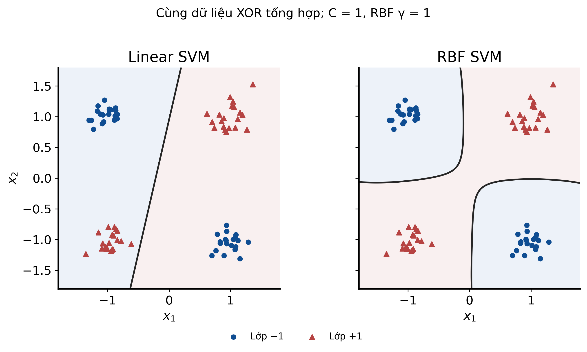

Ví dụ nhỏ dựng sẵn chỉ minh họa trực giác. Để chọn kernel một cách công bằng, nên so sánh accuracy qua nhiều lần cross-validation thay vì một lần chia train/test. Trên tập `make_moons` của scikit-learn, RBF có accuracy trung bình cao nhất ($0.924$) và sigmoid thấp nhất ($0.716$); kết quả này chỉ đúng cho dữ liệu đã chọn, trên dữ liệu gần tuyến tính như Banknote thì kernel tuyến tính có thể tốt ngang hoặc hơn.

{width=5.2}

```python
from sklearn.datasets import make_moons
from sklearn.model_selection import (
    RepeatedStratifiedKFold, cross_val_score)
from sklearn.pipeline import make_pipeline
from sklearn.preprocessing import StandardScaler
from sklearn.svm import SVC

X, y = make_moons(n_samples=200, noise=0.25, random_state=0)
cv = RepeatedStratifiedKFold(n_splits=5, n_repeats=10, random_state=0)
for kernel in ['linear', 'poly', 'rbf', 'sigmoid']:
    pipe = make_pipeline(StandardScaler(),
                         SVC(kernel=kernel, gamma='scale'))
    scores = cross_val_score(pipe, X, y, cv=cv)
    print(kernel, round(scores.mean(), 4), round(scores.std(), 4))
# linear  0.833 0.0542
# poly    0.828 0.0486
# rbf     0.924 0.0371
# sigmoid 0.716 0.0655
```

Về thực hành, scikit-learn có hai lớp cho SVM phân loại [5]. `SVC` dựa trên thư viện LIBSVM, giải bài toán đối ngẫu bằng một biến thể của SMO và nhận mọi kernel; thời gian huấn luyện tăng ít nhất theo bình phương số mẫu, nên phù hợp với dữ liệu vừa và nhỏ, cỡ vài chục nghìn mẫu trở xuống. `LinearSVC` dựa trên LIBLINEAR, chỉ học ranh giới tuyến tính nhưng không cần ma trận kernel, chi phí xấp xỉ tuyến tính theo số mẫu, nên là lựa chọn mặc định khi dữ liệu lớn hoặc rất nhiều chiều như văn bản. Hai lớp không cho cùng nghiệm ngay cả khi so với `SVC(kernel='linear')`: `LinearSVC` mặc định dùng bình phương hinge loss (`loss='squared_hinge'`), phạt cả hệ số tự do $b$, và cho chọn chuẩn phạt $\ell_1$ hoặc $\ell_2$ qua tham số `penalty`.

Mỗi kernel có bộ siêu tham số riêng cần chọn bằng cross-validation: kernel tuyến tính chỉ có $C$; RBF có $C$ và $\gamma$; đa thức có $C$, $\gamma$, $r$ và bậc $d$; sigmoid có $C$, $\gamma$ và $r$. Vì mọi kernel đều dựa trên tích vô hướng hoặc khoảng cách, nên đặt `StandardScaler` cùng `SVC` trong một `Pipeline`: các đặc trưng có thang đo tương đương, và trong mỗi fold scaler chỉ học trên phần train.

`SVC` mặc định chỉ trả nhãn và giá trị $f(x)$, không trả xác suất. Khi đặt `probability=True`, mô hình học thêm một hàm sigmoid trên $f(x)$ (Platt scaling):

$$P(y = 1 \mid x) = \frac{1}{1 + \exp(A f(x) + B)}$$

trong đó $A$, $B$ được ước lượng bằng cross-validation nội bộ. Việc này làm huấn luyện chậm đi nhiều lần, và lớp có xác suất lớn nhất đôi khi khác với kết quả của `predict`.

Khi một lớp hiếm hơn hẳn, tổng phạt $C \sum_i \xi_i$ bị lớp đông chi phối: mô hình có thể gần như bỏ qua lớp hiếm mà accuracy vẫn cao. Tham số `class_weight` gán cho mỗi lớp $k$ một trọng số $c_k$ và thay hằng số $C$ bằng $C c_{y_i}$ cho từng mẫu:

$$\min_{w, b, \xi} \frac{1}{2}\|w\|^2 + C \sum_{i=1}^{n} c_{y_i} \xi_i$$

Trong bài toán đối ngẫu, chặn trên của $\alpha_i$ cũng đổi từ $C$ thành $C c_{y_i}$. Lựa chọn `class_weight='balanced'` đặt $c_k = n / (K n_k)$, với $n_k$ là số mẫu của lớp $k$ và $K$ là số lớp; trên dữ liệu có khoảng 10% mẫu lớp 1, lớp này nhận trọng số gần 5 còn lớp 0 khoảng 0.56 [5]. Trong đoạn code sau, recall của lớp hiếm tăng từ $0.387$ lên $0.839$, đổi lại recall của lớp đông giảm từ $0.996$ xuống $0.848$. Vì vậy nên chọn trọng số theo chi phí thực tế của từng loại lỗi chứ không chỉ theo accuracy.

```python
from sklearn.datasets import make_classification
from sklearn.metrics import recall_score
from sklearn.model_selection import train_test_split
from sklearn.pipeline import make_pipeline
from sklearn.preprocessing import StandardScaler
from sklearn.svm import SVC

X, y = make_classification(n_samples=1000, n_features=4,
                           n_informative=2, n_redundant=0,
                           weights=[0.9], class_sep=0.5,
                           random_state=0)
X_tr, X_te, y_tr, y_te = train_test_split(
    X, y, test_size=0.3, random_state=0, stratify=y)
for cw in [None, 'balanced']:
    pipe = make_pipeline(StandardScaler(),
                         SVC(kernel='linear', class_weight=cw))
    pred = pipe.fit(X_tr, y_tr).predict(X_te)
    r1 = recall_score(y_te, pred)
    r0 = recall_score(y_te, pred, pos_label=0)
    print(cw, 'recall lớp 1:', round(r1, 3),
          'recall lớp 0:', round(r0, 3))
# None recall lớp 1: 0.387 recall lớp 0: 0.996
# balanced recall lớp 1: 0.839 recall lớp 0: 0.848
```

## Trước: Khái quát về Hồi quy vector hỗ trợ (Support Vector Regression – SVR)

Trong scikit-learn, `SVC` luôn huấn luyện theo chiến lược một-chống-một: với $K$ lớp nó học $K(K-1)/2$ bộ phân loại nhị phân rồi dự đoán bằng bỏ phiếu. Tham số `decision_function_shape` không đổi cách huấn luyện mà chỉ đổi dạng đầu ra của `decision_function`: `'ovo'` trả một cột cho mỗi cặp lớp, còn `'ovr'` (mặc định) gộp kết quả thành một cột cho mỗi lớp. Muốn thực sự huấn luyện một-chống-tất-cả thì dùng `LinearSVC`, vốn mặc định là OvR, hoặc bọc mô hình trong `OneVsRestClassifier`. Với 4 lớp, đoạn code sau cho 6 cột ở dạng `'ovo'` và 4 cột ở dạng `'ovr'`.

```python
from sklearn.datasets import make_blobs
from sklearn.svm import SVC

X, y = make_blobs(n_samples=200, centers=4, random_state=0)
for shape in ['ovo', 'ovr']:
    clf = SVC(decision_function_shape=shape).fit(X, y)
    print(shape, clf.decision_function(X[:1]).shape)
# ovo (1, 6)
# ovr (1, 4)
```

## Trước: Thiết lập thực nghiệm và tiền xử lý dữ liệu

Hiệu chỉnh ví dụ trên: với ba điểm đã cho và quy ước $f(x) = w^T x - b$, nghiệm lề cứng là $w = [1, 0]^T$, $b = 1$, lề rộng bằng $2$. Nghiệm $w = [0.5, 0.5]^T$, $b = 1$ nêu trên cho $f([2, 0]^T) = 0$ nên không thỏa ràng buộc $y_i f(x_i) \geq 1$.

Một ví dụ bốn điểm khác gồm $(-1, -1)$, $(-2, -1)$ thuộc lớp $-1$ và $(1, 1)$, $(2, 1)$ thuộc lớp $+1$. Hình sau vẽ nghiệm của ví dụ này: hai điểm hỗ trợ nằm trên hai biên, $w = (0.5, 0.5)$ và độ rộng lề bằng $2\sqrt{2} \approx 2.83$.

{width=5.2}

## Trước: Kết quả thực nghiệm và so sánh đánh giá

Trong scikit-learn, quy trình này được viết gọn bằng `GridSearchCV` bọc một `Pipeline` gồm `StandardScaler` và `SVC`, nhờ đó mỗi fold chỉ fit bộ chuẩn hóa trên phần huấn luyện của fold đó. Trên Banknote [4], dữ liệu gần như tách được tuyến tính nên cấu hình tốt nhất đạt accuracy $1.0$ cả khi kiểm định chéo lẫn trên tập kiểm thử; con số này không có nghĩa RBF luôn tốt nhất trên dữ liệu khác.

```python
from sklearn.model_selection import GridSearchCV, train_test_split
from sklearn.pipeline import make_pipeline
from sklearn.preprocessing import StandardScaler
from sklearn.svm import SVC
from svm_optimization.data import load_banknote

X, y = load_banknote()
X_train, X_test, y_train, y_test = train_test_split(
    X, y, test_size=0.3, random_state=42, stratify=y)
pipe = make_pipeline(StandardScaler(), SVC(kernel='rbf'))
grid = {'svc__C': [0.1, 1, 10], 'svc__gamma': [0.01, 0.1, 1]}
search = GridSearchCV(pipe, grid, cv=5).fit(X_train, y_train)
print('best params', search.best_params_)
print('best cv score', round(search.best_score_, 4))
print('test score', round(search.score(X_test, y_test), 4))
# best params {'svc__C': 10, 'svc__gamma': 0.1}
# best cv score 1.0
# test score 1.0
```

SMO [2] cập nhật hai hệ số $\alpha_i$ mỗi lần để giữ các ràng buộc của bài toán dual:

$$\sum_{i} \alpha_i y_i = 0,\text{ } 0 \leq \alpha_i \leq C$$

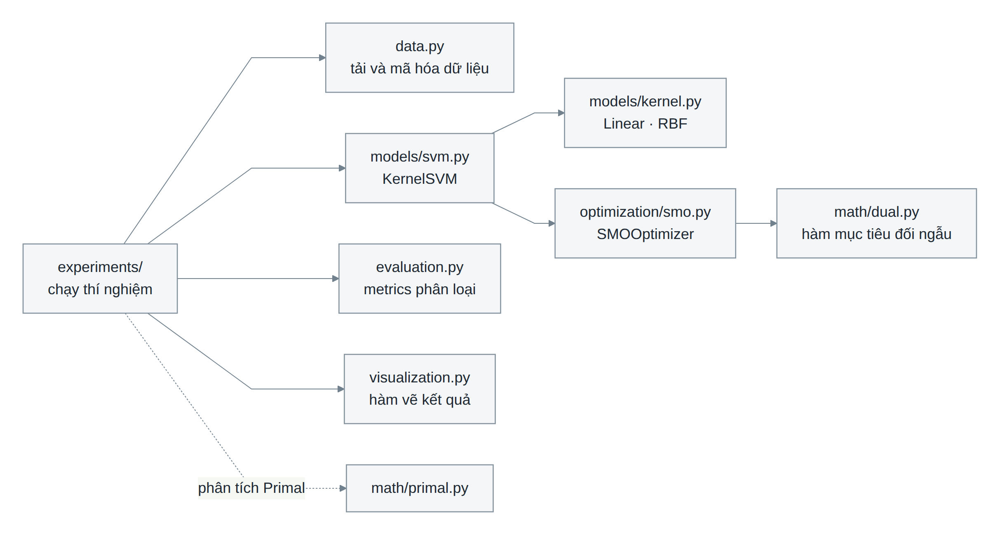


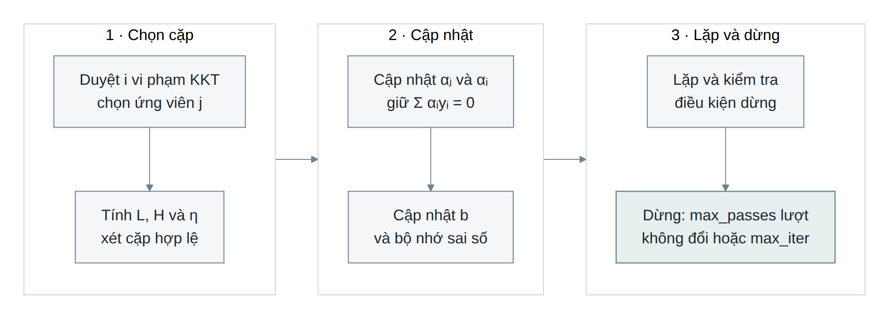

Trong mỗi vòng, cặp $(\alpha_i, \alpha_j)$ phải nằm trên đường ràng buộc bên trong hộp $[0, C] \times [0, C]$, nên giá trị $\alpha_j$ mới được cắt về đoạn $[L, H]$ trước khi cập nhật $\alpha_i$.

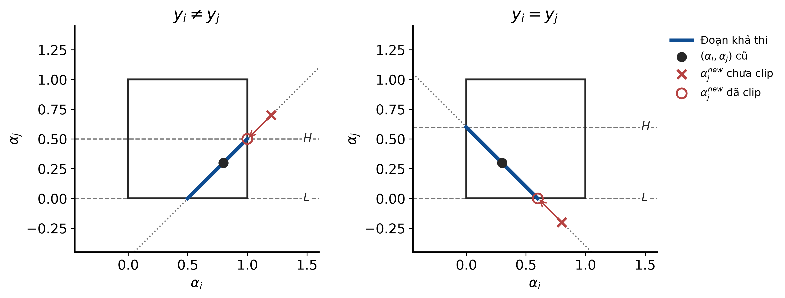{width=5.6}

## Sau: KẾT LUẬN VÀ KIẾN NGHỊ

Báo cáo đã xem SVM như một bài toán tối ưu lồi có ràng buộc: từ hình học lề và bài toán primal lề cứng, lề mềm [1], qua hàm Lagrange và bài toán đối ngẫu, đến điều kiện KKT giải thích vì sao nghiệm chỉ phụ thuộc vào các vector hỗ trợ. Thủ thuật hạt nhân dùng lại đúng bài toán đối ngẫu đó để tạo ranh giới phi tuyến mà không cần dựng ánh xạ $\phi$ tường minh.

Về thực nghiệm, project tự cài đặt thuật toán SMO [2] và đối chiếu với scikit-learn trên UCI Banknote Authentication [4] gồm 1372 mẫu, 4 đặc trưng và 275 mẫu kiểm thử. Với kernel tuyến tính và $C = 1$, SMO tự cài đặt hội tụ sau 1057 lần cập nhật cặp, duality gap còn khoảng $1.4 \times 10^{-4}$, và cho cùng accuracy $0.9745$ với `SVC` tuyến tính của scikit-learn, với 61 so với 62 vector hỗ trợ. SVC kernel RBF với $C = 10$, $\gamma = 0.1$ chọn bằng cross-validation đạt accuracy và F1 bằng $1.0$ trên tập kiểm thử, so với $0.9709$ của hồi quy logistic và $0.9964$ của rừng ngẫu nhiên.

Từ các kết quả trên, nhóm đề xuất ba hướng tiếp theo. Thứ nhất, Banknote gần như tách được tuyến tính nên chưa phân biệt rõ các mô hình; cần đánh giá thêm trên dữ liệu khó hơn, nhiều mẫu hơn, và báo cáo kết quả qua cross-validation lặp thay vì một lần chia train/test. Thứ hai, SMO tự cài đặt tính trước toàn bộ ma trận Gram và duyệt chỉ số thứ nhất theo thứ tự ngẫu nhiên, nên tốn bộ nhớ bậc $n^2$ và chậm hơn thư viện khoảng hai bậc độ lớn trong lần chạy này; có thể cải thiện bằng cách chọn cặp theo mức vi phạm KKT và lưu đệm kernel như LIBSVM [3]. Thứ ba, có thể mở rộng phần cài đặt sang bài toán đa lớp theo one-vs-rest hoặc one-vs-one, sang hồi quy SVR và các kernel đa thức, sigmoid.

## Trước: PHỤ LỤC

[1] Cortes, C. & Vapnik, V. (1995). Support-Vector Networks. Machine Learning, 20, 273–297.

[2] Platt, J. (1998). Sequential Minimal Optimization: A Fast Algorithm for Training Support Vector Machines. MSR-TR-98-14.

[3] Chang, C.-C. & Lin, C.-J. (2011). LIBSVM: A Library for Support Vector Machines.

[4] UCI Banknote Authentication: https://archive.ics.uci.edu/dataset/267/banknote+authentication

[5] Phạm Đình Khanh. Machine Learning Algorithms to Practice, chương Support Vector Machine. https://phamdinhkhanh.github.io/deepai-book/ch_ml/SVM.html
