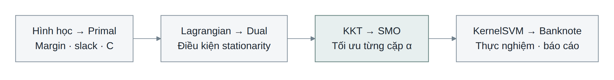
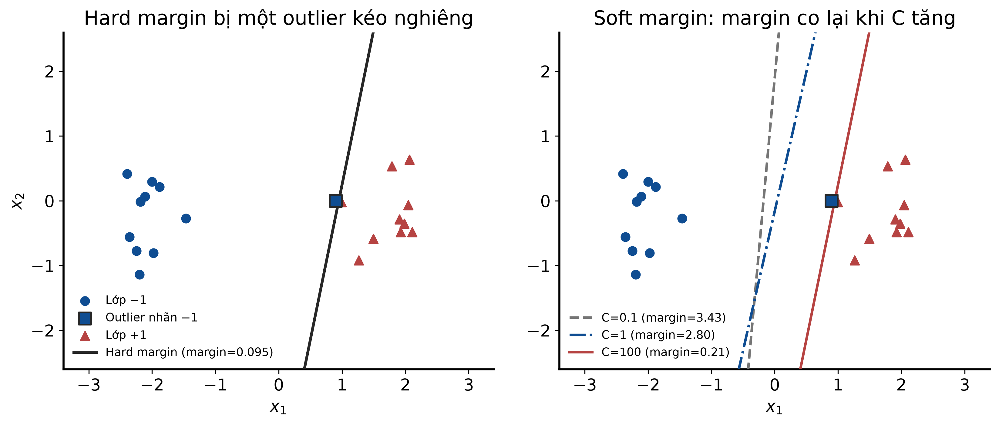
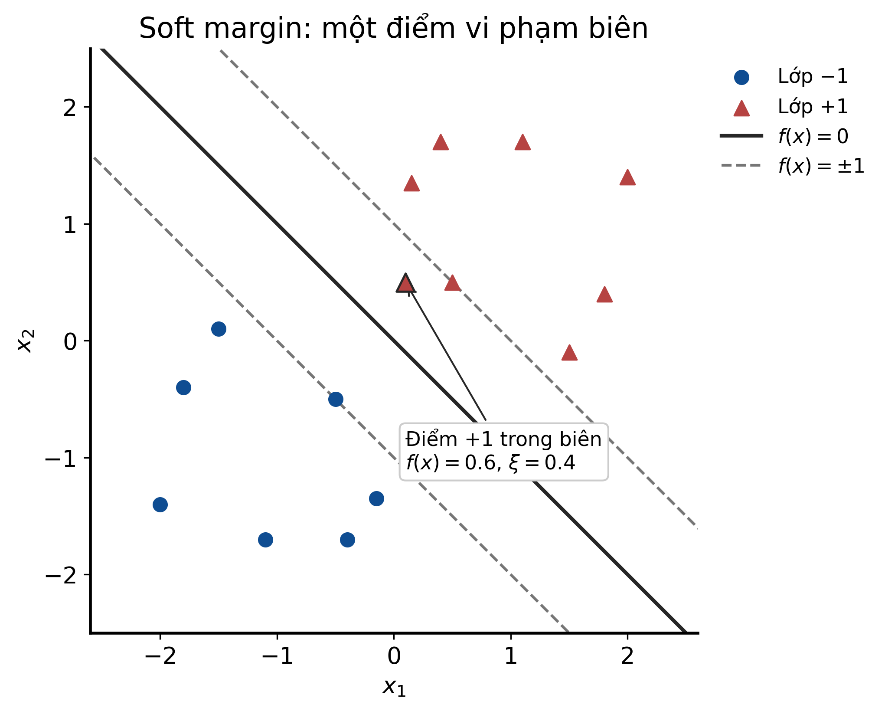
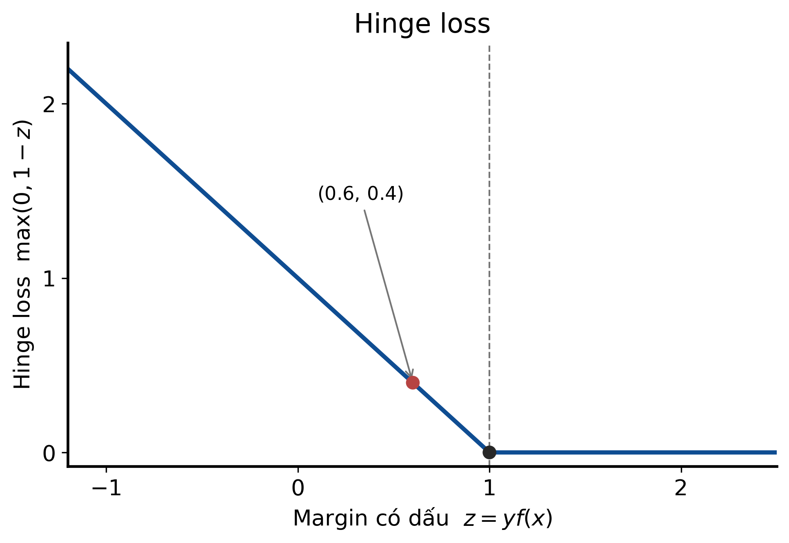
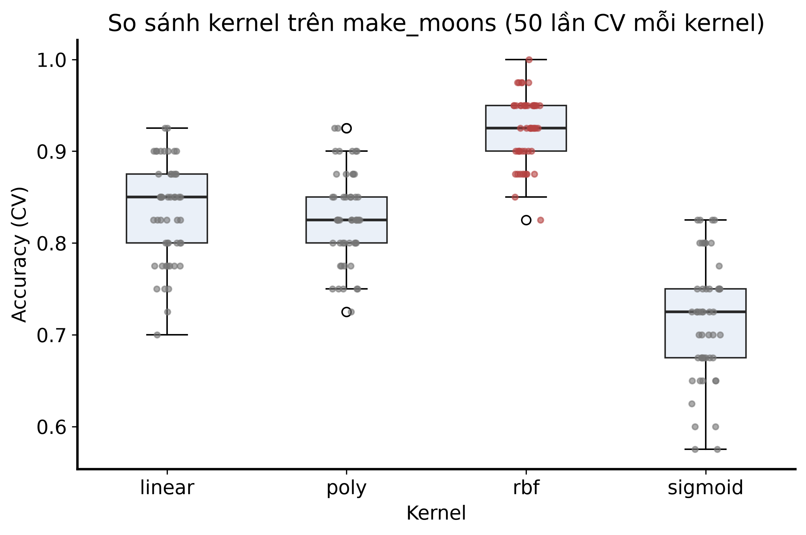
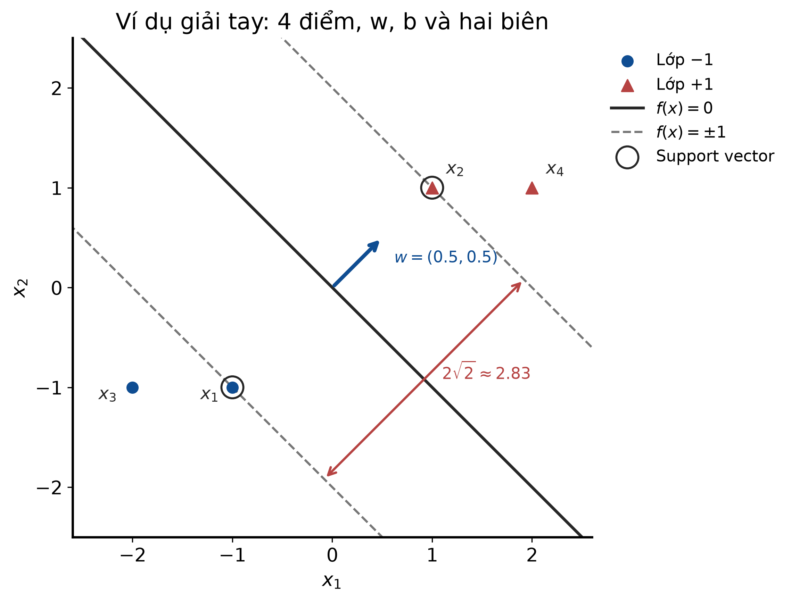
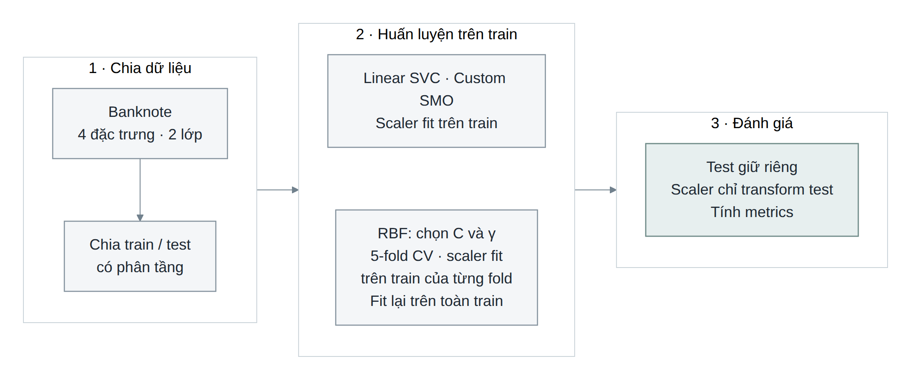

# Nội dung bổ sung của báo cáo Word

Mỗi mục `## Trước: <tiêu đề>` được `scripts/generate_docx.py` chèn ngay trước tiêu đề đó của bản nền, theo đúng thứ tự trong file. Hỗ trợ: đoạn văn (với `$toán$`, `` `code` ``, `**đậm**`), công thức khối `$$…$$`, hình `{width=4.6}` (đường dẫn tương đối với file này, chú thích lấy từ docs hoặc `figure_captions.md`), bảng Markdown có dòng `*Bảng: chú thích*` ngay phía trên, và khối code.

## Trước: Kết luận chương 1

Lộ trình của project đi từ hình học SVM, bài toán primal và dual đến điều kiện KKT, thuật toán SMO và đánh giá trên Banknote Authentication.

{width=6.1}

## Trước: Vai trò của các Vector hỗ trợ (Support Vectors)

Một ví dụ một chiều cho thấy vì sao ranh giới có lề lớn nhất cũng là ranh giới "công bằng" nhất (ý tưởng minh họa theo Phạm Đình Khanh, Machine Learning Algorithms to Practice, chương SVM). Giả sử điểm gần nhất của lớp $-1$ nằm tại $x = -1$ và điểm gần nhất của lớp $+1$ nằm tại $x = 3$. Đặt ranh giới tại vị trí $t$ thì khoảng an toàn còn lại của lớp $-1$ là $t + 1$, của lớp $+1$ là $3 - t$.

*Bảng: Khoảng an toàn của hai lớp theo vị trí ranh giới trong ví dụ một chiều.*
| $t$ | an toàn lớp $-1$ | an toàn lớp $+1$ | an toàn nhỏ nhất |
|---|---:|---:|---:|
| $-0.5$ | $0.5$ | $3.5$ | $0.5$ |
| $1$ | $2$ | $2$ | $2$ |
| $2$ | $3$ | $1$ | $1$ |

Khoảng an toàn nhỏ nhất đạt giá trị lớn nhất tại $t = 1$, đúng trung điểm của hai điểm gần nhất. Dịch ranh giới về phía lớp nào thì lớp đó mất bớt khoảng an toàn, nên ranh giới cách đều vừa không thiên vị lớp nào vừa cho lề lớn nhất.

Trong không gian hai chiều, ngoài vị trí còn phải chọn hướng của ranh giới. Hình sau so sánh vài ranh giới ứng viên trên cùng một bộ dữ liệu tách được: giữ hướng và trượt vị trí thì ranh giới cách đều hai lớp cho khoảng an toàn nhỏ nhất lớn nhất; đổi sang hướng khác thì dù vẫn phân loại đúng, lề cũng hẹp hơn.

{width=6.2}

## Trước: Máy vector hỗ trợ lề cứng (Hard Margin SVM)

{width=5.2}

Các đại lượng hình học trên được cài đặt trong module `geometry.py` của project. Đoạn code sau tính điểm quyết định của hai điểm nằm trên hai biên và độ rộng lề $2/\|w\|$ với $w = [0.5, 0.5]^T$, $b = 0$:

```python
import numpy as np
from svm_optimization.math.geometry import margin_width, decision_score

w = np.array([0.5, 0.5])
X = np.array([[-1., -1.], [1., 1.]])
print(decision_score(X, w, 0.0))  # [-1., 1.]
print(margin_width(w))            # 2.828427...
```

## Trước: Vai trò của biến bù và tham số điều chuẩn C

Hình sau minh họa hạn chế này trên dữ liệu tổng hợp: chỉ một điểm ngoại lai nhãn $-1$ nằm lẫn trong cụm $+1$ cũng đủ buộc lề cứng chọn ranh giới sát điểm đó với lề gần bằng 0, trong khi lề mềm cho phép điểm đó vi phạm và giữ được lề rộng hơn.

{width=6.2}

## Trước: Mối liên hệ với hàm mất mát Bản lề (Hinge Loss)

Ảnh hưởng của $C$ có thể kiểm tra trực tiếp bằng `SVC` của scikit-learn trên bốn điểm $(-1, -1)$, $(-2, -1)$ thuộc lớp $-1$ và $(1, 1)$, $(2, 1)$ thuộc lớp $+1$ (cũng là ví dụ giải tay ở chương 4). Với $C = 1$ và $C = 10$, nghiệm trùng với nghiệm lề cứng có lề $2\sqrt{2} \approx 2.83$ và hai vector hỗ trợ; với $C = 0.1$, phạt vi phạm đủ nhẹ để mô hình nới lề lên $4.39$ và cả bốn điểm đều trở thành vector hỗ trợ.

```python
from sklearn.svm import SVC
import numpy as np

X = np.array([[-1., -1.], [1., 1.], [-2., -1.], [2., 1.]])  # 4 điểm của ví dụ giải tay
y = np.array([-1, 1, -1, 1])
for C in [0.1, 1, 10]:
    clf = SVC(kernel='linear', C=C).fit(X, y)
    margin = 2 / np.linalg.norm(clf.coef_)
    print(f'C={C}: margin={margin:.4f}, n_sv={len(clf.support_)}')
# C=0.1: margin=4.3853, n_sv=4
# C=1: margin=2.8284, n_sv=2
# C=10: margin=2.8284, n_sv=2
```

## Trước: Phương pháp nhân tử Lagrange và bài toán đối ngẫu

Trong code, hàm quyết định dùng quy ước $w^T x + b$; quy ước này tương đương $w^T x - b$ trong bản nền khi đổi dấu bias.

{width=4.6}

{width=4.6}

Vị trí của một điểm so với lề quyết định biến bù $\xi_i$ rơi vào đúng một trong ba trường hợp sau.

*Bảng: Ba trường hợp của biến bù theo margin có dấu.*
| Điều kiện trên $y_i f(x_i)$ | $\xi_i$ | Ý nghĩa |
|---|---|---|
| $y_i f(x_i) \geq 1$ | $\xi_i = 0$ | nằm ngoài hoặc đúng trên lề |
| $0 \leq y_i f(x_i) < 1$ | $0 < \xi_i \leq 1$ | nằm trong lề, vẫn đúng phía |
| $y_i f(x_i) < 0$ | $\xi_i > 1$ | phân loại sai |

Ví dụ, điểm có $y = +1$ và $f(x) = 0.6$ nằm ở hàng giữa nên $\xi = 1 - 0.6 = 0.4$; điểm có $y = -1$ và $f(x) = -1.4$ nằm ngoài lề nên $\xi = 0$; điểm có $y = +1$ nhưng $f(x) = -0.2$ bị phân loại sai nên $\xi = 1.2$. Hàm `hinge_losses` trong module `primal.py` cho đúng ba giá trị này:

```python
import numpy as np
from svm_optimization.math.primal import hinge_losses

y = np.array([1, -1, 1])
scores = np.array([0.6, -1.4, -0.2])
print(hinge_losses(y, scores))  # [0.4, 0.0, 1.2]
```

Hinge loss không phải cách duy nhất để phạt margin có dấu $z = y f(x)$ nhỏ. Logistic loss, sau khi co giãn để cũng bằng $1$ tại $z = 0$, giảm dần theo $z$ nhưng mượt và không bao giờ bằng $0$; hinge loss thì bằng đúng $0$ khi $z \geq 1$. Vì vậy chỉ các điểm có $z \leq 1$ mới ảnh hưởng đến nghiệm SVM, và đó là nguồn gốc của tính thưa thớt.

{width=4.6}

```python
import numpy as np

def hinge(z):
    return np.maximum(0, 1 - z)

def logistic_scaled(z):  # co giãn để bằng 1 tại z=0 như hinge
    return np.log1p(np.exp(-z)) / np.log(2)

for z in [-2, -1, 0, 1, 2]:
    print(f'{z:2d} {hinge(z):.1f} {logistic_scaled(z):.4f}')
# -2 3.0 3.0685
# -1 2.0 1.8946
#  0 1.0 1.0000
#  1 0.0 0.4519
#  2 0.0 0.1831
```

## Trước: Ý nghĩa của việc chuyển đổi sang bài toán đối ngẫu

Trước khi áp dụng cho SVM, xét một bài toán quy hoạch bậc hai rất nhỏ để thấy nhân tử Lagrange hoạt động thế nào:

$$\min_{x,y} x^2 + 2y^2 \text{ sao cho } x + y = 3$$

Đưa ràng buộc vào hàm mục tiêu qua một nhân tử $\lambda$:

$$L(x, y, \lambda) = x^2 + 2y^2 - \lambda (x + y - 3)$$

Cho các đạo hàm riêng bằng 0 được $2x - \lambda = 0$ và $4y - \lambda = 0$, tức $x = \lambda/2$ và $y = \lambda/4$. Thay vào ràng buộc được $\lambda = 4$, do đó $x = 2$, $y = 1$ và giá trị nhỏ nhất của mục tiêu bằng $6$. Bài toán SVM lặp lại đúng cơ chế này, chỉ khác là có nhiều biến hơn và các ràng buộc là bất đẳng thức nên các nhân tử $\alpha_i$, $\mu_i$ phải không âm.

## Trước: Điều kiện tối ưu KKT (Karush-Kuhn-Tucker) và tính thưa thớt của nghiệm

Hình sau tóm tắt chuỗi suy diễn từ bài toán gốc qua hàm Lagrange và các đạo hàm riêng đến bài toán đối ngẫu.

{width=4.2}

## Trước: Kết luận chương 2

Theo điều kiện bù, giá trị của $\alpha_i$ cho biết vị trí của điểm: $\alpha_i = 0$ thường là điểm nằm ngoài lề và không đóng góp vào $w$; $0 < \alpha_i < C$ là điểm nằm đúng trên lề; $\alpha_i = C$ là điểm nằm trên lề hoặc vi phạm lề. Cả hai trường hợp sau đều là vector hỗ trợ.

{width=5.6}

## Trước: Điều kiện Mercer đảm bảo tính lồi và nghiệm tối ưu toàn cục

Trong project, module `kernel.py` tính ma trận kernel giữa hai tập mẫu; phần tử $K_{ij}$ so sánh mẫu thứ $i$ của tập thứ nhất với mẫu thứ $j$ của tập thứ hai. Kernel tuyến tính trả về tích vô hướng, kernel RBF trả về $\exp(-\gamma \|x_i - z_j\|^2)$:

```python
import numpy as np
from svm_optimization.models.kernel import linear_kernel, rbf_kernel

X = np.array([[0., 0.], [1., 1.]])
Z = np.array([[0., 1.], [1., 0.], [2., 2.]])
K_linear = linear_kernel(X, Z)
K_rbf = rbf_kernel(X, Z, gamma=0.5)
print(K_linear)
# [[0. 0. 0.]
#  [1. 1. 4.]]
print(K_rbf.round(4))
# [[0.6065 0.6065 0.0183]
#  [0.6065 0.6065 0.3679]]
```

## Trước: Hạt nhân hàm cơ sở xuyên tâm (RBF / Gaussian Kernel) và vai trò siêu tham số

Kernel đa thức bậc 2 là trường hợp hiếm có thể viết ánh xạ $\phi$ ra tường minh. Với $x = (x_1, x_2)$, kernel $K(x, z) = (x^T z)^2$ ứng với

$$\phi(x) = (x_1^2, \sqrt{2} x_1 x_2, x_2^2)$$

vì khai triển $(x_1 z_1 + x_2 z_2)^2$ cho đúng $\phi(x)^T \phi(z)$. Thử với $x = (1, 2)$ và $z = (3, 4)$: tính trực tiếp $x^T z = 11$ nên $K(x, z) = 121$; qua ánh xạ, $\phi(x) = (1, 2\sqrt{2}, 4)$, $\phi(z) = (9, 12\sqrt{2}, 16)$ và $\phi(x)^T \phi(z) = 9 + 48 + 64 = 121$. Kernel cho cùng kết quả mà không cần dựng $\phi(x)$ ba chiều.

Với bậc cao hơn, có thể dựng $\phi(x)$ tường minh bằng `PolynomialFeatures` rồi huấn luyện `LinearSVC`, nhưng số chiều của $\phi(x)$ tăng rất nhanh theo bậc và số đặc trưng gốc. Hai cách trong đoạn code sau cho độ chính xác khác nhau vì không dùng cùng một không gian đặc trưng: `PolynomialFeatures(degree=3)` giữ mọi đơn thức bậc 0 đến 3, còn `SVC(kernel='poly')` mặc định `coef0=0` nên chỉ ứng với các đơn thức bậc đúng 3; ngoài ra `LinearSVC` mặc định dùng bình phương hinge loss.

```python
from sklearn.datasets import make_moons
from sklearn.pipeline import make_pipeline
from sklearn.preprocessing import PolynomialFeatures, StandardScaler
from sklearn.svm import LinearSVC, SVC

X, y = make_moons(n_samples=200, noise=0.15, random_state=1)
poly_pipe = make_pipeline(StandardScaler(), PolynomialFeatures(degree=3), LinearSVC(C=1, max_iter=20000))
svc_poly = make_pipeline(StandardScaler(), SVC(kernel='poly', degree=3, C=1))
poly_pipe.fit(X, y); svc_poly.fit(X, y)
print('PolynomialFeatures + LinearSVC:', round(poly_pipe.score(X, y), 4))
print('SVC(kernel=poly):              ', round(svc_poly.score(X, y), 4))
# PolynomialFeatures + LinearSVC: 0.99
# SVC(kernel=poly):               0.875
```

## Trước: Bảng so sánh đặc điểm và tiêu chí lựa chọn hàm hạt nhân

Có thể hiểu RBF như độ giống nhau giữa $x$ và một điểm mốc $l$: giá trị gần $1$ khi $x$ ở sát $l$ và gần $0$ khi $x$ ở xa. Trên bốn đỉnh XOR, $(0, 0)$ và $(1, 1)$ thuộc lớp $-1$, $(0, 1)$ và $(1, 0)$ thuộc lớp $+1$. Chọn hai điểm mốc $l_1 = (0, 0)$, $l_2 = (1, 1)$, $\gamma = 1$ và đặt $f_1 = K(x, l_1)$, $f_2 = K(x, l_2)$.

*Bảng: Đặc trưng RBF theo hai điểm mốc trên bốn đỉnh XOR.*
| $x$ | lớp | $f_1$ | $f_2$ | $f_1 + f_2$ |
|---|---|---:|---:|---:|
| $(0, 0)$ | $-1$ | $1$ | $0.135$ | $1.135$ |
| $(1, 1)$ | $-1$ | $0.135$ | $1$ | $1.135$ |
| $(0, 1)$ | $+1$ | $0.368$ | $0.368$ | $0.736$ |
| $(1, 0)$ | $+1$ | $0.368$ | $0.368$ | $0.736$ |

Lớp $-1$ có $f_1 + f_2 \approx 1.135$, lớp $+1$ có $f_1 + f_2 \approx 0.736$, nên ngưỡng $f_1 + f_2 = 0.9$ đã tách được hai lớp, dù trong không gian gốc không đường thẳng nào tách được XOR.

Ví dụ một chiều sau cho thấy rõ hơn vai trò của điểm mốc. Bảy điểm nằm xen kẽ trên một trục nên không ngưỡng nào trên $x$ tách được hai lớp. Đặt hai điểm mốc $l_1 = -1.5$, $l_2 = 1.5$ với $\gamma = 1$: các điểm lớp $-1$ đều gần một điểm mốc, các điểm lớp $+1$ xa cả hai, nên trong không gian $(\phi_1, \phi_2)$ một đường thẳng đã tách sạch hai lớp.

{width=6.2}

## Trước: Mở rộng SVM cho bài toán phân lớp đa lớp và hồi quy (SVR)

Hình sau so sánh Linear và RBF trên cùng dữ liệu XOR tổng hợp; đây là hình minh họa trên train, không phải kết quả Banknote.


Ví dụ nhỏ dựng sẵn chỉ minh họa trực giác. Để chọn kernel một cách công bằng, nên so sánh accuracy qua nhiều lần cross-validation thay vì một lần chia train/test. Trên tập `make_moons` của scikit-learn, RBF có accuracy trung bình cao nhất ($0.924$) và sigmoid thấp nhất ($0.716$); kết quả này chỉ đúng cho dữ liệu đã chọn, trên dữ liệu gần tuyến tính như Banknote thì kernel tuyến tính có thể tốt ngang hoặc hơn.

{width=5.2}

```python
from sklearn.datasets import make_moons
from sklearn.model_selection import RepeatedStratifiedKFold, cross_val_score
from sklearn.pipeline import make_pipeline
from sklearn.preprocessing import StandardScaler
from sklearn.svm import SVC

X, y = make_moons(n_samples=200, noise=0.25, random_state=0)
cv = RepeatedStratifiedKFold(n_splits=5, n_repeats=10, random_state=0)
for kernel in ['linear', 'poly', 'rbf', 'sigmoid']:
    pipe = make_pipeline(StandardScaler(), SVC(kernel=kernel, gamma='scale'))
    scores = cross_val_score(pipe, X, y, cv=cv)
    print(kernel, round(scores.mean(), 4), round(scores.std(), 4))
# linear  0.833 0.0542
# poly    0.828 0.0486
# rbf     0.924 0.0371
# sigmoid 0.716 0.0655
```

## Trước: Thiết lập thực nghiệm và tiền xử lý dữ liệu

Hiệu chỉnh ví dụ trên: với ba điểm đã cho và quy ước $f(x) = w^T x - b$, nghiệm lề cứng là $w = [1, 0]^T$, $b = 1$, lề rộng bằng $2$. Nghiệm $w = [0.5, 0.5]^T$, $b = 1$ nêu trên cho $f([2, 0]^T) = 0$ nên không thỏa ràng buộc $y_i f(x_i) \geq 1$. Ví dụ bốn điểm khác của project được trình bày trong `docs/07_hand_example.md`.

Hình sau vẽ ví dụ bốn điểm đó: hai điểm hỗ trợ nằm trên hai biên, $w = (0.5, 0.5)$ và độ rộng lề bằng $2\sqrt{2} \approx 2.83$.

{width=5.2}

## Trước: Kết quả thực nghiệm và so sánh đánh giá

Trong scikit-learn, quy trình này được viết gọn bằng `GridSearchCV` bọc một `Pipeline` gồm `StandardScaler` và `SVC`, nhờ đó mỗi fold chỉ fit bộ chuẩn hóa trên phần huấn luyện của fold đó. Trên Banknote, dữ liệu gần như tách được tuyến tính nên cấu hình tốt nhất đạt accuracy $1.0$ cả khi kiểm định chéo lẫn trên tập kiểm thử; con số này không có nghĩa RBF luôn tốt nhất trên dữ liệu khác.

```python
from sklearn.model_selection import GridSearchCV, train_test_split
from sklearn.pipeline import make_pipeline
from sklearn.preprocessing import StandardScaler
from sklearn.svm import SVC
from svm_optimization.data import load_banknote

X, y = load_banknote()
X_train, X_test, y_train, y_test = train_test_split(X, y, test_size=0.3, random_state=42, stratify=y)
pipe = make_pipeline(StandardScaler(), SVC(kernel='rbf'))
grid = {'svc__C': [0.1, 1, 10], 'svc__gamma': [0.01, 0.1, 1]}
search = GridSearchCV(pipe, grid, cv=5).fit(X_train, y_train)
print('best params', search.best_params_)
print('best cv score', round(search.best_score_, 4))
print('test score', round(search.score(X_test, y_test), 4))
# best params {'svc__C': 10, 'svc__gamma': 0.1}
# best cv score 1.0
# test score 1.0
```

SMO cập nhật hai hệ số $\alpha_i$ mỗi lần để giữ các ràng buộc của bài toán dual:

$$\sum_{i} \alpha_i y_i = 0,\text{ } 0 \leq \alpha_i \leq C$$





Trong mỗi vòng, cặp $(\alpha_i, \alpha_j)$ phải nằm trên đường ràng buộc bên trong hộp $[0, C] \times [0, C]$, nên giá trị $\alpha_j$ mới được cắt về đoạn $[L, H]$ trước khi cập nhật $\alpha_i$.

{width=5.6}

## Trước: PHỤ LỤC

Cortes, C. & Vapnik, V. (1995). Support-Vector Networks. Machine Learning, 20, 273–297.

Platt, J. (1998). Sequential Minimal Optimization: A Fast Algorithm for Training Support Vector Machines. MSR-TR-98-14.

Chang, C.-C. & Lin, C.-J. (2011). LIBSVM: A Library for Support Vector Machines.

UCI Banknote Authentication: https://archive.ics.uci.edu/dataset/267/banknote+authentication

Phạm Đình Khanh. Machine Learning Algorithms to Practice, chương Support Vector Machine. https://phamdinhkhanh.github.io/deepai-book/ch_ml/SVM.html
